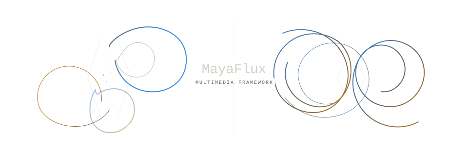

# MayaFlux

> **A C++20/23 framework for real-time computation across sound, geometry, image, and network: unified at the substrate level, not bridged at the API level.**

**A computational medium for form, time, and their many possible manifestations.**

A number is not a sound. A sequence is not a melody. A field is not an image, and a collection of coordinates is not necessarily geometry.

These identities are not inherent in the data. They arise when a computational structure is given a particular interpretation, and become unavoidable when that structure must eventually meet the physical constraints of a speaker, a display, or another device.

MayaFlux does not begin with separate media and provide ways to translate between them. There is no fundamental conversion from audio to image, or geometry to sound, because none of these identities needs to exist at the point where the computation begins.

Instead, MayaFlux works with numerical structures and their morphology: how they are arranged, transformed, sampled, accumulated, connected, and allowed to evolve. The same structure can acquire different sensory manifestations without first belonging to any one of them.

A speaker demands samples at a particular rate. A display demands geometry, pixels, and frames. These are real constraints, and MayaFlux respects them. But they enter as conditions of execution and presentation, not as the organizing categories of the computational material itself.

**Media identity is assigned at the boundary, when the world finally demands one.**

MayaFlux is an open-source C++20/23 framework for working within this possibility: constructing instruments, images, simulations, performances, and forms that need not be identified as any of these in advance.

**[Website](https://mayaflux.org) · [Get Started](docs/Getting_Started.md) · [Tutorials](https://mayaflux.org/tutorials) · [Digital Architecture](docs/Digital_Architecture.md) · [Releases](https://github.com/MayaFlux/MayaFlux/releases)**

---

## Matter without categories

What makes something a form?

Its boundaries, perhaps. Its internal relationships. The distribution of its parts, the forces acting upon them, the ways it changes when disturbed.

A waveform, a mesh, a distribution of particles, a resonant system, a field of probabilities: each has a morphology that can be examined and transformed without first deciding what sensory experience it should produce.

A recording can be cut into regions, attributed, sorted, scattered, or reconstructed. Its temporal structure may become the basis of something that no longer resembles the recording. A resonance need not imitate a physical instrument. A spatial field need not describe a visible surface.

The material is not defined by its eventual output.

<!-- MEDIA: GEOMETRY / SIMULATION
A spatial or volumetric process evolving through computation.
-->

## Things that happen in time

Some processes unfold tens of thousands of times each second. Others evolve once per frame, upon receiving an event, or only when a condition becomes true.

These differences matter to the machines that execute them. They need not define the nature of the processes themselves.

MayaFlux provides nodes for transformations, buffers for gathering and distributing data, containers for preserving and reorganizing it, and coroutines for describing work that unfolds over time.

Computation can happen on a CPU or GPU, synchronously or asynchronously, continuously or intermittently. Structures can be sampled, delayed, accumulated, reconstructed, and revisited. Their behavior can be changed while they are running.

Time is not only a timeline upon which things are placed. It is part of what can be composed.

Files can be found in the [MayaFlux community-projects repository](https://github.com/MayaFlux/community-projects/tree/main/ranjith/hostile_topsoil).

## An instrument is something you make

MayaFlux does not provide a fixed collection of instruments, images, or effects to arrange.

It provides the means to construct them.

A mathematical relationship can become a resonant system. A collection of spatial relationships can evolve into something playable. A process can be examined while it unfolds, and its own history can become material for further computation.

A finished work might be a fixed composition, an environment to navigate, an instrument to perform, or a system whose behavior remains partly unknown until it is encountered.

Nor must a work remain fixed in one of these identities. The rules by which it is experienced may themselves be subject to computation.

Composing the material and composing the process that produces it are not separate activities.

---

## Begin somewhere

You don't need to understand the architecture before making something.

The **[website](https://mayaflux.org)** is the main place to start: tutorials, guides, and the reasoning behind the design.

**[Weave](https://github.com/MayaFlux/Weave/releases)** installs MayaFlux and creates standalone C++ projects with the required configuration. The [Getting Started](docs/Getting_Started.md) guide covers installation, project creation, and the structure of a MayaFlux program.

### Sculpting Data

The [Foundations tutorials](https://mayaflux.org/tutorials/sculpting-data/foundations/) begin with existing material: a sound, a picture, a recording, a model.

Bring something in. Run an example. Change one number. Listen or look at what changed. Open the explanation when you want to understand why, then change something else.

The exercises move through sampling, reconstruction, audiovisual relationships, geometry, and simulations that can be played.

They are not a prerequisite for making work. They are places to begin.

<!-- MEDIA: SMALL SKETCH / TUTORIAL
A brief example whose source is available in the tutorials.
-->

### Write, compile, perform

MayaFlux is written in modern C++. Programs can be compiled normally, while **Lila**, its Clang/LLVM-based live coding environment, allows C++ fragments to be evaluated inside a running process.

The same language can describe a mathematical function, construct a network, manipulate GPU resources, or change an ongoing performance.

Live coding is an option, not a separate language or a requirement.

---

## Beneath the surface

MayaFlux is built around a simple premise: the separation of audio, visual, spatial, and control processing should not be imposed where the underlying computation does not require it.

The architecture includes real-time node and buffer processing, coroutine scheduling across audio and graphics clocks, multidimensional data containers, Vulkan rendering and compute, typed CPU/GPU operations, spatial simulation, media I/O, and systems for constructing interactive surfaces.

The data and its transformations are not assigned a sensory identity by these mechanisms. Processing domains describe execution requirements: timing, device, and concurrency. A structure is realized as sound, image, geometry, or another output when a consuming context requires it.

These are parts of one framework, not separate applications stitched together.

MayaFlux targets Linux, Windows, and Apple Silicon macOS, using native platform backends and Vulkan for graphics and compute.

For the implementation, its design boundaries, and the responsibilities of its different systems, read **[Digital Architecture](docs/Digital_Architecture.md)**.

Documentation is being consolidated on the [website](https://mayaflux.org). The repository keeps the technical guides next to the code: [live vision analysis](docs/Vision.md), the [GPGPU guide](docs/GPGPU-Guide.md), and the [CPU-GPU IO map](docs/GPU-CPU-IO-Map.md). For individual APIs, consult the [reference documentation](https://mayaflux.github.io/MayaFlux/).

---

## Open to investigation

MayaFlux is free software, licensed under the **[GNU General Public License v3.0](LICENSE)**.

It can be used to make instruments, performances, installations, interactive works, research prototypes, or other software built around its computational systems.

The project is under active development. Published releases provide a starting point for users, while development builds expose newer work that may still change.

- [Stable and development releases](https://github.com/MayaFlux/MayaFlux/releases)
- [Report a bug or ask a question](https://github.com/MayaFlux/MayaFlux/issues)
- [Build and contribute](docs/Dev_Getting_Started.md)
- [Contribution guidelines](CONTRIBUTING.md)
- [Code of Conduct and ethical declarations](CODE_OF_CONDUCT.md)

## Looking ahead

MayaFlux 0.5.0 marks the completion of a substantial period of architectural development. The focus now shifts toward using the framework: performances, compositions, experiments, tutorials, and the refinement that follows from them.

This release is meant to be used and reported on. Bugs found in practice shape what comes next, and development will continue through bug fixes, testing, documentation, and improvements informed by actual use. Rather than pursuing another large expansion of capabilities, the path toward MayaFlux 1.0 will concentrate on making the existing systems more dependable, accessible, and expressive.

## Authorship

MayaFlux was initiated in March 2025 by **Ranjith Hegde**, an independent musician, researcher, and software developer.

It has been developed primarily as an independent undertaking, with contributions, discussions, and experiments involving other artists and developers.

The framework grows through the problems encountered in making things with it, and through the questions that arise when familiar boundaries between media are no longer taken for granted.

---

*What becomes possible when computation is treated not merely as a means of reproducing existing instruments and images, but as material in its own right?*
