# MayaFlux: The Computational Substrate

---

## Everything Is Numbers

This is not a slogan. It is the architectural load-bearing wall.

An audio sample is a number. A vertex position is three coordinates. A pixel color is a set of numeric channels. A control signal, a physics force, a texture coordinate, a MIDI velocity: all of them, when the hardware and the OS and the driver have finished their ceremony, are numbers in memory. The boundaries you learned in other tools were never properties of the data. They were properties of the tools, built at a time when the alternative was infeasible.

MayaFlux removes those boundaries at the architectural level, not by providing conversion utilities but by never drawing the lines in the first place.

Domain is a routing annotation applied at the last moment, not a property of the data itself. A `NodeBuffer` driving a sine node into a speaker and a `GeometryBuffer` driving vertex positions to the GPU are the same kind of thing, driven by the same scheduler, described by the same primitives. What differs is which subsystem consumes them.

The architecture that follows emerges from that premise.

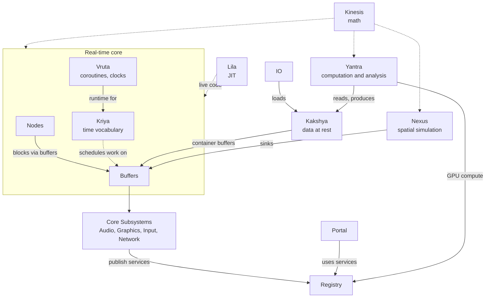

---

## The Real-Time Core: Nodes, Buffers, Vruta, Kriya

These four namespaces form the real-time backbone. They are what runs when the audio callback fires, when the GPU frame begins, when the network packet arrives. Everything else either feeds into them or operates independently of their timing constraints.

### Nodes

A node is a moment of transformation. It takes one unit of data and produces one unit of data, evaluated as many times per second as its domain requires. There is no implicit audio-ness or visual-ness to a node. A node that computes `sin(phase)` is equally valid as a 440 Hz oscillator, the x-coordinate of a moving point, or a brightness modulator. The node does not know which it is. The connection that routes its output decides.

The node taxonomy reflects what kinds of transformation exist, not what domain they belong to.

**Generators** produce values from internal state: `Sine`, `Phasor`, `Impulse`, `Polynomial`, `Logic`, `Random`. A phasor is a ramp from 0 to 1 that repeats. That ramp can drive audio synthesis, animation, or shader parameters without modification.

**Filters** reshape incoming streams: `FIR`, `IIR`. Coefficients define the response. The filter does not care whether the stream is audio or control.

**Conduit** nodes route and combine: `NodeChain`, `NodeCombine`, `Constant`, `StreamReaderNode`. These are the plumbing layer, connecting transformation stages without introducing computation of their own.

**Input** nodes bridge hardware events into the graph: `HIDNode`, `MIDINode`, `OSCNode`. A MIDI note becomes a frequency value; a HID axis becomes a double. From that point it is just a number.

**GpuSync** nodes connect node evaluation to asynchronous GPU work. `GpuComputeNode` dispatches compute and reports completion to consumers. `GeometryWriterNode` is the base for nodes that produce GPU vertex geometry.

**Graphics** nodes write computed values into GPU resources: geometry writers, mesh writers, topology generators, path generators, texture nodes, procedural texture nodes, point collection nodes. These are where numeric streams cross into the visual domain by routing them to a buffer that a render pipeline consumes.

**NodeNetworks** coordinate collections of nodes whose relationships define the output.

`ParticleNetwork` models entities with position, velocity, and force. Physics integrates forward each frame. The positions are numbers that flow wherever you connect them.

`PointCloudNetwork` holds spatial samples with no identity or persistence. Structure emerges through attached operators: `TopologyOperator` infers connectivity by k-nearest or radius or Delaunay; `PathOperator` interpolates curves through control points.

`ModalNetwork` decomposes resonance into independent modes, each a decaying oscillator with a frequency ratio, a decay coefficient, and an amplitude. Excite the network with an impulse and the modes respond according to their spectrum.

`WaveguideNetwork` simulates wave propagation through delay lines. Two modes: unidirectional for string-like structures; bidirectional for tube-like structures where two rails travel in opposite directions with reflection at each termination.

`ResonatorNetwork` applies IIR biquad bandpass sections to whatever signal enters. Feed it noise and it becomes a formant synthesizer; feed it a pulse and it voices a resonant space.

`MeshNetwork` operates on mesh topology as a first-class computational structure.

`InstanceNetwork` groups geometry slots for a single instanced draw. Slots can share a geometry source or use distinct nodes. `InstanceFieldOperator` derives their transforms or positions, optionally on the GPU.

All networks accept `NetworkOperator` instances that define behavioral layers. Operators compose: `FieldOperator`, `MeshFieldOperator`, `PhysicsOperator`, `MeshTransformOperator`, `GraphicsOperator`, `InstanceFieldOperator`, `OperatorChain`.

`GpuFieldOperator` evaluates spatial fields against network geometry on the GPU. The associated buffer processors manage spatial hashing, clusters, claims, population, and vertex field writes.

### Buffers

If a node is a moment of transformation, a buffer is a span of time held in one place until something can be done with it.

A node produces one value per evaluation. A buffer accumulates those values over a cycle, holds them, and makes them available as a block. Buffers are cycle-driven, carry processing tokens, and are registered with a `BufferManager` that knows when to process them.

**Audio buffers** accumulate samples for the audio subsystem. `NodeBuffer` draws from a node, `InputAudioBuffer` captures hardware input, and `FeedbackBuffer` retains history. `FeedbackProcessor` and `BlockFeedbackProcessor` use that history for sample or block feedback.

**Geometry buffers** accumulate vertex data for the graphics pipeline: `GeometryBuffer`, `MeshBuffer`, `CompositeGeometryBuffer`.

**Network buffers** carry NodeNetwork output to audio, texture, and geometry consumers. `InstanceNetworkBuffer` supplies geometry and per-instance transforms for an instanced draw.

**Texture buffers** hold image data flowing to GPU image resources: `TextureBuffer`, `NodeTextureBuffer`.

**GPU state buffers** retain evolving data between cycles. `RelaxationGridBuffer` runs double-buffered stencil rules; `VolumeGridBuffer` holds named 3D fields for flow, diffusion, and surface extraction. `RaymarchBuffer` renders a volume field directly.

**Container buffers** bridge Kakshya containers into the real-time cycle: `SoundContainerBuffer`, `VideoContainerBuffer`.

**Forma buffers** serve the Portal::Forma surface system. `FormaBuffer` is a GPU vertex buffer whose contents are rewritten each cycle by a geometry function parameterized on a typed state value. It is the render-side counterpart to `MappedState<T>`.

**Root buffers** aggregate child buffers and present a single output to a subsystem. `RootAudioBuffer` mixes its children into the audio callback output. `RootGraphicsBuffer` aggregates geometry for the frame.

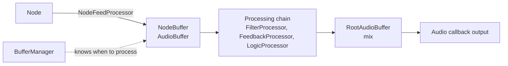

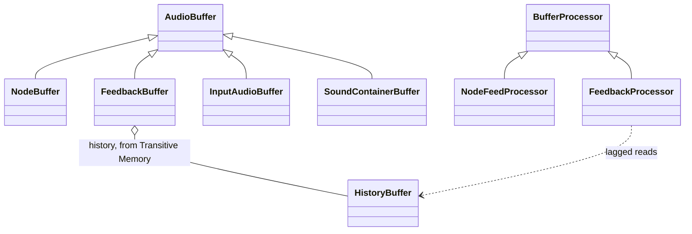

### Processors

Processing happens to buffers, not inside them. Every buffer carries a processing chain; processors attach to that chain and execute in order when the buffer's cycle fires.

Node processors turn evaluations into blocks and then transform them. `NodeFeedProcessor` fills a buffer from a node; `FilterProcessor`, `LogicProcessor`, and `PolynomialProcessor` reshape its values. `NodeBindingsProcessor` and `AggregateBindingsProcessor` instead route node outputs into GPU bindings.

Audio processors bring streams into the cycle and combine them for output. `StreamSliceProcessor` reads and mixes selected slices of a Kakshya sound stream, `AudioWriteProcessor` accepts typed values from elsewhere in the graph, and `MixProcessor` combines child audio buffers at the root.

Graphics processors prepare resources before drawing or compute. `GeometryBindingsProcessor` uploads changed node geometry, `MeshProcessor` updates mesh vertices and indices, and `InstanceSSBOProcessor` supplies per-instance transforms. `DescriptorBindingsProcessor` stages shader resources; `UVFieldProcessor` projects texture coordinates on the GPU. `RenderProcessor` records draws and `ComputeProcessor` dispatches compute. At the root, `GraphicsBatchProcessor` gathers child work and `PresentProcessor` submits it to the target windows.

Transfer processors connect these paths. `DataWriteProcessor` writes typed values into GPU buffers, while `FormaBindingsProcessor` routes Forma state into shader bindings. `BufferUploadProcessor` and `BufferDownloadProcessor` move buffer data across CPU and GPU memory; `TransferProcessor` specifically bridges audio and GPU buffers.

`SDFMeshProcessor` runs GPU signed-distance evaluation and marching cubes into a `ComputeMeshBuffer`, whose generated geometry can be rendered or exported.

### Vruta

Vruta is the execution model. It defines what time-structured work is in MayaFlux.

Four coroutine types cover the space of real-time work:

`SoundRoutine` ticks at audio rate and is resumed by the sample-clock pump on the audio thread. Suspend with `SampleDelay` or `BufferDelay`.

`GraphicsRoutine` ticks at frame rate and is resumed by the frame-clock pump on the graphics thread. Suspend with `FrameDelay`.

`CrossRoutine` spans audio and frame clocks. `MultiRateDelay` lets either clock resume the work while ensuring it runs only once at each suspension point.

`FreeRoutine` waits for a condition rather than a clock tick.

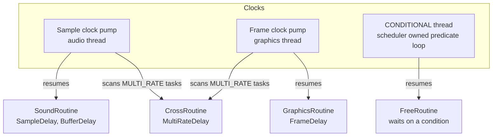

`CrossRoutine` is armed on both clocks at once. Each pump marks its own clock satisfied, and when every clock the suspension asked for is satisfied, a compare-exchange on the promise's delay context lets exactly one thread resume it.

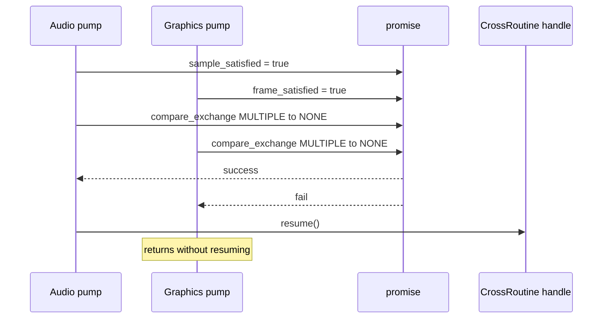

`DelayContext` distinguishes buffer-based and sample-based timing regimes. `Event` and `EventManager` hold named coroutines that respond to conditions. `EventSource` and `NetworkSource` are the sources events wait on. `Clock` tracks elapsed time in samples and converts between sample counts and seconds.

### Kriya

Kriya is the vocabulary for writing time-structured processing work against Vruta's runtime.

The awaiters `SampleDelay`, `BufferDelay`, `FrameDelay`, and `MultiRateDelay` express time in terms the system understands. `ProcessingGate` suspends until a condition becomes true. `EventAwaiter` and `NetworkAwaiter` suspend until an event or message fires.

`Tasks` provides common scheduling primitives: `metro` fires a callback at a regular interval with sample-accurate timing; `sequence` fires callbacks at specified offsets; `line` interpolates a value over a duration. `Kriya::pattern` passes an incrementing index to a typed generator and delivers each result to a callback. Its steps can follow a condition, a repeating duration list, or durations generated for each pass.

`BufferPipeline` composes buffer operations as coroutine-driven chains at audio or frame rate. `SamplingPipeline` connects a `DynamicSoundStream` to audio buffers and plays `StreamSlice` values through independently controlled slots.

Frame-rate pipelines can capture camera or video frames into a `DynamicVideoStream`. `TapSet` places multiple taps on one sound stream, each with its own lag, repeat, speed, direction, gain, and output channels. `Chimera` feeds a `TextureArrayBuffer` from still images, GPU images, live video rings, or recorded `TextureCollection` frames; each layer has independent timing and controls.

`Chain` (the `EventChain`) sequences discrete actions with sample-accurate delays via `then()`, `wait()`, `every()`, `repeat()`, `times()`.

`Timer` and `TimedAction` provide fire-once and fire-with-cleanup scheduling.

Input events enter the scheduling system through `InputEvents`: `any_key`, `mouse_pressed`, `mouse_released`, `mouse_move`. Network events enter through `NetworkEvents`: `on_message`, `on_message_from`, `on_message_matching`.

---

## Kakshya: The Data Layer

Kakshya is not real-time. This is intentional and important.

Kakshya holds and classifies stored and live data. It describes data, provides zero-cost views, and processes data on demand. It has no scheduler dependency. Its processors are pull-based, not tick-driven.

At the center is `SignalSourceContainer`, the base for all typed containers. Concrete types cover the full range of digital media:

Audio containers hold files, live streams, and the engine's own output: `SoundFileContainer`, `SoundStreamContainer`, `DynamicSoundStream`, and `AudioOutputContainer`. The output container makes playback available for metering, recording, or visualization. Video and image containers include `VideoFileContainer`, `VideoStreamContainer`, `DynamicVideoStream`, `CameraContainer`, `TextureContainer`, and `TextureCollection`. `WindowContainer` exposes rendered frames; `PlotContainer` holds time-series data for Forma plots.

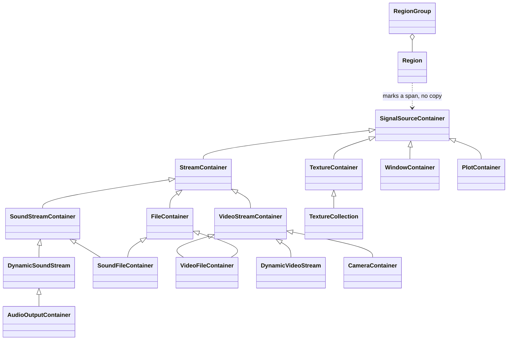

`NDData` and `DataVariant` carry typed, multidimensional values across containers and operations. Access and insertion adapters bridge them to Eigen matrices, meshes, vertices, and textures.

`CompositeLayout` describes named numeric, text, binary, or dynamic fields. `CompositeArray` packs records that share that layout while keeping variable-length text and binary data in separate stores. `Composite` provides a borrowed record view; `CompositeContainer` exposes insertion, slices, and traversal through the Kakshya container interface.

`Region` and `RegionGroup` describe spans of container data without copying them. Segments and organized regions add subdivisions and attribution.

`DataProcessingChain` applies `DataProcessor` instances on demand. The Processors subdirectory provides: `ContiguousAccessProcessor`, `CursorAccessProcessor`, `FrameAccessProcessor`, `WindowAccessProcessor`, `SpatialRegionProcessor`, `AudioOutputAccessProcessor`.

The relationship between Kakshya and Buffers is a one-way bridge. Buffers consume from Kakshya containers through container buffers; Kakshya never asks Buffers for anything.

---

## Yantra: Computation and Analysis

Yantra provides typed computation, analysis, composition, and GPU execution. Its operations can run on stored data or process live streams through scheduled workflows.

The type system begins with `Datum<T>`. Where the real-time side works with raw doubles flowing through buffers, Yantra wraps everything in `Datum`. A `Datum` carries the data, optional container context, and metadata. `ComputeData` is the concept constraining what `T` can be. `StructureIntrospection` infers the shape of any `ComputeData` value.

**Analyzers** extract information: `EnergyAnalyzer`, `StatisticalAnalyzer`, `UniversalAnalyzer`, `GpuAnalyzer`.

**Transformers** modify data: `MathematicalTransformer`, `SpectralTransformer`, `TemporalTransformer`, `ConvolutionTransformer`, `UniversalTransformer`, `GpuTransformer`.

**Sorters** reorder data: `StandardSorter`, `UniversalSorter`, `GpuSorter`.

**Extractors** pull features: `FeatureExtractor`, `UniversalExtractor`, `GpuExtractor`.

**Executors** bridge typed operations to Vulkan compute. `ShaderExecutionContext<>` handles buffer shaders, `TextureExecutionContext` handles images, and `GpuDispatchCore` with `GpuResourceManager` coordinates dispatch and resource reuse. GPU work can also be dispatched asynchronously.

**Composition** is where the system becomes expressive beyond individual operations.

`ComputeMatrix` holds named operations and runs them synchronously, asynchronously, in parallel, or as chains.

`ComputationGrammar` selects operations by matching incoming data against prioritized rules.

`ComputationPipeline` composes operations in sequence with optional grammar-driven selection at each stage.

`GranularWorkflow` is a complete opinionated granular analysis and reconstruction implementation built on the grammar and matrix systems.

### Vision

`VisionSequence` describes image operations and selects a CPU or GPU backend. `VisionQuery` resolves higher-level intents into sequences for segmentation, contours, features, and optical flow. Yantra's `VisionAnalyzer` executes those sequences; `VisionMatrix` keeps the frame, analysis, and optional extraction together. `VisionWorkflow` runs that matrix on video streams and can publish results, record GPU images in a `TextureCollection`, or feed a `Chimera` display.

---

## Portal: Cross-Domain Coordination

Portal is the glue layer between MayaFlux's internal systems and external-facing capabilities requiring coordination across backends, resource lifetimes, and platform abstractions. It currently covers Graphics, Text, Forma, System, and Network.

### Graphics

`Portal::Graphics` is the Vulkan coordination layer. MayaFlux's visual pipeline is independent of audio and shares its scheduler, buffer machinery, and Kriya composition layer.

`ShaderFoundry` manages shader compilation and GPU command and fence lifetimes.

`RenderFlow` orchestrates graphics pipeline creation and draw command recording using Vulkan 1.3 dynamic rendering with no render pass objects.

`ComputePress` records compute pipeline dispatches.

`TextureLoom` creates and manages GPU textures: 2D, 3D, cubemaps, render targets.

`SamplerForge` manages sampler object lifecycle.

`ShaderSpec` describes generated compute kernels; `ShaderFoundry` compiles or assembles them into SPIR-V and loads them alongside file-backed shaders.

The render descriptor layout reserves `set=0, binding=0` for a `RenderTransform` UBO containing the view, projection, and geometry transforms. User descriptors begin at `set=1`.

### Text

`Portal::Text` lays out UTF-8 text and renders it into GPU-resident textures. Its font, atlas, and press components manage glyphs and text buffers. `EditableText` supplies the editing operations used by Forma's `TextField`.

### Forma

`Portal::Forma` is the UI and surface orchestration system. It maps typed state to geometry and connects spatial input to the data graph, without imposing a widget hierarchy.

`Surface` brings together a window, a `Layer` of elements, and a `Context` for input. An `Element` can be rendered, used for hit testing, or both. `FormaBuffer` carries its vertices to the GPU.

`Form<T>` packages a geometry function with its topology, buffer capacity, and interaction. `create(surface, form, initial)` realizes it as a `Mapped<T>` element whose geometry follows a versioned `MappedState<T>`. Any function can produce a Form, so controls are compositions rather than a fixed widget catalog.

`Bridge` connects that state to the wider graph: nodes and callables can drive it, while its value can drive nodes, audio, buffers, and shaders. `Tend<T>` joins Form placement and Bridge binding in one chain.

`Inspector` exposes live views of the node graph and buffer manager as Forma surfaces.

`Plot` maps a `PlotContainer` and series descriptions into live data views.

`Collapsible`, `Scrollable`, `TextField`, and `pick` provide common interaction patterns. `LayoutCursor` and spatial placement helpers position them without imposing a layout engine.

### System

`Portal::System` provides native OS integration.

`Portal::System::Dialog` presents native open and save dialogs across Linux, Windows, and macOS. The `Depot` API builds typed media selection and saving on top of them.

### Network

`Portal::Network` provides the facade for network endpoint management. `MessageUtils` and `NetworkSink` handle message serialization and dispatch. `StreamForge` and `PacketFlow` manage TCP and UDP endpoint lifecycles.

---

## Registry

`BackendRegistry` lets backends publish service interfaces without coupling consumers to a particular implementation. Portal builds higher-level systems on those services, and Yantra can reach the active GPU backend through the same seam.

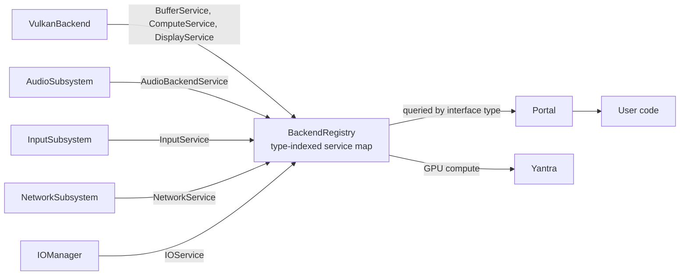

---

## Core and Subsystems

`Engine` owns the component graph and manages the initialization sequence. `SubsystemManager` coordinates `ISubsystem` instances.

`AudioSubsystem` wraps the native audio backend (PipeWire on Linux, WASAPI on Windows, CoreAudio on macOS), registers callbacks, and drives the audio processing cycle.

`GraphicsSubsystem` wraps `VulkanBackend`, manages the swapchain lifecycle, and drives frame rendering.

`InputSubsystem` owns the native input backend and MIDI backend and delivers events to `InputManager`.

`NetworkSubsystem` owns TCP and UDP backends and registers a `NetworkService`.

Each subsystem receives a `SubsystemProcessingHandle` for controlled access to Buffers, Nodes, the scheduler, windows, and input.

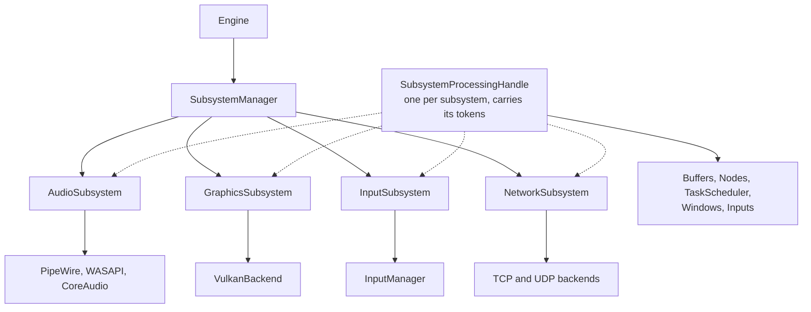

---

## Nexus: Spatial Entity Simulation

Nexus is the spatial simulation and orchestration layer. It connects to the real-time core through the buffer and rendering systems but does not depend on any of them for its own logic.

`Fabric` is the simulation container. `Fabric::commit()` runs one simulation step. On each commit, registered entities are evaluated: `Emitter` entities fire an influence function with an `InfluenceContext`; `Sensor` entities perceive their spatial neighborhood via a `PerceptionContext`; `Agent` entities both perceive and influence.

`Locus` is an `Agent` subclass that also carries a `NavigationState` for camera-like movement through the world. `Presence` is an `Agent` subclass with a `falloff_curve` and `falloff_radius` controlling how its influence attenuates over distance.

`Expanse` is a named spatial region carrying a `ContainsFn` predicate and optional `on_enter` and `on_exit` crossing callbacks. `Hull` derives its region from a buffer's geometry; `Mantle` places a buffer within its region. Expanses are registered on a `Fabric` and evaluated as part of each commit cycle. `Tapestry` manages a collection of Fabrics and owns named Expanses that can be active across multiple Fabrics.

`StateEncoder` saves Fabric and Tapestry state as numeric EXR data with a JSON schema. `StateDecoder` can patch existing entities or reconstruct missing ones from that pair.

`Wiring` is the builder interface for connecting entities to MayaFlux systems. The `on(window, key, bool held, on_release)` API attaches keyboard triggers; mouse drag support is available. `wire_player` is a free function that wires a Locus to standard movement controls. `Regime` is a user struct pattern for holding atomic state shared across routines.

`Sinks` connect entity outputs to the real-time cycle. `AudioSink` owns an `AudioBuffer` and `AudioWriteProcessor`. `RenderSink` owns a `VKBuffer`, `GeometryWriteProcessor`, and `RenderProcessor`.

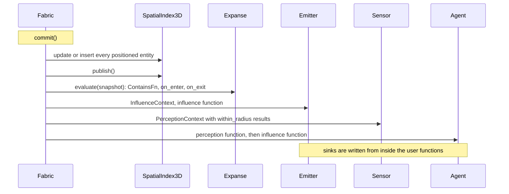

`SpatialIndex3D` answers radius and k-nearest queries. `HitTest` handles ray-entity and volume-entity intersection tests.

The function registry on `Fabric` maps string names to `InfluenceFn`, `ContainsFn`, and crossing functions, enabling `StateDecoder` to resolve callable names back to live function objects.

---

## Kinesis: The Mathematical Substrate

Kinesis is MayaFlux's mathematical library. It supplies algorithms and lightweight descriptions of computation without owning schedulers or buffers.

`Kinesis::Discrete` covers algorithms over `std::span`: convolution, spectral transforms, sorting, onset detection, zero-crossing analysis, taper application (Hann, trapezoid, Blackman), extraction of peaks and troughs, quantization.

`Kinesis::Tendency` covers parameterized curves and field functions. `Tendency<D,R>` is a pure callable from domain to range; composition is through free functions with domain-specific factories in separate files. `ForceFields` defines spatial influence functions. `UVProjection` maps 3D positions into 2D parameter spaces.

`Kinesis::Stochastic` covers probability: distributions (Gaussian, uniform, Poisson, exponential), noise generators (white, pink, Perlin, simplex), random walk systems.

`Kinesis::Spatial` covers geometric queries: `SpatialIndex3D` with radius and k-nearest search, `ProximityGraphs` for KNN, Delaunay, and minimum spanning tree construction, `HitTest` for intersection.

`Kinesis::Vision` supplies image operations, sequence descriptions, and result types used by both CPU and GPU vision executors. `Kinesis::Discrete` also provides reusable boolean, polynomial, and feedback kernels for Logic, Polynomial, and Feedback processors.

Top-level Kinesis provides: `GeometryPrimitives` (platonic solids, subdivided surfaces, parametric shapes; `filled_rect` and related NDC helpers used by Forma); `MatrixTransforms`; `MotionCurves`; `NavigationState` and other viewport controllers; `VertexSampler`; `ViewTransform` (view and projection matrices carried within the render UBO); `BasisMatrices`; `ndc_size_to_pixels` and related coordinate conversion helpers used by Portal::Forma layout.

---

## IO: Reading and Writing the World

IO brings external media into Kakshya containers and GPU buffers, and writes MayaFlux data back to files.

**Reading:** `SoundFileReader` decodes audio via the FFmpeg/libav stack into `SoundFileContainer`. `VideoFileReader` and `VideoStreamContext` decode video frames into `VideoFileContainer` and `VideoStreamContainer`. `ImageReader` loads still images via STB into `TextureBuffer`. `ModelReader` loads mesh data via assimp; `SpatialReader` reads time-sampled Alembic points and curves. `VolumeReader` loads OpenVDB grids into `VolumeData`, which `IOManager::load_volume` uploads to a `VolumeGridBuffer`. `CameraReader` captures from camera hardware. `AudioStreamContext` wraps live audio input. `IOManager` coordinates these readers.

**Writing:** `SoundFileWriter` and `VideoFileWriter` encode through FFmpeg worker threads. `FFmpegMuxContext` owns the output container; `AudioEncodeContext` and `VideoEncodeContext` add streams. `IOManager::write` queues a `SoundStreamContainer` for encoding. `ModelWriter` exports mesh buffers through Assimp. `SpatialCache` writes time-sampled points and curves to Alembic. `VDBWriter` saves volume fields as OpenVDB grids; `IOManager::save_volume` accepts either `VolumeData` or a GPU-resident `VolumeGridBuffer`.

**Capture:** `IOManager::capture_output` observes live audio output and writes it through `SoundFileWriter`; `capture_window` records rendered frames through `VideoFileWriter`. Both return capture handles with explicit stop calls. `capture_volume` records numbered VDB frames, and `capture_spatial` records live buffer geometry into Alembic.

`FileReader`, `FileWriter`, `TextFileWriter`: generic file IO interfaces. `JSONSerializer` handles structured JSON read/write for engine config, Nexus schemas, and other serialization tasks. `Keys` maps platform key codes to `IO::Keys`.

IO has no real-time dependency for loading: load, construct a container, return. Encoded file writing is dispatched to workers; capture obtains data from the relevant live subsystem before handing it to the writer.

---

## Journal: Structured Logging

`Journal::Archivist` collects structured logs by component and context. Ordinary logging includes severity and source location; the real-time path writes to a lock-free ring drained by a worker into console or file sinks. `MF_*` macros expose both paths.

---

## Transitive: Framework-Independent Utilities

Transitive contains code with no MayaFlux dependency. It exists because these utilities are useful throughout the codebase and because keeping them independent preserves the option to use them elsewhere.

`Transitive::Memory` provides `RingBuffer` (the history buffer underlying `FeedbackBuffer` and used throughout DSP code where temporal indexing is needed) and `Persist` (a simple persistence helper).

`Transitive::Parallel` provides `Dispatch` for thread pool work.

`Transitive::Reflect` provides `EnumReflect`, a wrapper over `magic_enum` used throughout for enum-to-string conversion in logging and serialization.

`Transitive::Platform` provides `HostEnvironment` (platform detection, path resolution) and `FontDiscovery` (system font enumeration used by `Portal::Text`).

`Transitive::Protocol` provides `BinaryBuffer`, a lightweight binary serialization type used in network message construction.

---

## Lila: The Live Layer

Lila is the live coding environment. It compiles C++23 fragments with Clang and LLVM ORC JIT and installs them into the running process.

Source arrives over a TCP connection. Installed code shares the process and address space with the engine, so it can work with MayaFlux objects directly.

`Vega` is the factory surface for creating and registering MayaFlux objects from live-coded fragments.

`LiveArena` keeps shared JIT objects alive across compilation cycles.

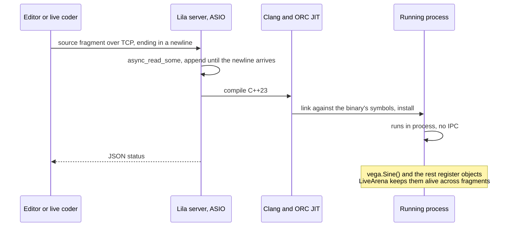

---

## Tokens and Domain

Every real-time object carries a processing token describing how and when it runs.

Vruta tokens choose when a routine resumes; Nodes tokens choose evaluation rate; Buffers tokens combine rate, device, and concurrency. These describe execution without changing the data being processed.

`Domain` unifies the token levels into a single routing value. Built-in domains cover audio, graphics, input, and mixed execution; custom domains combine the same timing, device, and concurrency choices.

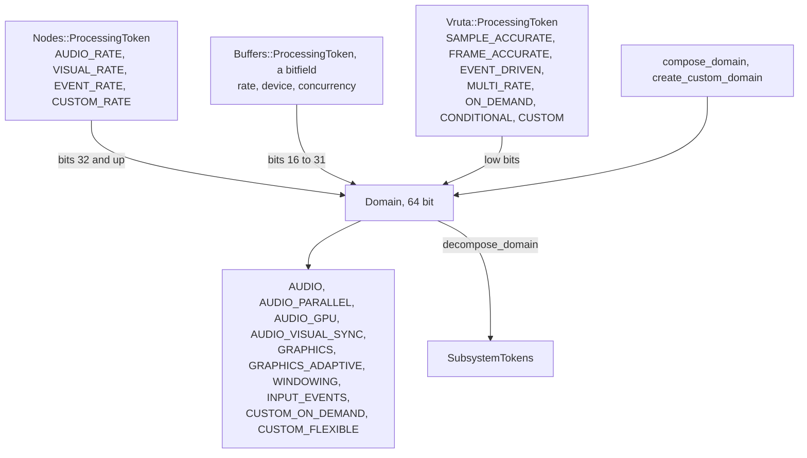

Domain is not a property attached to data when it is created. It is a token applied to the object that processes the data, resolved at the point where a stream enters a consuming context. The same numbers flow through all domains. The token decides the timing, the device, and the concurrency model that handles them.

The `API/Proxy/Domain` layer exposes domain composition and decomposition to user code and to the Vega factory system without requiring direct access to the token enums.

---

## How the System Composes

The namespaces above intersect at defined points and those intersections are where the interesting work happens.

A `SoundFileContainer` in Kakshya becomes audio output through a `SoundContainerBuffer` in Buffers, driven by a `BufferPipeline` in Kriya, scheduled by a `TaskScheduler` in Vruta, consumed by `AudioSubsystem` in Core, whose callback writes to hardware through the native audio backend.

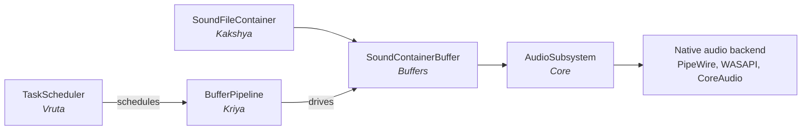

A `ParticleNetwork` in Nodes computes physics at visual rate, writes positions to a `NetworkGeometryBuffer` in Buffers, which a `RenderProcessor` submits as a draw call through `RenderFlow` in Portal, recorded via `ShaderFoundry` and submitted to the GPU by `VulkanBackend`.

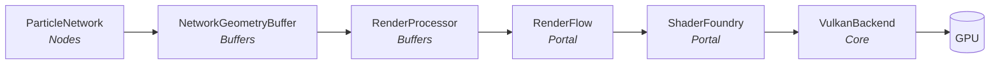

An `InstanceNetwork` drives `InstanceNetworkBuffer` which packs per-instance transforms from an optional `InstanceFieldOperator` GPU path into an SSBO and submits a single instanced draw call each frame.

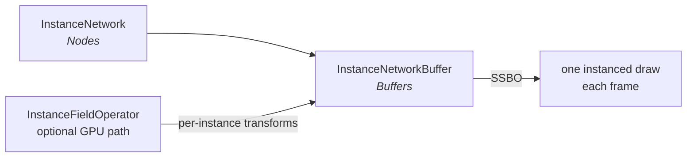

A Yantra `GranularWorkflow` analyzes a `SoundFileContainer` using `Kinesis::Discrete` for onset detection and `EnergyAnalyzer` for grain attribution, produces a sorted `RegionGroup`, which a `SamplingPipeline` in Kriya plays back through the audio subsystem.

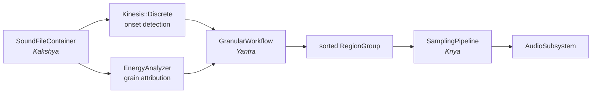

A Nexus `Emitter` fires its influence function each commit, pushes data to its `AudioSink`, which writes to an `AudioBuffer` registered with the `BufferManager`, mixed by `RootAudioBuffer` into the audio output. `StateEncoder` snapshots the Fabric's entity state to EXR+JSON; `StateDecoder` reconstructs it on the next session without re-running setup code.

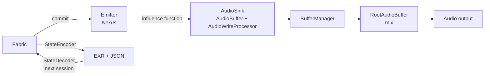

A Forma fader built from a `Form<float>` has one mapped state. `Bridge` can drive it from a node and route that value to both a shader parameter and an audio buffer. One control participates in both domains.

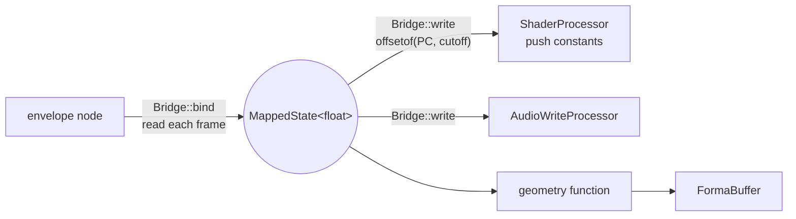

The common thread in all of these paths is data moving as numbers through typed containers, transformed by operations, driven by a scheduler, consumed by subsystems. Domain is resolved at the consumption point. Nothing before that moment needs to know whether the numbers will become sound, light, geometry, or control.

That is the premise, and it holds throughout.
