# Yantra Compute Guide

Yantra is MayaFlux's offline compute and grammar pipeline substrate. It is the layer you reach for when computation needs to be composed, orchestrated, and reasoned about as a data transformation graph rather than executed as a one-shot callback. The scope is deliberately broad: audio analysis, GPU image processing, spectral transforms, spatial sorting, granular reconstruction, speech analysis and arbitrary GPGPU work all use the same types and the same execution machinery.

The central premise is that audio samples, vertex positions, image pixels, spectral bins, and region descriptors are all just numbers with metadata. Yantra does not special-case any of them. All data flows through the same `Datum<T>` envelope, crosses every operation boundary in that envelope, and is processed by the same executor, operation, and matrix types regardless of what the numbers represent. Domain (audio, visual, spatial) is a routing annotation carried by `DataModality` on the `Datum`, not an architectural boundary in the system.

The layers stack as follows. At the bottom, Kakshya provides the raw data types: `DataVariant` for concrete storage, `DataDimension` for structural metadata, `DataModality` for semantic labelling, and a family of `SignalSourceContainer` subclasses for resident or streaming data. Above that, Yantra's executor layer bridges typed `Datum` values to Vulkan SSBO and image dispatch, handling buffer staging, dispatch sizing, and readback. The operation layer sits on top of executors: operations own computational identity, typed configuration, and one implementation per target they run on. Finally, the orchestration layer - `ComputeMatrix`, `ComputationPipeline`, and `ComputationGrammar` - composes operations into pipelines that can be linear, branching, async, or grammar-driven.

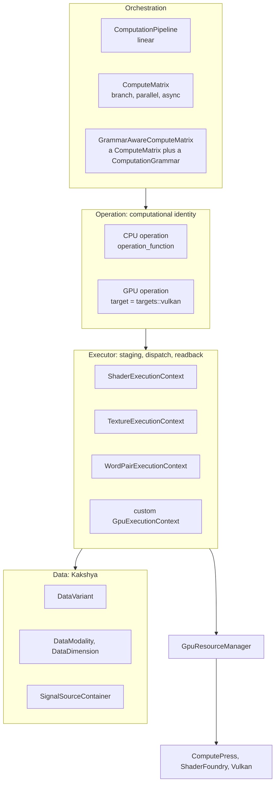


An operation is not a thin wrapper around a shader. It is the unit of algorithmic intent: a class with typed configuration, a category, and an implementation for each place it can run. Where it runs is declared on the class, not attached to it. A CPU operation needs no declaration. A GPU operation declares `static constexpr Target target = targets::vulkan;` and dispatches through its own executor. Grammar rules describe when and how to instantiate and invoke operations based on what data arrives, decoupling operation selection from call-site logic.

---

## The Compute Chain

Before the individual components, it helps to see how they connect end to end.

Data enters Yantra as a `Datum<T>`, where `T` is any type satisfying the `ComputeData` concept: flat vectors, `DataVariant` collections, region descriptors, or container handles. The `Datum` carries not just the data but its dimensional structure (`DataDimension`), its semantic role (`DataModality`), its typed facets, and, for data that lives in a resident or streaming source rather than a flat buffer, a container. This envelope is the only thing that crosses operation boundaries. Nothing is extracted, flattened, or converted until an executor needs to stage it for GPU dispatch.

A `ComputeOperation` consumes a `Datum<InputType>` and produces a `Datum<OutputType>`. Its settings are typed config structs (`OperationConfig`, read with `config<T>()`), and each call may carry typed facets in its `ExecutionContext`. Its implementation is `operation_function` on the CPU, or `apply_operation_internal` in a GPU class that dispatches through its own executor. The caller does not choose the implementation by name. The grammar chooses it by target and fitness; see [Targets, permits and fitness](#targets-permits-and-fitness).

A grammar stage is selected by an enum signature such as `MathematicalOperation::GAIN | TemporalOperation::TIME_REVERSE`, and the signature is resolved against an `OperationRegistry`.

Operations are composed by the orchestration layer. Three shapes are available:

`ComputationPipeline` is a sequential chain. Operations are added by name and run in declaration order. A grammar can be attached; its rules are evaluated before the chain executes, allowing dynamic pre-processing. This is the right choice when the sequence is fixed and linear.

`ComputeMatrix` is the general engine. It supports arbitrary composition: named operations, typed execute calls, two-op sequential chains, parallel execution across multiple operations on the same input, batch execution across multiple inputs on one operation, and fluent `.with().then().then().to_io()` chains. Crucially, `with_async()` runs an entire chain on a background thread and delivers the result via a completion callback. The matrix owns the future; destruction and `drain_async()` both guarantee completion. The fluent chain is typed end to end: the compiler enforces that each `.then<Op>()` call's input type matches the previous step's output type.

`GrammarAwareComputeMatrix` extends `ComputeMatrix` with a `ComputationGrammar`. When the matrix runs `execute_with_grammar()`, the grammar picks the highest-priority rule that matches the input, runs it, and returns its result as the matrix's output. This enables pipelines whose operation selection is data-driven rather than hard-coded. `GranularMatrix` is a `GrammarAwareComputeMatrix` subclass for the granular workflow; it exposes its typed stages as `segment()`, `attribute()` and `sort()`.

The async chain pattern in `ComputeMatrix` is not just fire-and-forget. It is the primary mechanism for building offline processing pipelines that do not block the audio or graphics thread. The chain lambda captures operation handles, the context, and any reconstruction state. The completion callback delivers a fully typed `Datum` result. Because the matrix holds the future and the chain is entirely described in the lambda, the caller's only obligation is to keep the matrix alive until the result arrives.

---

## Targets, permits and fitness

Where an operation runs is described by a `Target`, which is a set of (device, runtime) pairs. This is what lets a CPU implementation and a GPU implementation of one algorithm coexist as separate classes, with the grammar choosing between them.

**Devices and runtimes** (`OperationSpec/ExecutionTarget.hpp`):

| Device | Runtime | Named target |
|---|---|---|
| `CPU` | `NATIVE` (compiled C++ in this library) | `targets::cpu` |
| `GPU` | `VULKAN` (Vulkan compute shaders) | `targets::vulkan` |

`Device` and `Runtime` are flag sets. `Target` built from a device set and a runtime set names every combination of the two, and `|` joins targets as a union of pairs. `CPU | GPU` with `NATIVE` is therefore CPU+Native and GPU+Native, while `targets::cpu | targets::vulkan` names exactly CPU+Native and GPU+Vulkan. Two targets meet when they share a pair.

A class declares its target as `static constexpr Target target = targets::vulkan;`. A class that declares none is a CPU operation (`target_of_v`).

**Fitness** is an optional `static float fitness(const input_type&)`. The grammar compares fitness across candidates for the same selection. Larger wins. Zero or less declines the input. A missing fitness counts as neutral, and ties keep the existing priority order, so a rule without a fitness resolves as it always did. `BitonicSorter` grows its fitness with channel length and is zero while no device is up. `SpectralAnalyzer` is one while the shader foundry is initialised and zero otherwise.

**Permits** limit a call to some targets. A `Permit` is stored by type in `ExecutionContext::facets`. A rule whose target does not meet the permitted one is skipped. With no candidate left, the call throws. There is no CPU fallback, so a GPU-only call cannot silently run on the CPU.

**Pins** are applied when a grammar is built. `Builder::on(target)` filters a stage's candidates to those that meet the target, and throws if none qualify.

**Stateful choices.** A grammar remembers which rule ran at each stage. A class declaring `static constexpr bool stateful = true` keeps its choice while it still accepts its input, even when another candidate scores higher, until `reset_choices()` is called. `VisionAnalyzer` is declared stateful, because its tracks and flow atlases persist between calls. `set_switch_margin()` (or `Builder::switch_margin`) lets a stateless incumbent yield only to a candidate that beats its score by the margin. The default of zero keeps the best score winning on every call.

---

## Data Layer (Kakshya)

### DataVariant

Concrete storage inside every `Datum`. Carries numeric, complex, vector, and matrix types without conversion at the boundary.

```cpp
using Kakshya::DataVariant = std::variant<
    std::vector<double>,
    std::vector<float>,
    std::vector<uint8_t>,
    std::vector<uint16_t>,
    std::vector<uint32_t>,
    std::vector<std::complex<float>>,
    std::vector<std::complex<double>>,
    std::vector<glm::vec2>,
    std::vector<glm::vec3>,
    std::vector<glm::vec4>,
    std::vector<glm::mat4>
>;
```

### DataModality

Semantic label that travels with a `Datum`. Influences how `OperationHelper` extracts channels and how grammar rules match. Set explicitly or inferred from dimension structure.

Notable values: `AUDIO_1D`, `AUDIO_MULTICHANNEL`, `IMAGE_2D`, `IMAGE_COLOR`, `IMAGE_COLOR_ARRAY`, `VIDEO_COLOR`, `VIDEO_GRAYSCALE`, `TEXTURE_2D`, `SPECTRAL_2D`, `VOLUMETRIC_3D`, `TENSOR_ND`, `VERTEX_POSITIONS_3D`, `VERTEX_NORMALS_3D`, `VERTEX_COLORS_RGB`, `VERTEX_COLORS_RGBA`, `TEXTURE_COORDS_2D`, `TRANSFORMATION_MATRIX`, `SCALAR_F32`.

### DataDimension

Single-axis descriptor with a `Role` (`TIME`, `CHANNEL`, `SPATIAL_X/Y/Z`, `FREQUENCY`, `POSITION`, `NORMAL`, `TANGENT`, `UV`, `COLOR`, `INDEX`, `MIP_LEVEL`, `INSTANCE`, `CUSTOM`) and a `size`. Used by `OperationHelper` to determine dispatch element count and by grammar matchers to inspect structure.

Factory methods:
```cpp
DataDimension::time(n_samples);
DataDimension::channel(n_channels);
DataDimension::spatial(extent, 'x');
DataDimension::vertex_positions(n_verts);
```

### Datum\<T\>

The envelope. Every operation, executor, and grammar boundary crosses via `Datum`.

```cpp
template <ComputeData T>
struct Datum {
    T data;
    std::vector<DataDimension> dimensions;
    DataModality modality;
    std::unordered_map<std::string, std::any> metadata;
    Facets facets;                       // typed results, read by type
};
```

`facets` is the typed store: results such as an analysis or an interval list, and the container a `Datum` refers to, are read back by type. A container is set with `set_container` and read with `get_container<C>()`, with one slot per container family (signal, composite, tensor). `metadata` is a string-keyed bag for untyped values. Prefer facets.

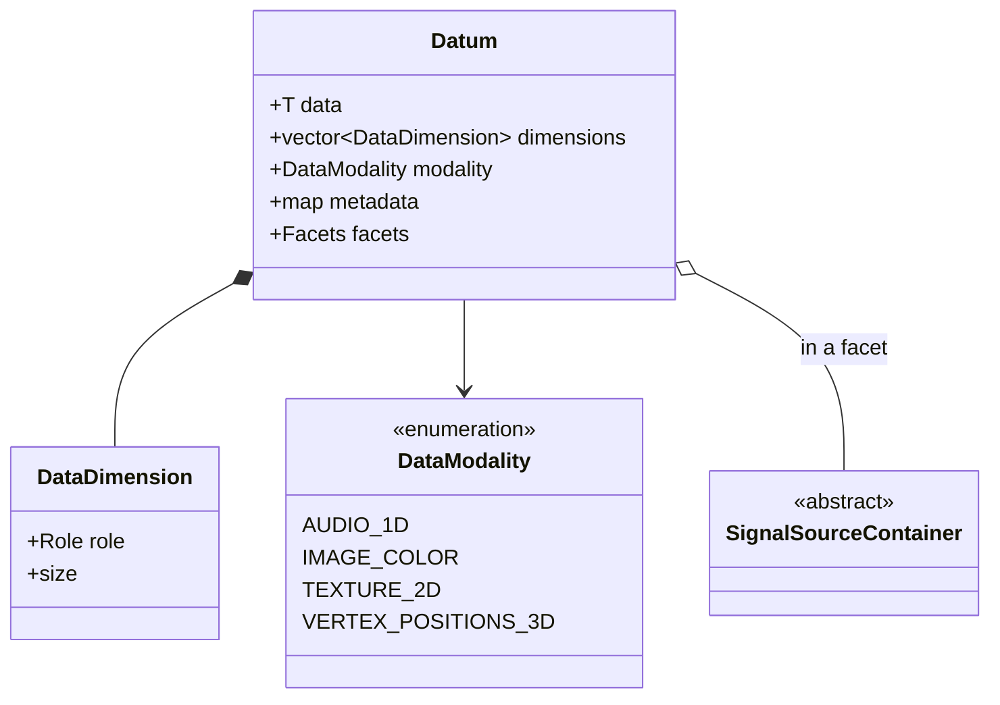

Common aliases (`Yantra/Data/DataIO.hpp`):

| Alias | Underlying type |
|---|---|
| `DataIO` | `Datum<std::vector<Kakshya::DataVariant>>` |
| `ContainerIO` | `Datum<std::shared_ptr<Kakshya::SignalSourceContainer>>` |
| `CompositeIO` | `Datum<Kakshya::CompositeArray>` |
| `TensorContainerIO` | `Datum<std::shared_ptr<Kakshya::TensorContainer>>` |
| `RegionIO` | `Datum<Kakshya::Region>` |
| `SegmentIO` | `Datum<std::vector<Kakshya::RegionSegment>>` |

Construction:
```cpp
std::vector<float> buf = ...;
Datum<std::vector<float>> d(buf);
d.set_metadata("sample_rate", 48000);
```

### Container types

Containers are pure storage with processing state and optional reader support. They sit in `Datum::container` and are resolved by executors and operations that need access to structured data beyond flat channels.

`SignalSourceContainer` - abstract base. Covers streaming, file-backed, and in-memory sources. Subclasses: `SoundFileContainer`, `SoundStreamContainer`, `AudioOutputContainer`, `DynamicSoundStream`, `VideoFileContainer`, `VideoStreamContainer`, `CameraContainer`, `PlotContainer`, `WindowContainer`, `TextureContainer`.

`TensorContainer` - one N-dimensional tensor, for model weights, activations and other numeric arrays that are not signals. Tensors are read from safetensors and NumPy files with `IOManager::load_tensors`, and `TensorConverter` changes their element type (half, bfloat16, float, double, integers with optional quantization).

`TextureContainer` - layer-aware image data. Key methods: `get_layer_count()`, `to_image(layer)`, `from_image(layer, img)`, `set_pixels(...)`, `pixel_bytes()`. Used as the input/output carrier for `TextureExecutionContext` and for array shaders.

`DynamicSoundStream` - writable sample stream. Produced by granular reconstruction (`STREAM` and `STREAM_ADDITIVE` outputs) and consumed by `create_sampler_from_stream`.

---

### GpuBufferBinding

Vulkan-agnostic description of a single storage buffer or image binding. Carries no `vk::` types; translation happens at the point of use in `ComputePress`/`ShaderFoundry`.

```cpp
struct GpuBufferBinding {
    uint32_t set { 0 };
    uint32_t binding { 0 };
    bool skip_auto_readback { false };

    enum class Direction : uint8_t { INPUT, OUTPUT, INPUT_OUTPUT } direction { Direction::INPUT };
    enum class ElementType : uint8_t {
        FLOAT32, UINT32, INT32, PASSTHROUGH, IMAGE_STORAGE, IMAGE_SAMPLED, VEC2_U32, FLOAT64
    } element_type { ElementType::FLOAT32 };

    BufferUsageHint usage_hint { BufferUsageHint::COMPUTE_STORAGE };
};
```

`set` is a real per-binding index, not always 0. Multi-set layouts are used directly, for example vision pipelines binding image data at `set=0` and structured scalar output at `set=1`.

`skip_auto_readback` skips the automatic CPU readback after dispatch for this binding. Use for bindings that stay GPU-resident and are never needed on CPU.

`usage_hint` (`BufferUsageHint`) selects how the buffer is allocated: staging, device-local, compute storage, vertex, index, uniform, indirect, host-visible, or storage with a device address. The default suits compute shaders.

`INPUT_OUTPUT` bindings receive a cross-pass memory barrier automatically when used across multiple recorded dispatches in one command buffer (`ComputePress::record_sequence`), since the same resource is read and written by consecutive stages.

## Executor Layer

Bridges `Datum<T>` to Vulkan SSBO and image dispatch. Executors own buffer staging, dispatch sizing, and readback. Operations delegate to executors; executors do not own computational identity.

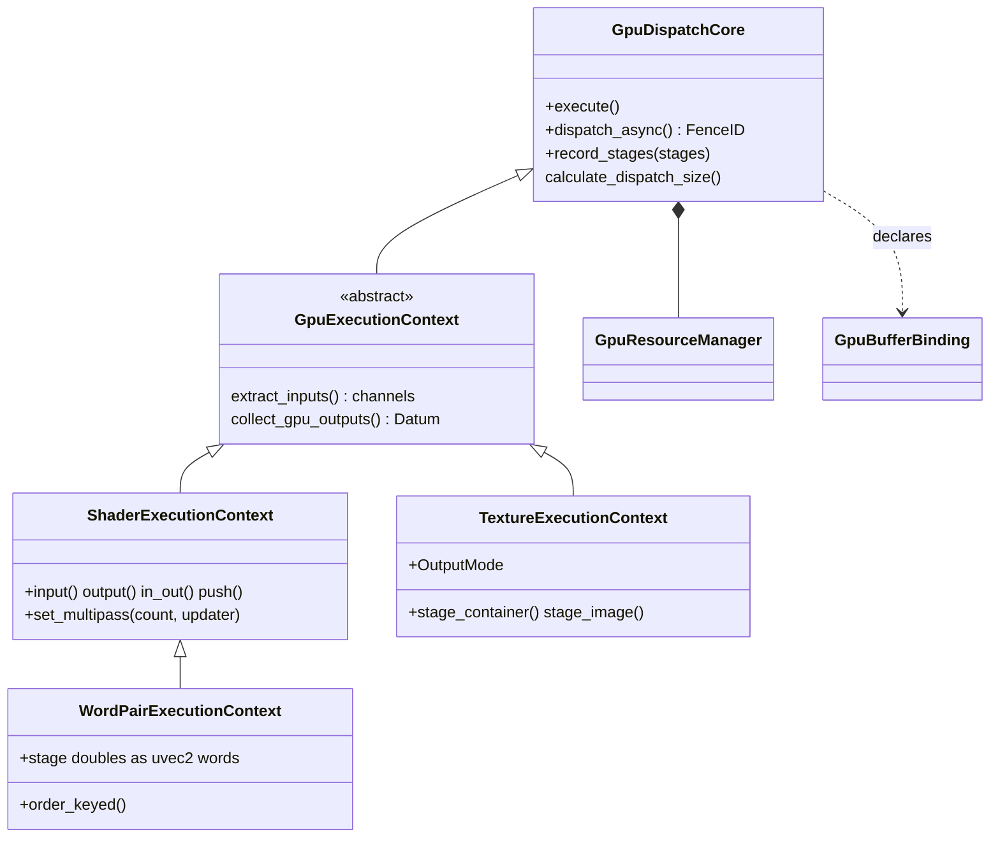


### GpuComputeConfig

```cpp
GpuComputeConfig cfg;
cfg.shader_path        = "my_pass.comp";
cfg.workgroup_size     = { 256, 1, 1 };
cfg.push_constant_size = sizeof(MyPC);
```

### GpuExecutionContext\<InputType, OutputType\>

Abstract type-parameterised shell over `GpuDispatchCore`. Handles the two type boundaries:
- `extract_inputs()` - converts `Datum<InputType>` to flat double channels for dispatch.
- `collect_gpu_outputs()` - reconstructs `Datum<OutputType>` from `GpuChannelResult`.

Subclass this only for custom channel layout or non-numeric input (e.g. image-only shaders). All standard buffer and image shaders use the concrete subclasses.

To size a dispatch other than one thread per element, such as a 2D or 3D grid, override `calculate_dispatch_size()`.

### Queues

`GpuDispatchCore` takes a `compute_isolated` flag, which defaults to `true`. Isolated work runs on a distinct compute queue when the device has one, and otherwise on the graphics queue. Shared work always uses the graphics queue. `GpuResourceManager` enforces the rule that matters in practice: **image bindings and image transitions require `compute_isolated=false`**. It throws otherwise, because image transitions do not yet run on the compute queue. `TextureExecutionContext` sets this for you. Pure buffer contexts keep the default.

### Multi-stage dispatch

Beyond the single-shot `execute()` / `dispatch_async()` pair, `GpuDispatchCore` runs several shader passes together.

`record_stages(stages)` runs an ordered sequence of `DependencyStage` values on one core instance. Each stage supplies its own `GpuComputeConfig` and a `stage_fn` that stages data and push constants, and every stage is followed by a barrier, so a stage sees the writes of every earlier one. With a recording attached (see [Sharing a recording and its buffers](#sharing-a-recording-and-its-buffers)), nothing is submitted until the recording is; without one, each stage is submitted and awaited on its own. Use it when several shader passes with different configs need to run back to back without allocating a separate executor per pass.

`set_multipass(count, updater)` repeats one shader for `count` passes with the push constants updated between them.

### Sharing a recording and its buffers

Contexts that cooperate on one result can share a `GpuDispatchRecorder`, one command buffer that every context appends to. It is submitted at a readback or an explicit `submit()`, and nothing waits between stages: a barrier after each recorded dispatch keeps the order. Contexts that share a recording must agree on `compute_isolated`.

A buffer written by one context can be read by another with no copy and no CPU hop. The owner declares it with `ensure_shared_buffer`, and the reader makes its own binding resolve to it with `import_shared(set, binding, source, source_set, source_binding, element_type)`. The import is a live alias: if the owner reallocates, the reader follows it. `shared_buffer_info` reports the element type, size and a generation that increases on each reallocation, for a consumer that holds a device address and needs to know it went stale. Sharing is read-only by convention, and the reader cannot grow the buffer.

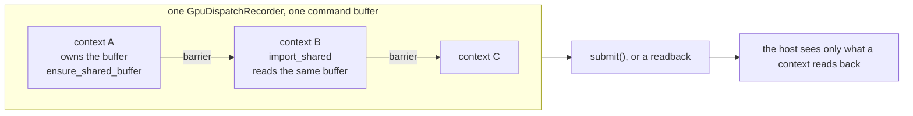

A shared binding is uploaded with `upload_shared_raw`. Staging host data into a binding that resolves to a shared buffer writes the context's own buffer, which the shader does not read.

Several operations use this. `WaveformAnalyzer` uploads each chunk once for all of its passes, and `VadAnalyzer::record` leaves its probabilities on the device for `IntervalExtractor::submit_resident`. See [GPU operations in the library](#gpu-operations-in-the-library).

### ShaderExecutionContext\<InputType, OutputType\>

Concrete executor for SSBO buffer shaders. Fluent API assigns binding indices sequentially unless an explicit index is provided. Explicit and sequential calls may be mixed: explicit calls set the binding; auto-index calls append after the highest index so far.

```cpp
auto exec = std::make_shared<ShaderExecutionContext<>>(
    GpuComputeConfig { "graph_build.comp", { 256, 1, 1 }, sizeof(GraphBuildPC) });

// Sequential auto-index (0, 1, 2, 3):
exec->input(positions, GpuBufferBinding::ElementType::PASSTHROUGH)
     .input(attributes)
     .output(k_max_edges * 2 * sizeof(float))
     .output(sizeof(uint32_t), GpuBufferBinding::ElementType::UINT32)
     .push(pc);

// Explicit indices when slot order cannot be inferred:
exec->input(0, positions, GpuBufferBinding::ElementType::PASSTHROUGH)
     .in_out(1, scratch)
     .output(2, output_bytes);
```

Fluent methods:

| Method | Direction | Data |
|---|---|---|
| `input(data, type)` / `input(binding, data, type)` | INPUT | Pre-staged from vector. |
| `input(binding, type)` | INPUT | No pre-staged data; sourced from `Datum` at dispatch. |
| `in_out(data, type)` / `in_out(binding, data, type)` | INPUT_OUTPUT | Uploads and reads back. |
| `in_out(type)` / `in_out(binding, type)` | INPUT_OUTPUT | No pre-staged data. |
| `output(byte_size, type)` / `output(binding, byte_size, type)` | OUTPUT | Allocates output buffer. |
| `push(struct_or_value)` | Push constant | Copies into push constant block. |
| `set_multipass(count, updater)` | CHAINED mode | Batches `count` passes; `updater(pass_index, pc_ptr)` called per pass. |
| `set_skip_readback(binding, skip)` | - | Keeps one auxiliary output on the GPU. |

`ElementType` values:

| Value | Meaning |
|---|---|
| `FLOAT32` | Default. Double channels are cast to float. |
| `UINT32`, `INT32` | Variant bytes are reinterpreted as that integer type. |
| `PASSTHROUGH` | Raw variant bytes, no cast. The caller pre-stages `INPUT`/`INPUT_OUTPUT` data. |
| `IMAGE_STORAGE`, `IMAGE_SAMPLED` | Image bindings, used by `TextureExecutionContext`. |
| `VEC2_U32` | One double per binding element, as two 32-bit words, low word first. See [Doubles without fp64 on the device](#doubles-without-fp64-on-the-device). |
| `FLOAT64` | A raw 64-bit double binding. It needs a device with `shaderFloat64`, as the native double path of `AudioComputeProcessor` does. |

Structured vector data goes through `DataVariant` at the `Datum` level, not through the binding's element type.

**Synchronous dispatch:**
```cpp
auto result = exec->execute(input_datum, ExecutionContext{});
// result.data: primary buffer readback (std::vector<double>)
```

**Output readback from named bindings:**
```cpp
auto edge_data = ShaderExecutionContext<>::read_output<float>(result, 2);
auto count     = ShaderExecutionContext<>::read_output<uint32_t>(result, 3)[0];
```

**Asynchronous dispatch:**
```cpp
auto fence = exec->dispatch_async(input_datum);
while (!Portal::Graphics::ShaderFoundry::is_fence_signaled(fence)) {}
auto raw = exec->collect_result();
```

`execute()` stages the inputs, sizes and submits the dispatch, waits, and reads back each binding unless `skip_auto_readback` is set:

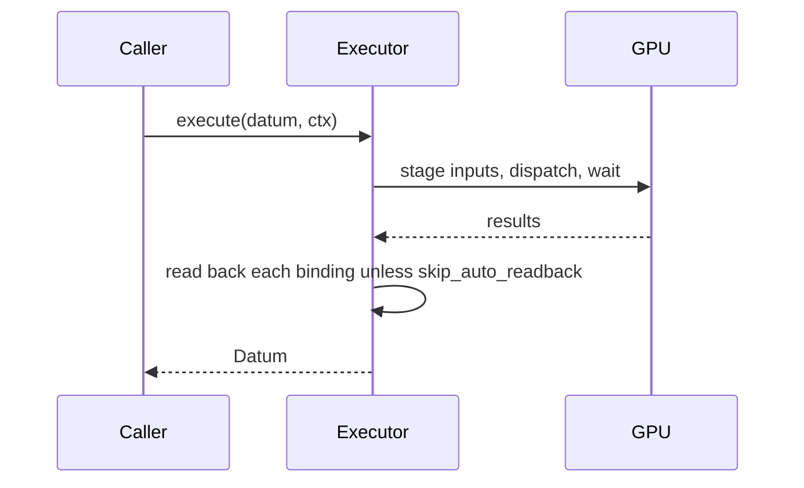

The asynchronous form returns before the work finishes and the caller polls:

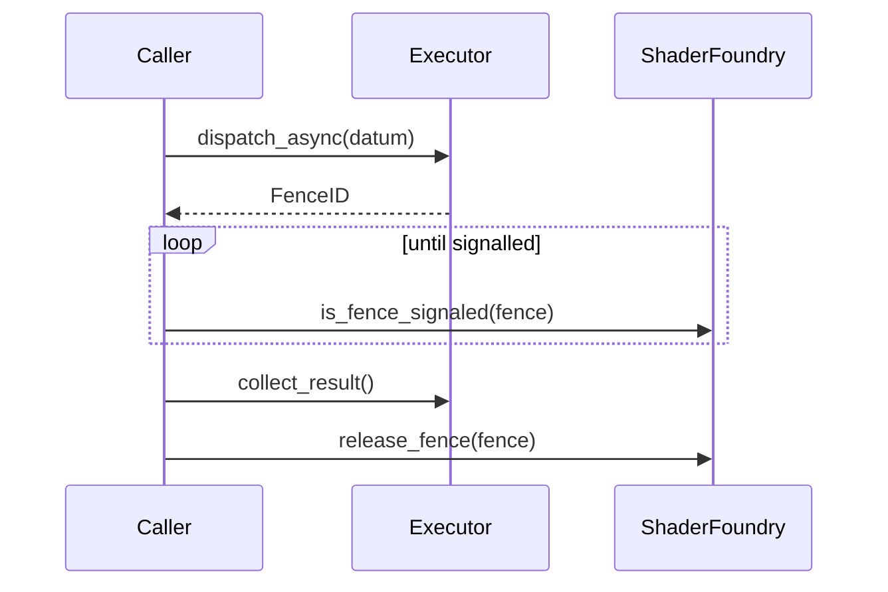


### TextureExecutionContext

Executor for shaders operating on `VkImage`. Does not use the double-channel extraction path. Binding 0 is always the output storage image (`IMAGE_STORAGE`); the input sampled image lands at `image_binding` (default 1). Additional SSBOs may be declared via `aux_bindings`. Texture contexts dispatch on the graphics queue, since image transitions do not yet run on the compute queue.

```cpp
TextureExecutionContext ctx(
    GpuComputeConfig { "warp.comp", { 16, 16, 1 }, sizeof(WarpPC) },
    Portal::Graphics::ImageFormat::RGBA8,
    TextureExecutionContext::OutputMode::CONTAINER,
    /*image_binding=*/1,
    /*aux_bindings=*/{ /* additional GpuBufferBindings */ });
```

Output modes:

| Mode | Description |
|---|---|
| `CONTAINER` | Downloads result into `TextureContainer`. Retrieved via `execute()` or `collect_container_result()`. |
| `SCALAR` | SSBO readback only; no image download. Retrieved via `collect_result()`. |
| `IMAGE` | Transitions output image to shader-read layout only; zero readback cost. Retrieved via `get_output_image(0)`. |

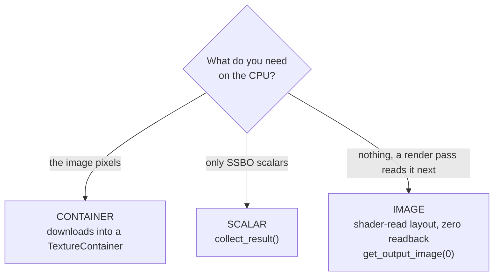


Staging input:
```cpp
// From a TextureContainer, explicit layer:
ctx.stage_container(my_container, /*layer=*/0);

// From a raw VKImage (render-pass output, camera frame):
ctx.stage_image(vk_image, sampler);  // must be in eShaderReadOnlyOptimal

// Via Datum::container field; context resolves on dispatch:
DataIO input;
input.container = texture_container;
ctx.set_input_layer(frame_index);
auto result = ctx.execute(input, ExecutionContext{});
```

Async path:
```cpp
auto fence = ctx.dispatch_async(input);
while (!Portal::Graphics::ShaderFoundry::is_fence_signaled(fence)) {}
auto result = ctx.collect_container_result();  // CONTAINER mode
auto raw    = ctx.collect_result();             // SCALAR mode
```

---

## Doubles without fp64 on the device

MayaFlux computes in doubles on the CPU. The GPU path does not need `shaderFloat64`, so a double is carried to the device as two 32-bit words, and the shader does the arithmetic on those words.

`WordPairExecutionContext` is a `ShaderExecutionContext` whose numeric input is staged as one `VEC2_U32` element per double, low word first. Its constructor takes the config, the binding list, and a flag that selects what is staged:

```cpp
auto exec = std::make_shared<WordPairExecutionContext>(
    GpuComputeConfig { "sort_pass.comp", { 256, 1, 1 }, sizeof(PC) },
    bindings,
    /*order_key=*/true);
```

- `order_key = true` stages each double's **order key**, a 64-bit word whose unsigned order is the numeric order. A shader can compare keys with integer operations and get exact double ordering.
- `order_key = false` stages the IEEE 754 bits unchanged, for arithmetic shaders that decode them.

The primary output of a dispatch is kept as raw words, and in IEEE mode it is also decoded to doubles.

Arithmetic on word pairs is exactly rounded: addition, multiplication, division and square root (`WordPairMap` with `WordPairOp`) return the IEEE 754 binary64 result rounded to nearest even. `WordPairOp::ToFloat32` converts a result to a float32 buffer, so a double-precision stage can feed a float32 consumer, such as a network, on the device with no host copy.

Two rules follow from this:

- `ShaderSpec` cannot declare a double. `ShaderFoundry::load_shader` rejects any spec with a `FLOAT64` or `VEC*_F64` binding or push constant, returning `INVALID_SHADER` rather than emitting a float shader. Double-precision work uses the word-pair path.
- The library's exact kernels are written as SPIR-V assembly emitted from `ShaderSpec`, not GLSL, and the word pair is the only double path. The float32 kernels that run neural networks (see [Speech and model operations](#speech-and-model-operations)) are the one exception, shipped as `.comp` files in `data/shaders`.

---

## Declarative Shaders (ShaderSpec)

`Portal::Graphics::ShaderSpec` is a code-first alternative to hand-written `.comp` files. `ShaderFoundry::load_shader(const ShaderSpec&)` emits SPIR-V assembly directly via `VKShaderModule::emit_spirv_asm()`, no GLSL or shaderc toolchain involved.

```cpp
auto spec = Portal::Graphics::ShaderSpec::Assemble{}
    .ssbo("sig", BindingDirection::InOut, Kakshya::GpuDataFormat::FLOAT32)
    .pc("gain")
    .pc("offset")
    .op(KernelOp::ScaleOffset)
    .build();
```

`BindingSlot` declares one SSBO or image binding:

```cpp
struct BindingSlot {
    std::string name;
    BindingDirection direction;
    Kakshya::GpuDataFormat format;
    Kakshya::DataModality modality { Kakshya::DataModality::SCALAR_F32 };
    uint32_t set { 0 };
    uint32_t binding_index { 0 };
};
```

`KernelTemplate` selects the shader body shape:

- `Elementwise` - one thread per element.
- `Reduction` - shared-memory tree reduction to a scalar.
- `Stencil` - neighbourhood reads with a radius in push constants.
- `GeometryEmit` - writes into a vertex SSBO with an atomic counter.
- `BitonicSort` - bitonic sort network, one thread per element.
- `Convolve2D` - 2D convolution, kernel weights in an SSBO.
- `Scan` - inclusive prefix scan, double-buffered.
- `SegmentedReduction` - one workgroup per segment over word-pair doubles. Input and output are `VEC2_U32`, with push constants for length, stride and offset. The combine is `Sum`, `Max` or `Min`, applied after a `ReductionMap` (`Identity`, `Abs`, `Square`).
- `FFT` - radix-2 transform of word-pair doubles, one workgroup per window, up to 2048 points. The output is complex bins, power bins, or a projection onto weight rows (`SpectrumOutput`).
- `LaggedPair` - for every lag in a range, the sum over a window of a pairwise map of `x[i]` and `x[i + lag]` (`Product`, `SignChange`, `AbsDifference`, optionally mean-centred), as word-pair doubles. This is the autocorrelation pass.
- `WordPairMap` - one IEEE double operation per element on word-pair doubles: `Add`, `Mul`, `Div`, `Sqrt`, or `ToFloat32`, each rounded to nearest even.
- `SegmentedArgMax` - the first maximum of each segment of word-pair doubles and its index, one workgroup per segment.

`KernelOp` selects a named operation the emitter lowers to SPIR-V opcodes deterministically:

- Arithmetic: `Scale`, `ScaleOffset`, `Fma`, `Offset`, `Clip`, `Abs`, `Negate`, `Floor`, `Ceil`, `Round`, `Trunc`, `Fract`, `Sqrt`, `InverseSqrt`.
- Transcendental: `Sin`, `Cos`, `Tan`, `Asin`, `Acos`, `Atan`, `Sinh`, `Cosh`, `Tanh`, `Exp`, `Exp2`, `Log`, `Log2`.
- Two-SSBO: `Add`, `Multiply`, `Mix`, `Sub`, `Pow`, `Atan2`, `Min`, `MaxTwo`, `Step`, `SmoothStep`.
- Reduction: `Sum`, `Max`, `ScanSum` (inclusive prefix sum), `MaxIndex` (maximum and its index).
- Index: `IndexScale` (`out[i] = float(i) * a[i]`, the only op that uses the invocation index as an operand).
- Image body: `CompareGE`, `CompareGEPreserve`, `ChannelDot`, `ChannelReplicate`.
- Stencil: `WeightedBlend` (float formats only).

For a custom kernel body not covered by `KernelOp`, `MF_KERNEL` stringifies a lambda at the call site and parses it into parameter names and a body. Parameter names must match the binding and push constant field names declared on the enclosing `ShaderSpec`, in declaration order. The lambda is never evaluated, only its text.

```cpp
.kernel(MF_KERNEL([](float* sig, float gain, uint32_t i) {
    sig[i] *= gain;
}))
```

### Bridging ShaderSpec to Yantra executors

`ShaderSpecBinding.hpp` adapts `ShaderSpec` output to the `GpuBufferBinding` vocabulary used by `GpuResourceManager` and any `GpuExecutionContext` subclass:

```cpp
auto bindings = bindings_from_spec(spec);   // std::vector<GpuBufferBinding>
```

Directions and element types follow the spec's `BindingDirection` and `GpuDataFormat`.

Use `bindings_from_spec` alongside a `GpuComputeConfig` derived from the compiled `ShaderSpec` to configure any concrete executor without depending on a specific executor type or writing GLSL.

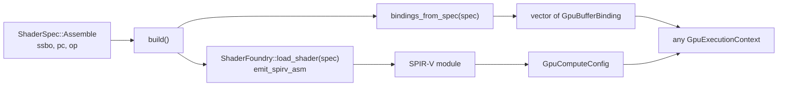


## Operation Layer

Operations own computational identity, typed configuration, and the implementation for each target they run on. Executors are infrastructure that operations delegate to.

### ComputeOperation\<InputType, OutputType\>

Base template. Subclass for fully custom operations.

```cpp
template <ComputeData Input, ComputeData Output>
class ComputeOperation {
protected:
    virtual output_type operation_function(const input_type& input) = 0;
    virtual output_type apply_operation_internal(const input_type& input, const ExecutionContext& context);

public:
    output_type apply_operation(const input_type& input);

    void set_pre_execution_hook(const OperationHookCallback&);
    void set_post_execution_hook(const OperationHookCallback&);

    void set_config(Config config);
    const Config& config() const;
};
```

`apply_operation` routes on `ExecutionContext::mode` inside `apply_operation_internal`. `ASYNC` waits on `apply_operation_async`, `PARALLEL` and `CHAINED` go to their own paths, and `SYNC` and `DEPENDENCY` run `apply_hooks`, which calls `operation_function` between the pre- and post-execution hooks. A GPU class overrides `apply_operation_internal` and dispatches through its executor instead, so its hooks run only if it calls them.

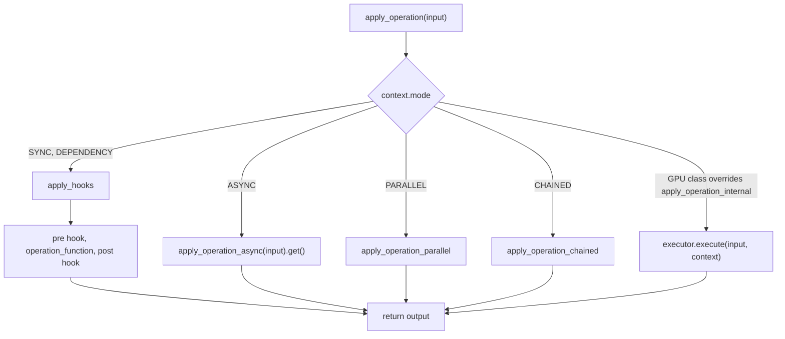

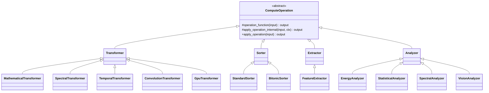


### Family types

Each family base has one override point for its CPU path:

| Type | Override |
|---|---|
| `Transformer<In, Out>` | `transform_implementation()` |
| `Sorter<In, Out>` | `sort_implementation()` |
| `Extractor<In, Out>` | `extract_implementation()` |
| `Analyzer<In, Out>` | `analyze_implementation()` |

Built-in CPU transformers: `MathematicalTransformer`, `SpectralTransformer`, `TemporalTransformer`, `ConvolutionTransformer`, and `TensorConverter` for tensor element types. Built-in CPU analyzers: `EnergyAnalyzer`, `StatisticalAnalyzer`. Built-in extractor: `FeatureExtractor`. Built-in sorter: `StandardSorter`.

A CPU operation is configured through its config struct:

```cpp
MathematicalTransformerConfig cfg;
cfg.gain_factor = 2.0;
auto gain = std::make_shared<MathematicalTransformer<>>(cfg);
```

---

## GPU operations in the library

GPU work is a class on a GPU target, not a flag on a CPU class. These are the ones in the tree:

| Class | Target | What it does |
|---|---|---|
| `BitonicSorter` | `targets::vulkan` | Exact GPU sort of numeric channels. Orders by order key, so it matches a stable CPU sort, with `-0.0 == +0.0` and NaN last (first when descending). Declines custom comparators, which are host code. Registered beside `StandardSorter`. |
| `SpectralAnalyzer` | `targets::vulkan` | Windowed spectral descriptors per window: `TOTAL_POWER`, `CENTROID`, `FLUX`. Tapers, transforms and reduces on the device, so only a few doubles per window return. Window size is a power of two from 2 to 2048. `record` leaves the descriptors on the device for a following stage. |
| `WaveformAnalyzer` | `targets::vulkan` | Time-domain descriptors per window, exact in double: level, crossing rate, peak, DC offset, crest factor, and the strength, period and frequency of the best repetition lag in a searched range. It measures the waveform and claims nothing about what the sound is. Can keep the full autocorrelation rows as a tensor. |
| `IntervalExtractor` | `targets::vulkan` | Where a score sequence stays engaged: hysteresis thresholds, minimum run and gap, padding, a maximum run, and a gate column, with each column's settings of its own. Gives half-open sample intervals. It is stateful, so successive calls continue one stream, and `submit`, `ready` and `collect` run it without blocking. |
| `WindowedKernelAnalyzer` | `targets::vulkan` | Runs your own kernel once per window of one to four float sequences, either as a GLSL body or a whole `.comp`, optionally with a workgroup of lanes per window. Float32. Not registered by default. |
| `FftContext` | (executor) | Batched exact FFT of doubles, one dispatch of the `FFT` template. Outputs complex bins, power bins, or a projection. An inverse context scales by one over the point count. |
| `SegmentedReductionContext` | (executor) | One workgroup per segment, over word-pair doubles, with `Sum`, `Max` or `Min`. |
| `SegmentedArgMax` | (executor) | The first maximum of each segment and its index, over word-pair doubles. |
| `GpuTransformer` | `targets::vulkan` | GPU-only transformer. It dispatches through its own executor by overriding `apply_operation_internal`, has no CPU path, and errors if the executor is not ready. It is not registered by default. |

`BitonicSorter` is what the granular workflow's GPU sort uses. `RegionKeySorter::gpu_order` builds a `BitonicSorter` and runs it whenever a `gpu_sort_threshold` is set and the grain count reaches it.

The spectral analyzer's output is a plain `Datum` of descriptors, so grammar rules can choose it by fitness exactly as they choose a CPU analyzer.

---

## Speech and model operations

Some operations run a trained network. A network is a set of weights read as a `Kakshya::TensorSet` and a graph that the library runs with its own float32 Vulkan kernels (convolution, normalisation, attention, LSTM, softmax and others, in `Yantra/Executors/TensorKernels`). There is no external runtime. The weights are not part of the library: they arrive with a Weave project, and `IOManager::load_tensors` reads them. The operations below take the weights in their constructor, are not in the default registry because they need them, and refuse weights of the wrong shape with the reason.

| Class | What it does |
|---|---|
| `VadAnalyzer` | Silero voice activity: one speech probability per 512 samples of 16 kHz audio. A stream, so state carries between calls; `reset()` starts a new recording and `flush_tail` includes the last partial chunk. |
| `PhonemeAnalyzer` | A HuBERT network with an English phoneme head: a distribution over 39 phonemes per 20 ms frame, with the recognised phonemes as events. One call takes an utterance of up to 30 s. |
| `SpeechSegmenter` | The speech intervals of a whole recording, from `VadAnalyzer` and `IntervalExtractor`. With `SpeechSettings::measure` it also gives each interval's voiced fraction and median pitch. |
| `PhonemeExtractor` | The phonemes of a whole recording: finds speech, then runs the phoneme network on each speech interval. Outputs records (`CompositeArray`), regions (`RegionGroup`) or the audio of the selected phonemes. |

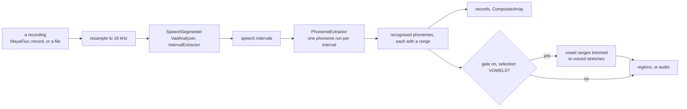

The networks run at 16 kHz and refuse other rates. Convert first with `Kinesis::Discrete::resample`, or `Resampler` for a stream.

```cpp
auto weights = get_io_manager()->load_tensors("data/tensors/silero/silero_vad_16k.safetensors");

SpeechSegmenterConfig config;
config.speech.padding = 160;
AudioSpeechSegmenter voices(*weights, config);

auto speech = voices.extract_data(samples_at_16k);
```

`SpeechSettings` holds the thresholds, minimum run and silence, padding and maximum run of the speech scan, all in samples. Padding, threshold and `min_silence` are what tighten or loosen the edges.

`PhonemeExtractor` selects with `config.method` (`ALL`, `VOWELS` or `CONSONANTS`). Phoneme ranges are estimates: the network emits a phoneme on one frame, so a range runs from one recognised phoneme to the next. The boundary between two phonemes was measured against forced alignments at a median error of about 12 ms, and the range of a phoneme the network missed is absorbed by its neighbours. `config.gate` trims vowel ranges to the stretches where the waveform is periodic, which drops bursts and hiss that the boundaries let in. It is off by default, applies to the audio and region outputs, and does not remove voiced consonants such as m or n.

```cpp
PhonemeExtractorConfig config;
config.method = PhonemeSelection::VOWELS;
config.gate.enabled = true;

AudioPhonemeExtractor vowels(*vad_weights, *phoneme_weights, config);
auto audio = vowels.extract_data(samples_at_16k);
```

Both extractors block until the result is ready and must not run on the audio thread. To record the input first, see `MayaFlux::record` in `API/Rigs.hpp`: it captures a live input channel into a `DynamicSoundStream` for a set time.

To keep a result on the device instead, `VadAnalyzer::record` leaves the probabilities in a device buffer, and an `IntervalExtractor` on the same recording reads them with `bind_scores` and `submit_resident`, so no probability returns to the host.

---

## Audio on the GPU under AUDIO_PARALLEL

Child `AudioBuffer`s under the `AUDIO_PARALLEL` unit are mixed by that unit, which publishes its root to the audio callback. Two buffer processors put a GPU step into a child's processing. Both are default processors of a child buffer, installed with `set_default_processor`.

**`AudioComputeProcessor`** runs a compute shader over one audio block, synchronously, on the graphics thread's processing cycle.

- The child's samples go to an owned host-visible storage buffer, bound as `block` at set 0, binding 0. The shader is dispatched and the result is read back into the child.
- The dispatch size comes from the block's frame count, not its byte size.
- `native_f64` selects the sample format the shader reads. `true` requires `shaderFloat64` on the device. `false` reads the samples as `uvec2` word pairs, which works everywhere.
- The shader is validated and prewarmed on attach. A dispatch that does not run leaves the child cleared, so a failure is silence, not stale audio.

```cpp
auto proc = std::make_shared<AudioComputeProcessor>("shaders/gain.comp", /*native_f64=*/false);
child->set_default_processor(proc);
```

**`AudioContextProcessor`** is the non-blocking form. It runs a `WordPairExecutionContext` over the child without waiting for the GPU.

- Each call stages the child's samples into one of `depth` contexts and dispatches asynchronously. The child receives the result of the call made `depth` calls earlier, so output lags input by `depth` blocks and nothing waits on the device.
- A call whose result is not yet complete yields a silent child. The late result is discarded, and an earlier block is never replayed.
- Contexts come from a factory, so every in-flight job owns its buffers. The default staging writes the samples to binding 0 as word pairs and reads the primary output back at the same size. A stage function replaces it when the shader takes other inputs.
- `missed()` counts calls whose output was silent although a result was due. A run of misses is logged once, when it starts.

```cpp
auto proc = std::make_shared<AudioContextProcessor>(
    []() { return std::make_shared<WordPairExecutionContext>(cfg, bindings, /*order_key=*/false); },
    /*depth=*/2);
child->set_default_processor(proc);
```

The root that `AUDIO_PARALLEL` publishes to the output is a triple buffer. The graphics thread writes the next block while the audio callback reads the last complete one, so the callback never sees a block that is zeroed or half-summed.

---

## Orchestration Layer


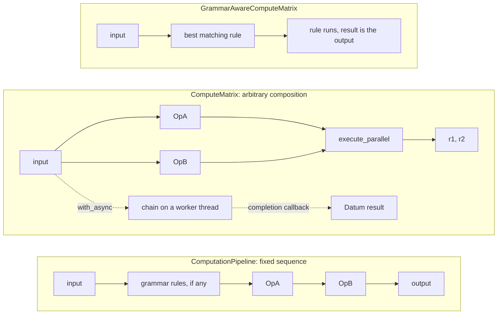

### ComputeMatrix

Instance-local execution engine. Create via `ComputeMatrix::create()` (returns `shared_ptr`).

**Add and retrieve operations:**
```cpp
auto matrix = ComputeMatrix::create();
matrix->add_operation("filter", my_op);
auto op = matrix->get_operation<MyOp>("filter");
auto op = matrix->create_operation<MyOp>("name", ctor_args...);
```

**Direct execution:**
```cpp
auto result   = matrix->execute<MyOp>(input);
auto future   = matrix->execute_async<MyOp>(input);
auto results  = matrix->execute_batch<MyOp>(inputs);
auto [r1, r2] = matrix->execute_parallel<InputType, OpA, OpB>(input);
```

**Two-op type-safe chain:**
```cpp
auto result = matrix->execute_chain<OpA, OpB, InputT, MidT, OutputT>(input);
auto result = matrix->execute_chain_named<OpA, OpB, In, Mid, Out>("name_a", "name_b", input);
```

**Fluent chain (synchronous):**
```cpp
auto result = matrix->with(start_data)
                     .then<OpA>("name_a")
                     .then<OpB>()
                     .to_io();
```

**Fluent chain (asynchronous):**

The matrix owns the `std::future` internally. The chain lambda runs on a background thread. `drain_async()` and the destructor guarantee completion before destruction. Retained futures are tracked by `Parallel::AsyncGroup`, which keeps exceptions instead of dropping them: `get_last_error()` reports a chain failure.

```cpp
matrix->with_async(
    input_datum,
    [](auto chain) {
        return chain.then<OpA>("name_a")
                    .then<OpB>("name_b")
                    .to_io();
    },
    [&](Datum<Result> result) {
        // called on worker thread
        my_result = std::move(result);
    });
```

`GrammarAwareComputeMatrix` is a `ComputeMatrix` subclass that carries a `ComputationGrammar`. Retrieve it with `get_grammar()`, replace it with `set_grammar()`, or add a rule with `add_grammar_rule()` / `create_grammar_rule()`.

### ComputationPipeline\<InputType, OutputType\>

Sequential engine. Grammar rules (if any) are evaluated before the named operation chain runs.

```cpp
auto pipeline = std::make_shared<ComputationPipeline<>>();

pipeline->create_operation<MathematicalTransformer<>>("gain", gain_cfg)
         .create_operation<SpectralTransformer<>>("spectrum");

auto result = pipeline->process(input, ExecutionContext{});
```

Settings are passed when an operation is created. To change one afterwards, use `configure_operation<Op>(name, configurator)`, which hands the operation to the callback as its concrete type.

### ComputationGrammar

A grammar resolves an ordered **signature** to one rule per stage. A signature is a sequence of enum selections, usually the operation enums joined with `|`:

```cpp
auto grammar = ComputationGrammar::assemble(
    MathematicalOperation::GAIN | TemporalOperation::TIME_REVERSE | MathematicalOperation::GAIN,
    { quiet, TemporalTransformerConfig {}, loud });

auto out = grammar->process(input);
```

`assemble` takes the configs positionally, one per stage. Overloads take an explicit `OperationRegistry`; the ones without one use `make_default_registry()`. The registry catalogs which operation implements each selection, and for a selection with several candidates the grammar picks by target, permit and fitness.

To build rules by hand, use `ComputationGrammar::Builder`. This is how the granular workflow builds its grammar:

```cpp
auto builder = ComputationGrammar::Builder(std::make_shared<const OperationRegistry>());
builder.rule(GranularStage::Segment).priority(100).uses(segment_op)
       .rule(GranularStage::Attribute).priority(75).uses(attribute_op)
       .rule(GranularStage::Sort).priority(50).uses(sort_op);
auto grammar = builder.build();
```

Builder methods: `rule(signature[, OperationConfig])`, `when(matcher)`, `on(target)`, `priority(n)`, `switch_margin(m)`, `uses(op)`, `build()`.

`process<Out>(input, signature, ctx)` resolves a signature directly and returns the final output as `Datum<Out>`:

```cpp
auto regions = grammar->process<Kakshya::RegionGroup>(input, signature);
```

Rules can also be named and added one at a time:

```cpp
grammar->create_rule("gain_only")
    .matches(MathematicalOperation::GAIN)
    .uses(gain_op)
    .with_priority(80)
    .with_description("Gain for every double channel")
    .matches_type<std::vector<double>>()
    .build();
```

Rule-level queries and removal:

```cpp
auto best   = grammar->find_best_match(input_any, ctx);           // -> std::optional<Rule>
auto result = grammar->execute_rule("gain_only", input_any, ctx); // -> std::optional<std::any>
bool exists = grammar->has_rule("gain_only");
grammar->remove_rule("gain_only");
```

`execute_with_grammar` on a `GrammarAwareComputeMatrix` runs only the single best matching rule and returns its result. `set_switch_margin` and `reset_choices` control the remembered per-stage choices described in [Targets, permits and fitness](#targets-permits-and-fitness).

---

## Workflows

Workflows are complete pipelines built on `ComputeMatrix` + `ComputationGrammar`. They are not the only way to use Yantra; they are the reference pattern for how to compose the layers into a self-contained processing unit.

### GranularWorkflow

Offline granular analysis and reconstruction. The pipeline is: segment grains from a `SignalSourceContainer` into a `RegionGroup`, attribute each grain with a scalar feature, sort by that feature, then optionally reconstruct into a `SoundFileContainer` or `DynamicSoundStream`. The stages are typed members of `GranularMatrix`, and its grammar holds them under the `GranularStage` selections `Segment`, `Attribute`, `Sort` and `Reconstruct`.

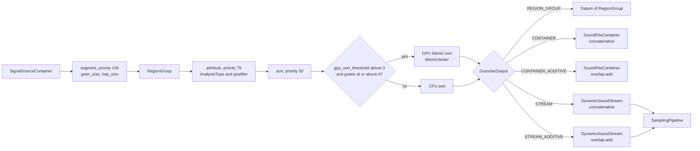

The reconstruct stage, at priority 25, is added for every output other than `REGION_GROUP`.

**Config:**
```cpp
GranularConfig config;
config.grain_size         = 1024;
config.hop_size           = 512;
config.channel            = 0;
config.ascending          = true;
config.gpu_sort_threshold = 65536;  // 0 = always CPU
config.taper              = {};     // optional per-grain taper for the additive outputs
```

**Attribution.** The attribute stage takes one of three forms, each with `make_granular_context`:

```cpp
// Built-in AnalysisType and a qualifier naming the scalar to take:
auto ctx = make_granular_context(config, AnalysisType::FEATURE, /*qualifier=*/0);

// Pre-configured analyzer instance:
auto analyzer = std::make_shared<EnergyAnalyzer<>>();
auto ctx = make_granular_context(config, analyzer, /*qualifier=*/0);

// Custom span-level lambda:
AttributeExecutor my_attr = [](std::span<const double> samples, const ExecutionContext&) {
    return *std::max_element(samples.begin(), samples.end());
};
auto ctx = make_granular_context(config, std::move(my_attr));
```

The qualifier is a `Qualifier` (a `uint8_t`) that selects the scalar within an analysis type. It is not a string.

**Output modes:**

| `GranularOutput` | Terminal type |
|---|---|
| `REGION_GROUP` | `Datum<RegionGroup>` - sorted grain regions, no reconstruction. |
| `CONTAINER` | `SoundFileContainer` - concatenative stitch. |
| `CONTAINER_ADDITIVE` | `SoundFileContainer` - overlap-add reconstruction. |
| `STREAM` | `DynamicSoundStream` - concatenative, ready for `SamplingPipeline`. |
| `STREAM_ADDITIVE` | `DynamicSoundStream` - overlap-add. |

**Synchronous:**
```cpp
// Terminates in RegionGroup (segment + attribute + sort only):
GranularDatum grains = process(container, AnalysisType::FEATURE, config, /*qualifier=*/0);

// Terminates in SoundFileContainer:
auto result = process_to_container(container, AnalysisType::FEATURE, config, /*qualifier=*/0,
                                   GranularOutput::CONTAINER);

// Terminates in DynamicSoundStream, with a custom attribute:
auto stream = process_to_stream(container, my_attr_lambda, config,
                                GranularOutput::STREAM_ADDITIVE);
```

**Asynchronous:**
```cpp
auto matrix = std::make_shared<GranularMatrix>(GranularOutput::STREAM, config.taper);

process_to_stream_async(
    matrix, container,
    AnalysisType::FEATURE,
    [&](std::shared_ptr<DynamicSoundStream> stream) {
        // called on worker thread; install stream into SamplingPipeline here
        my_sampler = create_sampler_from_stream(stream, 0);
    },
    config, /*qualifier=*/0,
    GranularOutput::STREAM);
```

The matrix owns the async future. Keep it alive until `drain_async()` or destruction.

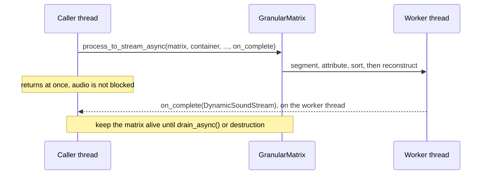

**Using the stages directly.** A `GranularMatrix` exposes its typed stages, so the grammar can be extended or the stages reused:

```cpp
auto matrix = std::make_shared<GranularMatrix>(GranularOutput::CONTAINER_ADDITIVE, my_taper);
auto segment = matrix->segment();   // SegmentOp
auto sort    = matrix->sort();      // RegionKeySorter
```

Rules added to the grammar by name still override a stage through `execute_with_grammar()`.

---

## Writing a Compute Shader for Yantra

SSBO shaders: `set = 0` for all compute bindings. Small per-dispatch scalars go in push constants.

```glsl
#version 450
layout(local_size_x = 256) in;

layout(set = 0, binding = 0) readonly  buffer InBuf  { float data[]; } in_buf;
layout(set = 0, binding = 1) writeonly buffer OutBuf { float data[]; } out_buf;

layout(push_constant) uniform PC {
    uint  n_elements;
    float scale;
} pc;

void main() {
    uint idx = gl_GlobalInvocationID.x;
    if (idx >= pc.n_elements) return;
    out_buf.data[idx] = in_buf.data[idx] * pc.scale;
}
```

Image shaders consumed by `TextureExecutionContext`: binding 0 is the output storage image, binding 1 (or `image_binding`) is the input sampled image.

```glsl
#version 450
layout(local_size_x = 16, local_size_y = 16) in;

layout(set = 0, binding = 0, rgba8) uniform writeonly image2D out_image;
layout(set = 0, binding = 1)        uniform sampler2D  in_image;

layout(push_constant) uniform PC { float strength; } pc;

void main() {
    ivec2 coord = ivec2(gl_GlobalInvocationID.xy);
    vec4  src   = texelFetch(in_image, coord, 0);
    imageStore(out_image, coord, src * pc.strength);
}
```

---

## Decision Reference

**Which executor?**

| Data | Executor |
|---|---|
| `float`/`int` SSBOs, or `glm::vec*` via `PASSTHROUGH` | `ShaderExecutionContext` |
| Doubles, exactly, on a device without `shaderFloat64` | `WordPairExecutionContext`, or a `FFT` / `SegmentedReduction` template |
| `VkImage` (sampled or storage) | `TextureExecutionContext` |
| Custom AoS/SoA buffer layout | Subclass `GpuExecutionContext`; override `extract_inputs()` and `collect_gpu_outputs()`. |
| 2D/3D dispatch grid | Override `calculate_dispatch_size()` in the subclass. |

**Which operation?**

| Situation | Type |
|---|---|
| CPU implementation | Subclass the family base and override its `*_implementation()`. |
| GPU implementation of an algorithm that also has a CPU one | A separate class on `targets::vulkan`, next to the CPU class. The grammar chooses by target and fitness. |
| GPU-only; no CPU path | `GpuTransformer` (its executor is the only path). |
| Multiple passes over the same dispatch (bitonic sort, iterative refinement) | Any operation + `set_multipass(count, updater)` on the executor. |

**Which orchestrator?**

| Situation | Orchestrator |
|---|---|
| Linear fixed sequence | `ComputationPipeline` |
| Branching, parallelism, fluent chaining, async | `ComputeMatrix` |
| Dynamic operation selection on data properties | `GrammarAwareComputeMatrix` + `ComputationGrammar` |
| Single shader; no operation abstraction needed | `exec->execute(datum, ctx)` directly |
| Self-contained domain pipeline (the granular pattern) | `GranularMatrix`, with typed stages and free functions as entry points |

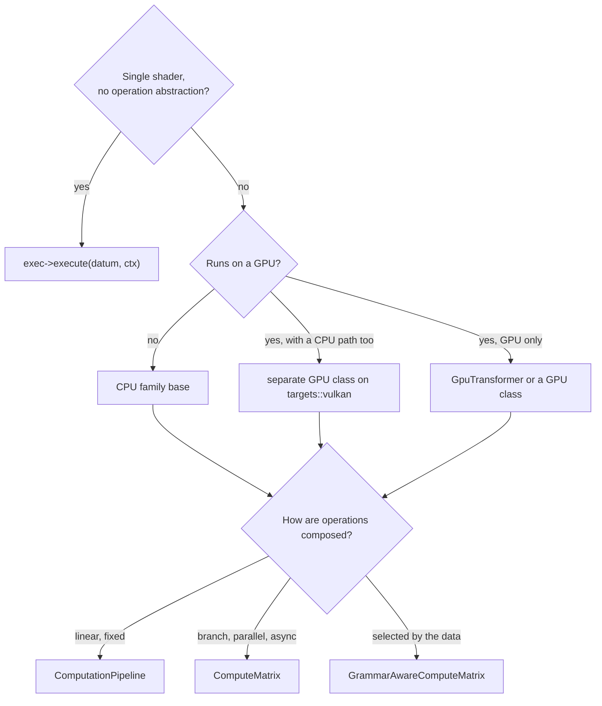

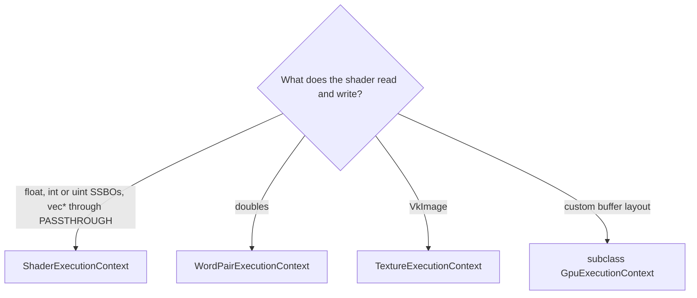

**When to subclass vs. configure:**

Subclass `GpuExecutionContext` only for custom data extraction or reconstruction. Subclass `GpuDispatchCore` only for custom dispatch sizing or staging not covered by the fluent API. Everything else is configuration.
