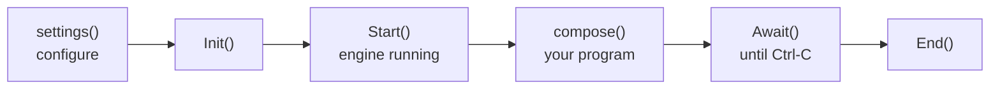

# MayaFlux: Getting Started

MayaFlux is a C++20/23 framework for real-time computation across sound, geometry, image, and network. All data is the same numerical substrate; the domain annotation decides where a buffer cycle goes, not what the data is.

This guide covers environment setup and the structure of a MayaFlux program. Tutorials that build on this foundation are at [mayaflux.org/tutorials](https://mayaflux.org/tutorials).

---

## Weave: Recommended for Most Users

**Weave** is the installer and project tool for MayaFlux. Download it from the [Weave releases page](https://github.com/MayaFlux/Weave/releases).

### Installing MayaFlux

Launch Weave and choose **Install MayaFlux**. Weave downloads the framework, installs all required dependencies, and configures your environment. Restart your terminal when it finishes.

### Creating a Project

Launch Weave and choose **Create Project**. Enter a name and pick a destination. Weave generates a ready-to-build project:

```
MyProject/
├── CMakeLists.txt
├── CMakePresets.json
├── community.cmake
├── cmake/
│   ├── mayaflux.cmake
│   ├── shaders.cmake
│   └── build_community.cmake
├── src/
│   ├── main.cpp
│   └── user_project.hpp
├── data/
│   └── shaders/
└── .gitignore
```

`src/user_project.hpp` is where you write your code. `CMakeLists.txt` is yours to edit; the MayaFlux integration lives in `cmake/mayaflux.cmake` and is included automatically.

`CMakePresets.json` ships with every project and defines `debug` and `release` presets. CLion, VS Code with the CMake extension, and Visual Studio all pick up the presets automatically when you open the project folder.

```bash
cmake --preset release
cmake --build --preset release
./build/MyProject
```

On Windows the binary lands in `build\MyProject.exe`.

### Live Coding (Lila)

Check **Enable Live Coding (Lila)** in the project creation dialog to embed the Lila JIT compiler in your process. Connect [LilaCode](https://github.com/MayaFlux/LilaCode) (VS Code) or [lila.nvim](https://github.com/MayaFlux/lila.nvim) (Neovim) to evaluate C++ against your running application in real time.

### Community Modules

Community modules are C++ source libraries that compile directly into your project with no plugin boundary. In Weave, open your project and choose **Add Community Module**. Weave fetches the [community registry](https://github.com/MayaFlux/community-sources-registry), checks version compatibility, clones the module into `community/<name>/`, and registers it in `community.cmake`. Rebuild after adding modules.

After Weave completes setup, jump to [Program Structure](#program-structure).

---

## Building MayaFlux Itself From Source

Weave is the supported path for using MayaFlux; it downloads a prebuilt framework and generates a project against it, no compiler toolchain or dependency management on your end.

Building the framework itself from source is a different, separate task, for contributors modifying the engine, not for writing programs against it. If that's what you're doing, see [`docs/Dev_Getting_Started.md`](Dev_Getting_Started.md) in the MayaFlux repository, which covers dependencies, setup scripts, build presets, and the in-tree run loop.

If you're not sure which you need: if you want to write music, visuals, or interactive pieces with MayaFlux, use Weave. If you want to change how MayaFlux itself works, build from source.

---

## Program Structure

A MayaFlux program has two entry points defined in `src/user_project.hpp`:

```cpp
#pragma once
#include "MayaFlux/MayaFlux.hpp"

void settings() {
    // Runs before the engine starts.
    // Configure audio, graphics, input, network and logging.
    auto& stream = MayaFlux::Config::get_global_stream_info();
    stream.sample_rate = 48000;
    stream.buffer_size = 256;
    stream.output.channels = 2;

    auto& gfx = MayaFlux::Config::get_global_graphics_config();
    gfx.target_frame_rate = 60;
    gfx.surface_info.image_count = 3;
}

void compose() {
    // Runs after the engine starts.
    // All computation, routing, scheduling, and rendering lives here.
}
```

`settings()` reaches every part of the engine, not only audio. The stream config sets the audio device, rate and buffer; the graphics config sets the frame rate and window surface; input, network and logging have their own. Leave `settings()` empty if the defaults suit you.

`main.cpp` calls `settings()`, `Init()`, `Start()`, `compose()`, `Await()`, and `End()` in order. If a config file is present it is loaded around `settings()`; see [Engine Configuration](Settings.md) for which one wins. You do not edit `main.cpp` unless you need custom engine configuration beyond what `settings()` exposes.



An exception thrown by `settings()` or by `compose()` is logged, and the engine carries on.

`MayaFlux.hpp` includes the common concrete types and namespace imports by default, so the examples can use names such as `Sine` without extra includes. To keep the global namespace clear and include only the types you use, define `MAYAFLUX_NO_CONVENIENCE` before including `MayaFlux.hpp`.

### The `vega` global

`vega` is the global `Creator` instance. It is the factory for all computation objects: generators, filters, networks, buffers, containers, mesh loaders, input nodes. Every object created through `vega` is registered with the engine automatically.

```cpp
auto sine   = vega.Sine(440.0, 0.5) | Audio[0];
auto modal  = vega.ModalNetwork(12, 220.0) | Audio[{0, 1}];
auto audio  = vega.read_audio("res/drum.wav") | Audio;
auto img    = vega.read_image("res/texture.png") | Graphics;
auto mesh   = vega.read_mesh_network("res/scene.glb");
```

The `| Audio` and `| Graphics` operators are domain annotations. They attach a processing token that decides which subsystem drives the object and at what rate. They do not change what the object is.

Two more calls take a whole configuration and do the entire job in one step, including attaching rendering to a window. `vega.mint` builds a visible structure from a config (an object, a model, instances, an assembly or an isosurface). `vega.evolve` sets a system going: state that persists and a rule that advances it every cycle, such as a cellular grid, a volume of flow, or a network of particles driven by GPU fields. Both return the real object and both need a `target_window`.

```cpp
auto form = vega.mint(StructureConfig::Object { .mesh = mesh, .render = { .target_window = window } });

auto swarm = vega.ParticleNetwork(50000, glm::vec3(-1.0F), glm::vec3(1.0F), distribution);
vega.evolve(swarm, { .absorb_radius = 0.05F },
    [](const auto& field) { field->bind(Nodes::Network::FieldTarget::POSITION, swirl); },
    { .target_window = window });
```

The program below uses both: `mint` builds the form from a field, and `evolve` sets the swarm going.

---

### A First Program

Before explaining how MayaFlux works, here is something made with it.

Most introductions begin with a hello world, or with a small example that isolates one idea. This one begins with something to play with. It is a complete piece, with sound, a moving form and a swarm, that you can run, disturb and change without understanding any of it. Play is a better way to learn than a single triangle on a screen: you try something, see or hear what moved, and the questions come from you instead of from the page.

Four voices emerge from different kinds of randomness and orbit through a shared space. Each owns a body of a different shape in a form carved on the GPU, and two hundred thousand particles stream toward the voices along its surface. Their activity is shared: the voices shape the form and the swarm, the form's changing size affects the voices, and the whole system develops its own irregular rhythms.

Nothing needs to be recorded, downloaded, or connected. No microphone or camera is required. When it starts it asks you to choose one image, which becomes the form's skin.

Copy the program into your Weave-created project, build it, and run it. Listen, watch, click to strike every voice, hold and drag to play them, and leave it running for a minute.

You do not need to understand the code yet. It is here to show you a direction, not to test your understanding.

This program is complete and runs as written, but it is deliberately not the shortest way to make this picture. It is built as a set of separate units: the voices, the scene they share, the form, the swarm, the camera, the Nexus wiring that gives each voice a place and a pulse, and the fields that tell the GPU what to draw. Each unit has one job and can be changed without touching the others. The fields near the end are the exception to easy reading: they are GLSL written as C++ lambdas, compiled once by the host and turned into a GPU shader function from the same text. Skip them at first and come back when you want to change how the form or the swarm look and move. Written by hand with every effect fused into one loop, it would be fewer lines, and it would also be a dead end: nothing in it could be extended. The extra length is the price of having this many places to change it, and a later tutorial takes each unit in turn and shows how to extend it.

<details>
<summary>The program (click to expand)</summary>

```cpp
#pragma once
#include "MayaFlux/MayaFlux.hpp"
#include "MayaFlux/SimulationIncludes.hpp"

namespace {

using Kind = Kinesis::Stochastic::Algorithm;

constexpr size_t count = 4;
constexpr uint32_t width = 1920;
constexpr uint32_t height = 1080;
constexpr std::array<Kind, count> kinds { Kind::UNIFORM, Kind::NORMAL, Kind::EXPONENTIAL, Kind::BROWNIAN };
constexpr std::array<double, count> pitch { 110.0, 1400.0, 3800.0, 240.0 };
constexpr std::array<double, count> decay { 1.0, 0.05, 0.01, 0.3 };
constexpr std::array<double, count> drift { 0.13, 0.07, 0.31, 0.05 };

struct Scene {
    std::array<double, count> energy {};
    std::array<double, count> burst {};
    std::array<double, count> pan {};
    std::array<double, count> lean {};
    glm::vec4 shape {};
    glm::vec2 hand {};
    bool gripping {};
    double surface {};
    double peak {};
    std::chrono::steady_clock::time_point start {};
    float clock {};
    float angle {};
};

struct Voices {
    std::array<std::shared_ptr<Nodes::Generator::Random>, count> noise;
    std::array<std::shared_ptr<Node>, count> follow;
};

glm::vec3 voice_at(float t, size_t v)
{
    const auto f = static_cast<float>(v);
    return { 1.1F * std::sin(0.5F * t + 1.7F * f), 0.5F * std::sin(0.65F * t + f), 0.8F * std::cos(0.4F * t + 1.3F * f) };
}

auto shaped(const std::shared_ptr<Node>& input, auto shape)
{
    auto node = vega.Polynomial(shape);
    node->set_input_node(input);
    return node;
}

Voices make_voices(const Scene& scene)
{
    namespace D = Kinesis::Discrete;

    const auto rate = static_cast<double>(Config::get_sample_rate());
    const uint32_t channels = std::max(1U, Config::get_global_stream_info().output.channels);

    std::vector<double> a1, b1;
    D::one_pole(0.9995, a1, b1);

    Voices voices;
    for (size_t v = 0; v < count; ++v) {
        std::vector<double> a, b;
        D::resonator(D::pole_radius_from_decay(decay[v], rate), 6.2832 * pitch[v] / rate, a, b);
        voices.noise[v] = vega.Random(kinds[v]);
        auto voice = vega.IIR(voices.noise[v], a, b);
        voice->set_gain(0.3 * std::sqrt(decay[v] * rate));

        auto room = vega.Sine(drift[v], 1.0);
        auto swell = (vega.Sine(drift[v], 1.0) >> vega.Polynomial([](double x) { return 0.5 + 0.5 * x; }))
            * shaped(room, [&scene, v](double) { return 0.4 + 0.6 * std::min(1.0, scene.lean[v]); });
        auto heard = voice * swell;

        (heard * shaped(room, [&scene, v](double) { return 0.5 + 0.5 * scene.pan[v]; })) | Audio[0];
        (heard * shaped(room, [&scene, v](double) { return 0.5 - 0.5 * scene.pan[v]; })) | Audio[1 % channels];

        voices.follow[v] = vega.IIR(shaped(heard, [](double x) { return std::abs(x); }), a1, b1);
        voices.follow[v] | Audio[0];
        voices.follow[v]->exclude_output_from_graph();
    }
    return voices;
}

void orbit_camera(const std::shared_ptr<Core::Window>& window, const Scene& scene)
{
    auto view = [&scene]() -> Kinesis::ViewTransform {
        return Kinesis::look_at_perspective(
            glm::vec3(6.5F * std::sin(scene.angle), 2.5F, 6.5F * std::cos(scene.angle)), glm::vec3(0.0F),
            0.9F, static_cast<float>(width) / static_cast<float>(height), 0.1F, 50.0F);
    };
    for (const auto& buffer : window->get_rendering_buffers()) {
        buffer->get_render_processor()->set_view_transform_source(view);
    }
}

void mutate(const Voices& voices, size_t v)
{
    voices.noise[v]->set_type(kinds[static_cast<size_t>(get_uniform_random(0.0, 3.999))]);
}

void evolve_voices(Scene& scene, const Voices& voices)
{
    auto& breath = make_persistent(vega.Sine(0.05, 1.0) | Audio[0]);
    breath->exclude_output_from_graph();

    schedule_pattern(
        [&](uint64_t) { return static_cast<size_t>(std::ranges::max_element(scene.energy) - scene.energy.begin()); },
        [&](size_t v) { mutate(voices, v); },
        [&](uint64_t) { return std::vector<double> { 3.0 + 2.0 * breath->get_last_output() }; },
        "mutate");

    schedule_pattern(
        [&](uint64_t) { return static_cast<size_t>(std::ranges::min_element(scene.energy) - scene.energy.begin()); },
        [&](size_t v) { scene.burst[v] = 1.0; },
        { 0.8, 1.3, 0.5, 2.1, 0.9 },
        "bursts");
}

void inhabit(Scene& scene, const Voices& voices, const std::shared_ptr<Core::Window>& window, const std::shared_ptr<Buffers::ComputeMeshBuffer>& form, const std::shared_ptr<Nodes::Network::ParticleNetwork>& swarm)
{
    using namespace Nodes::Network;

    scene.start = std::chrono::steady_clock::now();

    auto& fabric = make_persistent<Nexus::Fabric>(*get_scheduler(), *get_event_manager());
    auto& agents = make_persistent<std::array<std::shared_ptr<Nexus::Presence>, count>>();
    constexpr auto token = Vruta::ProcessingToken::FRAME_ACCURATE;

    for (size_t v = 0; v < count; ++v) {
        agents[v] = std::make_shared<Nexus::Presence>(
            1.5F,
            [](const Nexus::PerceptionContext&) { },
            [&scene, &voices, v](const Nexus::InfluenceContext& ctx) {
                scene.pan[v] = std::clamp(ctx.position.x / 1.1F + (scene.gripping ? 2.0F * scene.hand.x - 1.0F : 0.0F), -1.0F, 1.0F);
                scene.energy[v] = std::min(1.0, voices.follow[v]->get_last_output() * 10.0);
                scene.burst[v] *= 0.9;
                scene.lean[v] *= 0.6;
                if (scene.gripping) {
                    scene.lean[v] = std::max<double>(scene.lean[v], 1.0 - scene.hand.y);
                }
                const double lift = scene.burst[v] + scene.lean[v];
                voices.noise[v]->set_amplitude((1.0 + 2.0 * lift) * (0.6 + 0.8 * scene.surface));
            },
            [&scene, &agents, v](uint32_t id, float weight) {
                for (size_t n = 0; n < count; ++n) {
                    if (n != v && agents[n]->id() == id) {
                        scene.lean[n] += weight * scene.energy[v];
                    }
                }
            });
        agents[v]->set_falloff_radius(1.5F);
        agents[v]->set_falloff_curve(Nexus::Presence::FalloffCurve::Cosine);

        fabric.wire(agents[v])
            .every(1.0 / 24.0, token)
            .position_from([&scene, v] { return voice_at(scene.clock, v); })
            .finalise();
    }

    auto field = swarm->get_operator_chain()->find<GpuFieldOperator>();

    auto body = std::make_shared<Nexus::Emitter>(
        [&scene, form](const Nexus::InfluenceContext&) {
            const double live = form->get_live_vertex_count().value_or(0);
            scene.peak = std::max(scene.peak * 0.999, live);
            scene.surface += ((scene.peak > 0.0 ? live / scene.peak : 0.0) - scene.surface) * 0.1;
            scene.angle += 0.003F + 0.01F * static_cast<float>(std::accumulate(scene.energy.begin(), scene.energy.end(), 0.0) / count);
        });
    body->set_influence<glm::vec4>(
        [&scene](const Nexus::InfluenceContext&) { return scene.shape; },
        Nexus::bind_params(field));
    fabric.wire(body).every(1.0 / 24.0, token).finalise();

    auto striker = std::make_shared<Nexus::Emitter>([&scene](const Nexus::InfluenceContext&) {
        scene.burst.fill(3.0);
        scene.shape += glm::vec4(1.0F);
    });
    fabric.wire(striker).on(window, IO::MouseButtons::Left).finalise();

    auto hand = std::make_shared<Nexus::Emitter>([&scene](const Nexus::InfluenceContext& ctx) {
        if (ctx.cursor_pos) {
            scene.hand = *ctx.cursor_pos / glm::vec2(static_cast<float>(width), static_cast<float>(height));
        }
        scene.gripping = true;
    });
    fabric.wire(hand).on(window, IO::MouseButtons::Left, true, [&scene](double, double) { scene.gripping = false; }).finalise();

    auto voice_of = [&agents](uint32_t id) {
        return static_cast<size_t>(std::ranges::find_if(agents, [id](const auto& agent) { return agent->id() == id; }) - agents.begin());
    };
    fabric.add_expanse(std::make_shared<Nexus::Expanse>(
        [](const glm::vec3& p) { return glm::length(p) < 0.85F; },
        [&, voice_of](uint32_t id) {
            if (const size_t v = voice_of(id); v < count) {
                mutate(voices, v);
            }
        },
        [&, voice_of](uint32_t id) {
            if (const size_t v = voice_of(id); v < count) {
                scene.burst[v] = 1.0;
            }
        }));

    schedule_metro(
        1.0 / 60.0,
        [&scene, form]() {
            const auto field = form->get_field_processor();
            if (!field) {
                return;
            }
            const auto& e = scene.energy;
            glm::vec4 heard(e[0], e[1], e[2], e[3]);
            if (scene.gripping) {
                heard += glm::vec4(1.2F * (1.0F - scene.hand.y));
            }
            scene.shape += (heard - scene.shape) * 0.05F;
            scene.clock = std::chrono::duration<float>(std::chrono::steady_clock::now() - scene.start).count();
            field->set_time(scene.clock);
            field->set_params(scene.shape);
            form->set_dirty();
        },
        "form", token);

    schedule_metro(1.0 / 24.0, [&fabric] { fabric.commit(); }, "commit", token);
}

}

/**
 * The fields below are GLSL written as C++ lambdas. Each one is compiled by the host
 * and its text is also turned into a GPU shader function, so a single definition
 * serves both. They are the densest part of the program and can be skipped until
 * you want to change how the form or the swarm look and move.
 */
namespace MayaFlux::Fields {

using namespace MayaFlux::ShaderCompat;

const auto flock = MF_FIELD_P(flock, [](vec3 p, float t, vec4 a) -> vec3 {
    float s = 4.0f * fract(sin(dot(p, vec3(12.9898f, 78.233f, 37.719f))) * 43758.5453f);
    int v = int(s);
    float reach = 12.0f * fract(s + t * 0.15f);

    vec3 home = vec3(1.1f, 0.5f, 0.8f)
        * sin(t * vec3(0.5f, 0.65f, 0.4f) + float(v) * vec3(1.7f, 1.0f, 1.3f) + vec3(0.0f, 0.0f, 1.5708f));

    vec3 x = p;
    for (int k = 0; k < 12; k++) {
        vec3 flow = sin(vec3(x.y, x.z, x.x) * vec3(1.7f, 1.5f, 1.9f) + t * vec3(0.4f, -0.3f, 0.25f));
        vec3 q = (x + (0.2f + 0.4f * (a.x + a.w)) * flow) * 2.4f;
        vec3 next = vec3(q.y, q.z, q.x);

        float sheet = dot(sin(q), cos(next)) - 0.2f - a.y
            + 0.3f * a.z * sin(q.x * 3.0f + q.y * 2.0f + t * 1.2f);
        vec3 slope = cos(q) * cos(next) - sin(vec3(q.z, q.x, q.y)) * sin(q);
        x -= 0.33f * sheet * slope / (dot(slope, slope) + 0.5f);

        vec3 n = normalize(slope + vec3(0.0001f));
        vec3 toward = home - x;
        vec3 along = normalize(toward - n * dot(n, toward) + vec3(0.0001f));
        x += step(float(k), reach) * (0.08f + 0.3f * a[v]) * along;
    }

    return x - p;
});

const auto voiced = MF_FIELD_P(voiced, [](vec3 p, float t, vec4 a) -> vec3 {
    float s = 4.0f * fract(sin(dot(p, vec3(12.9898f, 78.233f, 37.719f))) * 43758.5453f);
    int v = int(s);
    float progress = fract(s + t * 0.15f);

    vec3 tribe = 0.5f + 0.5f * cos(6.2832f * (float(v) * 0.25f + vec3(0.0f, 0.33f, 0.67f)));
    vec3 colour = mix(tribe, vec3(1.0f), 0.4f * progress * progress);

    float energy = 0.22f + 0.58f * smoothstep(0.0f, 0.5f, a[v]);
    return colour * (energy * sin(3.1416f * progress));
});

const auto grain = MF_FIELD_P(grain, [](vec3 p, float t, vec4 a) -> float {
    float s = 4.0f * fract(sin(dot(p, vec3(12.9898f, 78.233f, 37.719f))) * 43758.5453f);
    int v = int(s);

    float journey = 0.3f * sin(3.1416f * fract(s + t * 0.15f));
    float breath = 0.25f * (1.0f + sin(0.4f * t + 1.6f * float(v)));
    float loud = 0.55f * smoothstep(0.0f, 0.5f, a[v]);
    return 0.4f + journey + breath + loud;
});

const auto heard_form = MF_FIELD_P(heard_form, [](vec3 p, float t, vec4 a) -> float {
    vec3 shake = sin(vec3(p.y, p.z, p.x) * vec3(3.0f, 2.6f, 3.3f) + t * vec3(8.0f, -6.4f, 4.8f));
    vec3 w = p + (0.1f + 0.2f * (a.x + a.w)) * shake;

    float body = 1000.0f;
    for (int v = 0; v < 4; v++) {
        float fv = float(v);
        float s = 0.35f + 0.4f * a[v];
        vec3 d = w - vec3(1.1f, 0.5f, 0.8f) * sin(t * vec3(0.5f, 0.65f, 0.4f) + fv * vec3(1.7f, 1.0f, 1.3f) + vec3(0.0f, 0.0f, 1.5708f));

        float ball = length(d) - s;
        float ring = length(vec2(length(vec2(d.x, d.z)) - 1.1f * s, d.y)) - 0.35f * s;
        float spike = length(vec3(d.x, d.y - clamp(d.y, -2.0f * s, 2.0f * s), d.z)) - 0.35f * s;
        float cube = max(abs(d.x), max(abs(d.y), abs(d.z))) - s;
        float shape = fv < 0.5f ? ball : (fv < 1.5f ? ring : (fv < 2.5f ? spike : cube));

        body = -log(exp(-5.0f * body) + exp(-5.0f * shape)) / 5.0f;
    }

    return body + 0.04f * a.z * sin(w.x * 14.0f + w.y * 11.0f + t * 24.0f);
});

}

std::shared_ptr<Buffers::ComputeMeshBuffer> make_form(const std::shared_ptr<Core::Window>& window)
{
    auto skin = vega.read_image() | Graphics;
    auto form = vega.mint(StructureConfig::Isosurface {
        .config = Buffers::ComputeMeshBuffer::Config {
            .source = Fields::heard_form,
            .bounds_min = glm::vec3(-2.3F),
            .bounds_max = glm::vec3(2.3F),
            .resolution_x = 48,
            .resolution_y = 48,
            .resolution_z = 48,
        },
        .textures = { skin->get_texture() },
        .render = { .target_window = window },
    });

    return form;
}

std::shared_ptr<Nodes::Network::ParticleNetwork> make_swarm(const std::shared_ptr<Core::Window>& window)
{
    using namespace Nodes::Network;

    auto swarm = vega.ParticleNetwork(200000, glm::vec3(-3.0F), glm::vec3(3.0F), Kinesis::SpatialDistribution::RANDOM_SPHERE);
    swarm->create_operator<PhysicsOperator>()->set_gravity(glm::vec3(0.0F));
    vega.evolve(swarm, {}, [](const auto& field) {
        field->bind(FieldTarget::POSITION, Fields::flock);
        field->bind(FieldTarget::COLOR, Fields::voiced);
        field->bind(FieldTarget::SCALAR, Fields::grain);
    },
        { .target_window = window });
    return swarm;
}

void settings()
{
}

void compose()
{
    auto& scene = make_persistent<Scene>();
    auto& voices = make_persistent(make_voices(scene));
    auto& window = make_persistent(create_window({ "Four Voices, One Form", width, height }));
    window->show();

    auto& form = make_persistent(make_form(window));
    auto& swarm = make_persistent(make_swarm(window));

    orbit_camera(window, scene);
    evolve_voices(scene, voices);
    inhabit(scene, voices, window, form, swarm);
}
```

</details>

What this shows:

- **Sound from nothing but chance.** Each voice is a stochastic generator (`UNIFORM`, `NORMAL`, `EXPONENTIAL`, `BROWNIAN`) through a resonant filter, with a gain worked out from its decay. No oscillator makes a tone.
- **Voices that live in a room.** Each voice is a `Nexus::Presence` moving on its own closed orbit near the origin. Its stereo position is where it is, not a separate oscillator.
- **Neighbours lean on each other.** A voice pushes on the voices within one and a half units of it, strongest when close, and swells as the others push on it. Voices that drift together grow louder together, and part again.
- **Four bodies, one form.** `vega.mint(StructureConfig::Isosurface { ... })` turns a field into a live mesh. The field is written once with `MF_FIELD_P` and evaluated on the GPU. Each voice owns a body of its own shape (a sphere, a ring, a spike, a cube) at its position in the room, sized by its energy. Bodies merge when they come close or grow loud, and part when they do not.
- **A swarm that follows the sound.** The two hundred thousand particles belong to four tribes, one per voice. Each particle lands on a flowing sheet and walks along it toward its voice. A louder voice sends its tribe further and faster, and brightens it. Hue says whose tribe it is, whiteness says how far along its walk it has come, and brightness says how loud its voice is. Size grows through a journey and with the voice's energy, and breathes slowly on its own.
- **A loop, not a chain.** Each voice's amplitude depends on its neighbours and on how large the form currently is. The patterns watch the scene: the loudest voice is the one that mutates and the quietest is the one that is struck. A region at the centre adds events through space: a voice that wanders into it mutates, and one that leaves it is struck. A click is an `Emitter` wired to the mouse button that strikes every voice and flares the scene. Holding and dragging lifts the voices and pans them toward the cursor.
- **Fast and slow on purpose.** The form's surface moves about twenty times faster than the swarm's sheet, so the two differ in time as well as in look. Both fields are evaluated on the GPU. The form is re-evaluated every frame at 48 cells a side.

Change `kinds` to give the voices other randomness, `voice_at` (with the matching orbit expression in the fields) to change where they move, `set_falloff_radius` and `set_falloff_curve` for how far and how softly they reach each other, the core radius `0.85` for how often events fire, `read_image()` to choose the skin it wears, `heard_form` to change what the form is made of, `flock` to change what the swarm does, and `voiced` and `grain` for its colour and size. The number four appears in the constant arrays, in the `Presence` loop, and in the fields themselves, where a `vec4` carries the four energies, so a fifth voice means widening all three.

---

## What to Read Next

- **[Digital Architecture](Digital_Architecture.md)**: how the substrate works, what each namespace does, how everything composes
- **[Sculpting Data I](https://mayaflux.org/tutorials/sculpting-data/foundations/)**: first tutorial series; start here if you have not written a MayaFlux program before
- **[Processing Expression](https://mayaflux.org/tutorials/sculpting-data/processing_expression/)**: buffers, processors, math as expression
- **[Visual Materiality I](https://mayaflux.org/tutorials/sculpting-data/visual_materiality_i/)**: graphics pipeline from a user perspective
- **[API docs](https://mayaflux.github.io/MayaFlux/)**: generated reference; build locally with `doxygen doxyconf`
- **Extending the units**: a future tutorial will take each part of the program above (voices, scene, form, swarm, camera, Nexus wiring, fields) and show how to extend it

---

## FAQ

### macOS: do I need Homebrew LLVM?

No. MayaFlux compiles with Apple Clang from Xcode Command Line Tools. Homebrew LLVM is not used for compilation. LLVM is required as a runtime dependency for Lila (the JIT environment) and is installed by the setup script, but it is not your compiler. This applies to building MayaFlux itself from source; see [`docs/Dev_Getting_Started.md`](Dev_Getting_Started.md).

### What is the minimum OS version?

Weave-installed MayaFlux (currently 0.4.1) targets: Windows 10 version 1909+, Fedora 43, Ubuntu 25.10, macOS 15.

Building from source targets a newer floor, since source currently tracks 0.5-dev: Windows 10 version 1909+, Fedora 44, Ubuntu 26.04 LTS, macOS 26 (Tahoe) on Apple Silicon (ARM64). See [`docs/Dev_Getting_Started.md`](Dev_Getting_Started.md) for the from-source requirement list.

The Windows floor is set by MSVC 2022's own minimum supported OS. Win32 windowing, WinMM, and WASAPI all predate this by a wide margin and impose no additional constraint.

### Why is Intel macOS support removed?

Starting with 0.5-dev, MayaFlux supports macOS on Apple Silicon only, for both source builds and binary distributions. This does not change the hardware requirements of previously published releases.

The constraint comes from the dependency ecosystem, beyond MayaFlux's control. In September 2026, [Homebrew stopped building new Intel macOS bottles](https://docs.brew.sh/Support-Tiers) and moved Intel Macs to Tier 3, without CI coverage or a commitment to fix platform-specific failures. Existing bottles may still work, but updated formulae may require source builds. Homebrew expects to remove Intel execution support in or after September 2027. [Homebrew's release announcement](https://brew.sh/2026/09/13/homebrew-7.0.0/) also identifies Apple and GitHub's retreat from Intel support as infrastructure its volunteers cannot replace. MayaFlux cannot replace that infrastructure or maintain a separate binary dependency stack where much larger, better-funded platform providers are withdrawing support.

Building MayaFlux from source does not bypass this problem. Before reaching MayaFlux, a fresh Homebrew installation can require source builds of its dependency chain, including LLVM, FFmpeg, Vulkan components, and their dependencies where matching bottles are unavailable. Our Intel CI has already encountered a GCC source rebuild. GCC is not MayaFlux's macOS compiler, which remains Apple Clang; it can enter through dependency builds. The burden includes building the compiler's dependencies, packages that need it, and resolving failures on a platform Homebrew no longer tests. A cached CI installation can conceal that burden until the cache changes or expires; a new user's machine has no such protection.

This is not a practical installation path we can support. Current setup scripts and CMake configurations reject Intel macOS targets, and universal macOS builds are unsupported. Existing Intel installations may continue to work with older dependencies, but they do not provide a reliable path to current releases.

### What happens if a dependency is missing?

This applies to building MayaFlux itself from source. Weave-installed MayaFlux handles dependencies for you. See [`docs/Dev_Getting_Started.md`](Dev_Getting_Started.md) for the from-source dependency list and setup scripts.

### Can I use MayaFlux without the JIT (Lila)?

Yes. Lila is part of the engine but you do not have to use it. Programs written entirely in `compose()` and compiled normally do not touch the JIT path. Weave's live coding toggle controls whether Lila is embedded in your project at all.

### Where does my code go?

In `src/user_project.hpp`. It is never overwritten by Weave updates. `main.cpp` is the engine entry point and should not be modified unless you need a custom startup sequence.
