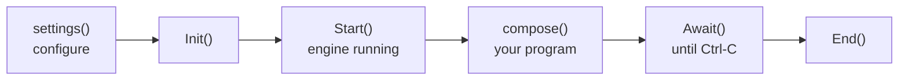

# MayaFlux: Getting Started

MayaFlux is a C++20/23 framework for real-time computation across sound, geometry, image, and network. All data is the same numerical substrate; the domain annotation decides where a buffer cycle goes, not what the data is.

This guide covers environment setup and the structure of a MayaFlux program. Tutorials that build on this foundation are at [mayaflux.org/tutorials](https://mayaflux.org/tutorials).

---

## Weave: Recommended for Most Users

**Weave** is the installer and project tool for MayaFlux. Download it from the [Weave releases page](https://github.com/MayaFlux/Weave/releases).

### Installing MayaFlux

Launch Weave and choose **Install MayaFlux**. Weave downloads the framework, installs all required dependencies, and configures your environment. Restart your terminal when it finishes.

### Creating a Project

Launch Weave and choose **Create Project**. Enter a name and pick a destination. Weave generates a ready-to-build project:

```
MyProject/
├── CMakeLists.txt
├── CMakePresets.json
├── community.cmake
├── cmake/
│   ├── mayaflux.cmake
│   ├── shaders.cmake
│   └── build_community.cmake
├── src/
│   ├── main.cpp
│   └── user_project.hpp
├── data/
│   └── shaders/
└── .gitignore
```

`src/user_project.hpp` is where you write your code. `CMakeLists.txt` is yours to edit; the MayaFlux integration lives in `cmake/mayaflux.cmake` and is included automatically.

`CMakePresets.json` ships with every project and defines `debug` and `release` presets. CLion, VS Code with the CMake extension, and Visual Studio all pick up the presets automatically when you open the project folder.

```bash
cmake --preset release
cmake --build --preset release
./build/MyProject
```

On Windows the binary lands in `build\MyProject.exe`.

### Live Coding (Lila)

Check **Enable Live Coding (Lila)** in the project creation dialog to embed the Lila JIT compiler in your process. Connect [LilaCode](https://github.com/MayaFlux/LilaCode) (VS Code) or [lila.nvim](https://github.com/MayaFlux/lila.nvim) (Neovim) to evaluate C++ against your running application in real time.

### Community Modules

Community modules are C++ source libraries that compile directly into your project with no plugin boundary. In Weave, open your project and choose **Add Community Module**. Weave fetches the [community registry](https://github.com/MayaFlux/community-sources-registry), checks version compatibility, clones the module into `community/<name>/`, and registers it in `community.cmake`. Rebuild after adding modules.

After Weave completes setup, jump to [Program Structure](#program-structure).

---

## Building MayaFlux Itself From Source

Weave is the supported path for using MayaFlux; it downloads a prebuilt framework and generates a project against it, no compiler toolchain or dependency management on your end.

Building the framework itself from source is a different, separate task, for contributors modifying the engine, not for writing programs against it. If that's what you're doing, see [`docs/Dev_Getting_Started.md`](Dev_Getting_Started.md) in the MayaFlux repository, which covers dependencies, setup scripts, build presets, and the in-tree run loop.

If you're not sure which you need: if you want to write music, visuals, or interactive pieces with MayaFlux, use Weave. If you want to change how MayaFlux itself works, build from source.

---

## Program Structure

A MayaFlux program has two entry points defined in `src/user_project.hpp`:

```cpp
#pragma once
#include "MayaFlux/MayaFlux.hpp"

void settings() {
    // Runs before the engine starts.
    // Configure sample rate, buffer size, channels, logging.
    auto& stream = MayaFlux::Config::get_global_stream_info();
    stream.sample_rate = 48000;
    stream.buffer_size = 256;
    stream.output.channels = 2;
}

void compose() {
    // Runs after the engine starts.
    // All computation, routing, scheduling, and rendering lives here.
}
```

`main.cpp` calls `settings()`, `Init()`, `Start()`, `compose()`, `Await()`, and `End()` in order. If a config file is present it is loaded around `settings()`; see [Engine Configuration](Settings.md) for which one wins. You do not edit `main.cpp` unless you need custom engine configuration beyond what `settings()` exposes.



An exception thrown by `settings()` or by `compose()` is logged, and the engine carries on.

`MayaFlux.hpp` includes the common concrete types and namespace imports by default, so the examples can use names such as `Sine` without extra includes. To keep the global namespace clear and include only the types you use, define `MAYAFLUX_NO_CONVENIENCE` before including `MayaFlux.hpp`.

### The `vega` global

`vega` is the global `Creator` instance. It is the factory for all computation objects: generators, filters, networks, buffers, containers, mesh loaders, input nodes. Every object created through `vega` is registered with the engine automatically.

```cpp
auto sine   = vega.Sine(440.0, 0.5) | Audio[0];
auto modal  = vega.ModalNetwork(12, 220.0) | Audio[{0, 1}];
auto audio  = vega.read_audio("res/drum.wav") | Audio;
auto img    = vega.read_image("res/texture.png") | Graphics;
auto mesh   = vega.read_mesh_network("res/scene.glb");
```

The `| Audio` and `| Graphics` operators are domain annotations. They attach a processing token that decides which subsystem drives the object and at what rate. They do not change what the object is.

---

### A First Program

Before explaining how MayaFlux works, here is something made with it.

Four voices emerge from different kinds of randomness and wander through a room. A form continually reconstructs itself on the GPU, while two hundred thousand points move through a changing field. Their activity is shared: the voices alter the form, the form's changing complexity affects the voices, and the whole system develops its own irregular rhythms.

Nothing needs to be recorded, downloaded, or connected. No microphone, camera, or external files are required.

Copy the program into your Weave-created project, build it, and run it. Listen, watch, click to disturb it, and leave it running for a minute.

You do not need to understand the code yet. It is here to show you a direction, not to test your understanding.

<details>
<summary>The program (click to expand)</summary>

```cpp
#pragma once
#include "MayaFlux/MayaFlux.hpp"
#include "MayaFlux/SimulationIncludes.hpp"

namespace MayaFlux::Fields {

using namespace MayaFlux::ShaderCompat;

const auto flock = MF_FIELD_P(flock, [](vec3 p, float t, vec4 a) -> vec3 {
    vec3 c = vec3(1.6f * sin(a.x * 0.3f), 0.4f * sin(a.x * 0.5f), 1.6f * cos(a.x * 0.3f));
    vec3 q = p * (0.35f + 0.2f * a.z + 0.15f * a.w);
    float w = (0.2f + a.y) * t * 0.4f / (0.6f + length(p));
    vec3 turned = vec3(q.x * cos(w) - q.z * sin(w), q.y, q.x * sin(w) + q.z * cos(w));
    return c + turned - p;
});

const auto voiced = MF_FIELD_P(voiced, [](vec3 p, float t, vec4 a) -> vec3 {
    float lean = clamp(0.5f + 0.5f * (a.y - a.z) + 0.3f * sin(p.x * 1.1f + p.z * 0.7f + t * 0.2f), 0.0f, 1.0f);
    vec3 colour = mix(vec3(0.25f, 0.6f, 1.0f), vec3(1.0f, 0.5f, 0.15f), lean);
    float glow = 0.3f + 0.7f * clamp(a.y + a.z, 0.0f, 1.0f);
    return colour * (glow + 0.3f * a.w * (1.0f - clamp(length(p) / 3.0f, 0.0f, 1.0f)));
});

}

namespace {

using Kind = Kinesis::Stochastic::Algorithm;

constexpr size_t count = 4;
constexpr std::array<Kind, count> kinds { Kind::UNIFORM, Kind::NORMAL, Kind::EXPONENTIAL, Kind::BROWNIAN };
constexpr std::array<double, count> pitch { 110.0, 1400.0, 3800.0, 240.0 };
constexpr std::array<double, count> decay { 1.0, 0.05, 0.01, 0.3 };
constexpr std::array<double, count> drift { 0.13, 0.07, 0.31, 0.05 };

struct Scene {
    std::array<double, count> energy {};
    std::array<double, count> burst {};
    std::array<double, count> pan {};
    std::array<double, count> lean {};
    double surface {};
    double peak {};
    double travel {};
    float freq { 3.0F };
    float aim { 3.0F };
    float clock {};
    float angle {};
};

struct Voices {
    std::array<std::shared_ptr<Nodes::Generator::Random>, count> noise;
    std::array<std::shared_ptr<Node>, count> follow;
};

auto shaped(const std::shared_ptr<Node>& input, auto shape)
{
    auto node = vega.Polynomial(shape);
    node->set_input_node(input);
    return node;
}

Kinesis::SpatialField gyroid(float s, float thickness, float t)
{
    return { .fn = [=](const glm::vec3& p) {
        const float g = std::sin(p.x * s + t) * std::cos(p.y * s)
            + std::sin(p.y * s + t * 0.7F) * std::cos(p.z * s)
            + std::sin(p.z * s + t * 1.3F) * std::cos(p.x * s);
        return std::max(glm::length(p) - 1.2F, std::abs(g) - thickness);
    } };
}

Voices make_voices(const Scene& scene)
{
    namespace D = Kinesis::Discrete;

    const auto rate = static_cast<double>(Config::get_sample_rate());
    const uint32_t channels = std::max(1U, Config::get_global_stream_info().output.channels);

    std::vector<double> a1, b1;
    D::one_pole(0.9995, a1, b1);

    Voices voices;
    for (size_t v = 0; v < count; ++v) {
        std::vector<double> a, b;
        D::resonator(D::pole_radius_from_decay(decay[v], rate), 6.2832 * pitch[v] / rate, a, b);
        voices.noise[v] = vega.Random(kinds[v]);
        auto voice = vega.IIR(voices.noise[v], a, b);
        voice->set_gain(0.3 * std::sqrt(decay[v] * rate));

        auto room = vega.Sine(drift[v], 1.0);
        auto swell = (vega.Sine(drift[v], 1.0) >> vega.Polynomial([](double x) { return 0.5 + 0.5 * x; }))
            * shaped(room, [&scene, v](double) { return 0.4 + 0.6 * std::min(1.0, scene.lean[v]); });
        auto heard = voice * swell;

        (heard * shaped(room, [&scene, v](double) { return 0.5 + 0.5 * scene.pan[v]; })) | Audio[0];
        (heard * shaped(room, [&scene, v](double) { return 0.5 - 0.5 * scene.pan[v]; })) | Audio[1 % channels];

        voices.follow[v] = vega.IIR(shaped(heard, [](double x) { return std::abs(x); }), a1, b1);
        voices.follow[v] | Audio[0];
        voices.follow[v]->exclude_output_from_graph();
    }
    return voices;
}

std::shared_ptr<Buffers::ComputeMeshBuffer> make_form(const std::shared_ptr<Core::Window>& window)
{
    auto skin = vega.read_image() | Graphics;
    auto form = vega.mint(StructureConfig::Isosurface {
        .config = Buffers::ComputeMeshBuffer::Config {
            .source = gyroid(3.0F, 0.08F, 0.0F),
            .bounds_min = glm::vec3(-1.6F),
            .bounds_max = glm::vec3(1.6F),
            .resolution_x = 40,
            .resolution_y = 40,
            .resolution_z = 40,
        },
        .textures = { skin->get_texture() },
        .render = { .target_window = window },
    });

    return form;
}

std::shared_ptr<Nodes::Network::ParticleNetwork> make_swarm(const std::shared_ptr<Core::Window>& window)
{
    using namespace Nodes::Network;

    auto swarm = vega.ParticleNetwork(200000, glm::vec3(-3.0F), glm::vec3(3.0F), Kinesis::SpatialDistribution::RANDOM_SPHERE);
    swarm->create_operator<PhysicsOperator>()->set_gravity(glm::vec3(0.0F));
    vega.evolve(swarm, {}, [](const auto& field) {
        field->bind(FieldTarget::POSITION, Fields::flock);
        field->bind(FieldTarget::COLOR, Fields::voiced);
    },
        { .target_window = window });
    return swarm;
}

void orbit_camera(const std::shared_ptr<Core::Window>& window, const Scene& scene)
{
    auto view = [&scene]() -> Kinesis::ViewTransform {
        return Kinesis::look_at_perspective(
            glm::vec3(11.0F * std::sin(scene.angle), 4.0F, 11.0F * std::cos(scene.angle)), glm::vec3(0.0F, 0.2F, 0.0F),
            0.9F, 1280.0F / 800.0F, 0.1F, 50.0F);
    };
    for (const auto& buffer : window->get_rendering_buffers()) {
        buffer->get_render_processor()->set_view_transform_source(view);
    }
}

void mutate(Scene& scene, const Voices& voices, size_t v)
{
    voices.noise[v]->set_type(kinds[static_cast<size_t>(get_uniform_random(0.0, 3.999))]);
    scene.aim = static_cast<float>(get_uniform_random(2.2, 4.2));
}

void evolve_voices(Scene& scene, const Voices& voices)
{
    auto& breath = make_persistent(vega.Sine(0.05, 1.0) | Audio[0]);
    breath->exclude_output_from_graph();

    schedule_pattern(
        [&](uint64_t) { return static_cast<size_t>(std::ranges::max_element(scene.energy) - scene.energy.begin()); },
        [&](size_t v) { mutate(scene, voices, v); },
        [&](uint64_t) { return std::vector<double> { 3.0 + 2.0 * breath->get_last_output() }; },
        "mutate");

    schedule_pattern(
        [&](uint64_t) { return static_cast<size_t>(std::ranges::min_element(scene.energy) - scene.energy.begin()); },
        [&](size_t v) { scene.burst[v] = 1.0; },
        { 0.8, 1.3, 0.5, 2.1, 0.9 },
        "bursts");
}

void inhabit(Scene& scene, const Voices& voices, const std::shared_ptr<Core::Window>& window, const std::shared_ptr<Buffers::ComputeMeshBuffer>& form, const std::shared_ptr<Nodes::Network::ParticleNetwork>& swarm)
{
    using namespace Nodes::Network;

    auto& fabric = make_persistent<Nexus::Fabric>(*get_scheduler(), *get_event_manager());
    auto& agents = make_persistent<std::array<std::shared_ptr<Nexus::Presence>, count>>();
    constexpr auto token = Vruta::ProcessingToken::FRAME_ACCURATE;

    for (size_t v = 0; v < count; ++v) {
        agents[v] = std::make_shared<Nexus::Presence>(
            3.0F,
            [](const Nexus::PerceptionContext&) {},
            [&scene, &voices, v](const Nexus::InfluenceContext& ctx) {
                scene.pan[v] = std::clamp(ctx.position.x / 4.0F, -1.0F, 1.0F);
                scene.energy[v] = std::min(1.0, voices.follow[v]->get_last_output() * 10.0);
                scene.burst[v] *= 0.9;
                scene.lean[v] *= 0.6;
                const double lift = scene.burst[v] + scene.lean[v];
                voices.noise[v]->set_amplitude((1.0 + 2.0 * lift) * (0.6 + 0.8 * scene.surface));
            },
            [&scene, &agents, v](uint32_t id, float weight) {
                for (size_t n = 0; n < count; ++n) {
                    if (n != v && agents[n]->id() == id) {
                        scene.lean[n] += weight * scene.energy[v];
                    }
                }
            });
        agents[v]->set_falloff_radius(3.0F);
        agents[v]->set_falloff_curve(Nexus::Presence::FalloffCurve::Cosine);

        fabric.wire(agents[v])
            .every(1.0 / 24.0, token)
            .position_from([&scene, v] {
                const float t = scene.clock * (0.4F + 0.15F * static_cast<float>(v));
                return glm::vec3(4.0F * std::sin(t + 1.7F * static_cast<float>(v)), 0.5F * std::sin(1.3F * t), 3.0F * std::cos(0.8F * t + static_cast<float>(v)));
            })
            .finalise();
    }

    auto field = swarm->get_operator_chain()->find<GpuFieldOperator>();

    auto body = std::make_shared<Nexus::Emitter>(
        [&scene, &voices, form](const Nexus::InfluenceContext& ctx) {
            double loudness = 0.0;
            for (size_t v = 0; v < count; ++v) {
                loudness += scene.energy[v];
            }
            const double live = form->get_live_vertex_count().value_or(0);
            scene.peak = std::max(scene.peak * 0.999, live);
            scene.surface += ((scene.peak > 0.0 ? live / scene.peak : 0.0) - scene.surface) * 0.1;

            scene.travel += 0.04 + 0.3 * loudness / count;
            scene.angle += 0.003F + 0.01F * static_cast<float>(loudness / count);
            scene.freq += (scene.aim - scene.freq) * 0.05F;
            scene.clock += 0.02F;

            form->set_field(gyroid(
                scene.freq + 0.5F * static_cast<float>(scene.energy[0] + scene.energy[2]),
                0.06F + 0.07F * static_cast<float>(std::min(1.0, scene.energy[1] + scene.energy[3])),
                scene.clock));
            form->set_dirty();
            form->get_render_processor()->set_geometry_transform(
                glm::translate(glm::mat4(1.0F), ctx.position) * glm::scale(glm::mat4(1.0F), glm::vec3(1.4F)));
        });
    body->set_influence<glm::vec4>(
        [&scene](const Nexus::InfluenceContext&) {
            return glm::vec4(static_cast<float>(scene.travel), static_cast<float>(scene.energy[0] + scene.energy[2]), static_cast<float>(scene.energy[1] + scene.energy[3]), static_cast<float>(scene.surface));
        },
        Nexus::bind_params(field));
    fabric.wire(body)
        .every(1.0 / 24.0, token)
        .position_from([&scene] {
            const auto s = static_cast<float>(scene.travel);
            return glm::vec3(4.5F * std::sin(s * 0.3F), 0.8F * std::sin(s * 0.5F), 4.5F * std::cos(s * 0.3F));
        })
        .finalise();

    auto striker = std::make_shared<Nexus::Emitter>([&scene](const Nexus::InfluenceContext&) {
        scene.burst[static_cast<size_t>(get_uniform_random(0.0, 3.999))] = 1.0;
    });
    fabric.wire(striker).on(window, IO::MouseButtons::Left).finalise();

    auto voice_of = [&agents](uint32_t id) {
        return static_cast<size_t>(std::ranges::find_if(agents, [id](const auto& agent) { return agent->id() == id; }) - agents.begin());
    };
    fabric.add_expanse(std::make_shared<Nexus::Expanse>(
        [&scene](const glm::vec3& p) {
            const auto s = static_cast<float>(scene.travel);
            return glm::length(p - glm::vec3(1.6F * std::sin(s * 0.3F), 0.4F * std::sin(s * 0.5F), 1.6F * std::cos(s * 0.3F))) < 1.8F;
        },
        [&, voice_of](uint32_t id) {
            if (const size_t v = voice_of(id); v < count) {
                mutate(scene, voices, v);
            }
        },
        [&, voice_of](uint32_t id) {
            if (const size_t v = voice_of(id); v < count) {
                scene.burst[v] = 1.0;
            }
        }));

    schedule_metro(
        1.0 / 24.0,
        [&fabric, physics = swarm->as_operator<PhysicsOperator>(), sized = false]() mutable {
            if (!sized) {
                physics->set_parameter("point_size", 0.4);
                sized = true;
            }
            fabric.commit();
        },
        "commit", token);
}

}

void settings()
{
}

void compose()
{
    auto& scene = make_persistent<Scene>();
    auto& voices = make_persistent(make_voices(scene));
    auto& window = make_persistent(create_window({ "Four Voices, One Form", 1280, 800 }));
    window->show();

    auto& form = make_persistent(make_form(window));
    auto& swarm = make_persistent(make_swarm(window));

    orbit_camera(window, scene);
    evolve_voices(scene, voices);
    inhabit(scene, voices, window, form, swarm);
}
```

</details>

What this shows:

- **Sound from nothing but chance.** Each voice is a stochastic generator (`UNIFORM`, `NORMAL`, `EXPONENTIAL`, `BROWNIAN`) through a resonant filter, with a gain worked out from its decay. No oscillator makes a tone.
- **Voices that live in a room.** Each voice is a `Nexus::Presence` wandering its own path through space. Its stereo position is where it is, not a separate oscillator.
- **Neighbours lean on each other.** A voice pushes on the voices within three units of it, strongest when close, and swells as the others push on it. Voices that drift together grow louder together, and part again.
- **One form, carved by the GPU.** `vega.mint(StructureConfig::Isosurface { ... })` turns a signed distance field into a live mesh, a gyroid lattice cut out of a sphere. The form is an `Emitter` that carries the swarm's parameters with it through `bind_params`. The low and high voices set the lattice frequency, the other two set how thick its walls are, and the combined loudness sets how fast it travels the room.
- **One swarm beside it.** Two hundred thousand particles run through one GPU field. The field keeps the cloud as a whole, turns it, and swells and tightens it with the voices and the form's surface. Colour follows what is sounding: warm when the low voices dominate, cool when the high ones do, brighter as the whole gets louder, with a glow in the core that grows with the form's surface, and a slow drift across the cloud so it never goes flat. It travels the same circle as the form at a third of the radius, so the form stays outside it.
- **A loop, not a chain.** Each voice's amplitude depends on its neighbours and on how complex the form currently is. The patterns watch the scene: the loudest voice is the one that mutates and the quietest is the one that is struck. A region around the swarm adds events through space: a voice that wanders into it mutates, and one that leaves it is struck. A click is an `Emitter` wired to the mouse button, so it fires the same way a path does.
- **Slow on purpose.** The form is re-evaluated about twenty-four times a second, and its field is evaluated on the CPU across all cores, which is why the grid is 40 cells a side.

Change `kinds` to give the voices other randomness, the paths in `position_from` to change where they go, `set_falloff_radius` and `set_falloff_curve` for how far and how softly they reach each other, the region's radius `1.8` for how often events fire, a fifth entry in each constant array and a fifth `Presence` for another voice, `read_image()` to choose the skin it wears, and `flock` to change what the swarm does.

---

## What to Read Next

- **[Digital Architecture](Digital_Architecture.md)**: how the substrate works, what each namespace does, how everything composes
- **[Sculpting Data I](https://mayaflux.org/tutorials/sculpting-data/foundations/)**: first tutorial series; start here if you have not written a MayaFlux program before
- **[Processing Expression](https://mayaflux.org/tutorials/sculpting-data/processing_expression/)**: buffers, processors, math as expression
- **[Visual Materiality I](https://mayaflux.org/tutorials/sculpting-data/visual_materiality_i/)**: graphics pipeline from a user perspective
- **[API docs](https://mayaflux.github.io/MayaFlux/)**: generated reference; build locally with `doxygen doxyconf`

---

## FAQ

### macOS: do I need Homebrew LLVM?

No. MayaFlux compiles with Apple Clang from Xcode Command Line Tools. Homebrew LLVM is not used for compilation. LLVM is required as a runtime dependency for Lila (the JIT environment) and is installed by the setup script, but it is not your compiler. This applies to building MayaFlux itself from source; see [`docs/Dev_Getting_Started.md`](Dev_Getting_Started.md).

### What is the minimum OS version?

Weave-installed MayaFlux (currently 0.4.1) targets: Windows 10 version 1909+, Fedora 43, Ubuntu 25.10, macOS 15.

Building from source targets a newer floor, since source currently tracks 0.5-dev: Windows 10 version 1909+, Fedora 44, Ubuntu 26.04 LTS, macOS 26 (Tahoe) on Apple Silicon (ARM64). See [`docs/Dev_Getting_Started.md`](Dev_Getting_Started.md) for the from-source requirement list.

The Windows floor is set by MSVC 2022's own minimum supported OS. Win32 windowing, WinMM, and WASAPI all predate this by a wide margin and impose no additional constraint.

### Why is Intel macOS support removed?

Starting with 0.5-dev, MayaFlux supports macOS on Apple Silicon only, for both source builds and binary distributions. This does not change the hardware requirements of previously published releases.

The constraint comes from the dependency ecosystem, beyond MayaFlux's control. In September 2026, [Homebrew stopped building new Intel macOS bottles](https://docs.brew.sh/Support-Tiers) and moved Intel Macs to Tier 3, without CI coverage or a commitment to fix platform-specific failures. Existing bottles may still work, but updated formulae may require source builds. Homebrew expects to remove Intel execution support in or after September 2027. [Homebrew's release announcement](https://brew.sh/2026/09/13/homebrew-7.0.0/) also identifies Apple and GitHub's retreat from Intel support as infrastructure its volunteers cannot replace. MayaFlux cannot replace that infrastructure or maintain a separate binary dependency stack where much larger, better-funded platform providers are withdrawing support.

Building MayaFlux from source does not bypass this problem. Before reaching MayaFlux, a fresh Homebrew installation can require source builds of its dependency chain, including LLVM, FFmpeg, Vulkan components, and their dependencies where matching bottles are unavailable. Our Intel CI has already encountered a GCC source rebuild. GCC is not MayaFlux's macOS compiler, which remains Apple Clang; it can enter through dependency builds. The burden includes building the compiler's dependencies, packages that need it, and resolving failures on a platform Homebrew no longer tests. A cached CI installation can conceal that burden until the cache changes or expires; a new user's machine has no such protection.

This is not a practical installation path we can support. Current setup scripts and CMake configurations reject Intel macOS targets, and universal macOS builds are unsupported. Existing Intel installations may continue to work with older dependencies, but they do not provide a reliable path to current releases.

### What happens if a dependency is missing?

This applies to building MayaFlux itself from source. Weave-installed MayaFlux handles dependencies for you. See [`docs/Dev_Getting_Started.md`](Dev_Getting_Started.md) for the from-source dependency list and setup scripts.

### Can I use MayaFlux without the JIT (Lila)?

Yes. Lila is part of the engine but you do not have to use it. Programs written entirely in `compose()` and compiled normally do not touch the JIT path. Weave's live coding toggle controls whether Lila is embedded in your project at all.

### Where does my code go?

In `src/user_project.hpp`. It is never overwritten by Weave updates. `main.cpp` is the engine entry point and should not be modified unless you need a custom startup sequence.
