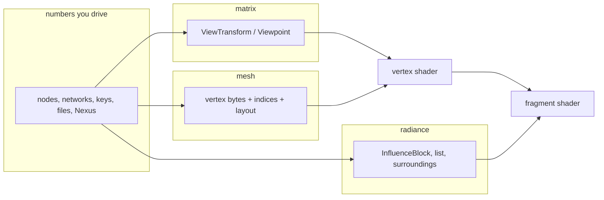
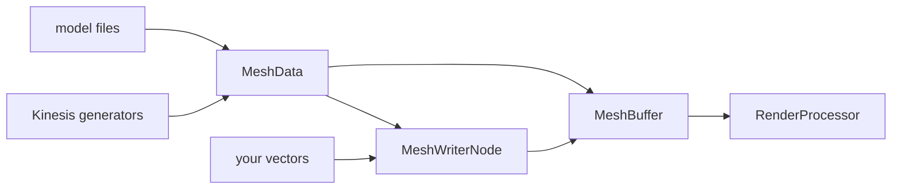

# Matrix, Mesh, Radiance

*No camera, no model class, no lamp. Three kinds of numbers and the functions between them.*

Vulkan has no camera. It has a block of memory a vertex shader may read. It has no mesh either: it reads two spans of bytes and is told how. And it has no light. A fragment shader computes a number, and whatever that number depends on is yours to decide.

MayaFlux leaves all three as they are. A view is a function that returns two matrices. A mesh is vertex bytes, indices and a description of the bytes. Illumination is an integral over directions: what arrives, times what the surface does with it, times the cosine. None of them needs to be a thing before it can be driven, and anything that can be driven can be driven by anything else: a node, a network, a table of rules, a file, a key.

Naming these "camera", "model" and "light" is not wrong. It is just late. The names belong where you use the numbers, which is why the math in Kinesis does not know them and the shaders and Nexus do.

Sources: [ViewTransform.hpp](../src/MayaFlux/Kinesis/Viewport/ViewTransform.hpp), [Frustum.hpp](../src/MayaFlux/Kinesis/Viewport/Frustum.hpp), [GeometryPrimitives.hpp](../src/MayaFlux/Kinesis/GeometryPrimitives.hpp), [Radiometry](../src/MayaFlux/Kinesis/Radiometry), [lighting.glsl](../data/shaders/include/lighting.glsl), [InfluenceList.hpp](../src/MayaFlux/Nexus/Pheme/InfluenceList.hpp).

## Where it sits



The examples are bodies for `compose()` in `src/user_project.hpp`, with these includes:

```cpp
#include "MayaFlux/MayaFlux.hpp"
#include "MayaFlux/SimulationIncludes.hpp"

#include "MayaFlux/Buffers/Geometry/MeshBuffer.hpp"
#include "MayaFlux/Buffers/Network/MeshNetworkBuffer.hpp"
#include "MayaFlux/Buffers/Shaders/RenderProcessor.hpp"
#include "MayaFlux/Kinesis/ColorSpace.hpp"
#include "MayaFlux/Kinesis/GeometryPrimitives.hpp"
#include "MayaFlux/Kinesis/MatrixTransforms.hpp"
#include "MayaFlux/Portal/Graphics/TextureLoom.hpp"
```

They also assume `window` is made:

```cpp
auto window = create_window({ "study", 1280, 720 });
window->show();
constexpr float aspect = 1280.0F / 720.0F;
```

---

# Part 1. The matrix

[Viewport.md](Viewport.md) covers coordinates, near and far, and interactive presets in detail. This part is the short form and what sits beyond it.

## 1.1 A matrix, once

```cpp
auto ball = std::make_shared<Buffers::MeshBuffer>(
    Kinesis::generate_parametric_surface(
        [](float u, float v) {
            const float theta = u * glm::two_pi<float>();
            const float phi = v * glm::pi<float>();
            return glm::vec3(std::sin(phi) * std::cos(theta), std::cos(phi), std::sin(phi) * std::sin(theta));
        },
        64, 32))
    | Graphics;
ball->setup_rendering({ .target_window = window });

ball->get_render_processor()->set_view_transform(Kinesis::look_at_perspective(
    { 0.0F, 1.0F, 4.0F }, { 0.0F, 0.0F, 0.0F }, glm::radians(45.0F), aspect, 0.1F, 100.0F));
```

## 1.2 A matrix, every frame

`set_view_transform_source` takes any callable. Closing over a node makes the view a signal.

```cpp
auto turn = vega.Phasor(0.05F) | Graphics;
auto swell = vega.Sine(0.2F, 0.5F) | Graphics;

ball->get_render_processor()->set_view_transform_source([turn, swell] {
    const float a = static_cast<float>(turn->get_last_output()) * glm::two_pi<float>();
    const float reach = 4.0F + static_cast<float>(swell->get_last_output());
    return Kinesis::look_at_perspective(
        { std::sin(a) * reach, 1.0F, std::cos(a) * reach }, glm::vec3(0.0F),
        glm::radians(45.0F), aspect, 0.1F, 100.0F);
});
```

Nothing here is camera shaped. Roll, field of view and the up vector are arguments like the others, and a field of view driven by an envelope is as legal as a position driven by one.

```cpp
auto hit = vega.Impulse(2.0F) | Graphics;
auto kick = std::make_shared<float>(0.0F);

ball->get_render_processor()->set_view_transform_source([hit, kick] {
    *kick = std::max(*kick * 0.92F, static_cast<float>(hit->get_last_output()));
    return Kinesis::look_at_perspective(
        { 0.0F, 0.0F, 4.0F }, glm::vec3(0.0F),
        glm::radians(35.0F + 40.0F * *kick), aspect, 0.1F, 100.0F,
        { std::sin(*kick), std::cos(*kick), 0.0F });
});
```

## 1.3 Viewpoint: a placement and a frustum

A `Viewpoint` keeps where the view is apart from what it sees. It can be rotated, moved and blended, which a finished pair of matrices cannot.

```cpp
const auto placed = glm::inverse(glm::lookAt(
    glm::vec3(0.0F, 1.0F, 4.0F), glm::vec3(0.0F), glm::vec3(0.0F, 1.0F, 0.0F)));
const Kinesis::Viewpoint home { placed, Kinesis::frustum_from_fov(glm::radians(45.0), aspect, 0.1, 100.0) };

const auto side = Kinesis::rotate_viewpoint_about(home, glm::vec3(0.0F), glm::half_pi<float>(), 0.0F);
const auto closer = Kinesis::translate_viewpoint_toward(home, glm::vec3(0.0F), 0.5F);
const auto between = Kinesis::mix_viewpoints(side, closer, 0.5F);

ball->get_render_processor()->set_view_transform(
    Kinesis::view_from_frustum(between.first, between.second, aspect));
```

Blending two viewpoints by a signal:

```cpp
auto sway = vega.Sine(0.1F, 0.5F, 0.5F) | Graphics;

ball->get_render_processor()->set_view_transform_source([home, side, sway] {
    const auto now = Kinesis::mix_viewpoints(home, side, static_cast<float>(sway->get_last_output()));
    return Kinesis::view_from_frustum(now.first, now.second, aspect);
});
```

## 1.4 Hands on it

```cpp
bind_viewport_preset(window, ball->get_render_processor());   // fly: WASD, QE, right drag, scroll
bind_orbit_preset(window, { .focal_point = { 0.0F, 0.0F, 0.0F }, .initial_distance = 4.5F });
```

Pick one for a window. `bind_viewport_preset` returns the viewpoint it drives, so another driver can take it over.

## 1.5 A Locus: the view as a thing in the world

A Nexus `Locus` is an Agent with a view. It has a place others can perceive, and it can follow.

```cpp
static auto tapestry = create_tapestry();
static auto orchestrator = create_orchestrator(tapestry);
orchestrator->set_wiring_rule([](Nexus::Wiring& wiring, std::optional<uint64_t>) {
    wiring.every(Vruta::ProcessingToken::FRAME_ACCURATE);
});

auto locus = orchestrator->locus_from(home);
locus->set(Nexus::LocusControls { .aspect = aspect });
locus->add_view_target(ball->get_render_processor());

auto drift = vega.Phasor(0.02F) | Graphics;
locus->follow([home, drift] {
    return Kinesis::rotate_viewpoint_about(home, glm::vec3(0.0F),
        static_cast<float>(drift->get_last_output()) * glm::two_pi<float>(), 0.0F);
});
```

## 1.6 The other matrix

The view moves everything. The geometry transform moves one renderer's geometry, in the shader, without touching its bytes.

```cpp
auto spin = vega.Phasor(0.1F) | Graphics;

ball->get_render_processor()->set_geometry_transform_source([spin] {
    const float a = static_cast<float>(spin->get_last_output()) * glm::two_pi<float>();
    return Kinesis::pivot_transform(glm::vec3(0.0F), glm::vec3(0.0F),
        glm::angleAxis(a, glm::normalize(glm::vec3(0.3F, 1.0F, 0.0F))));
});
```

---

# Part 2. The mesh

A mesh is two spans: vertex bytes and triangle indices, with a `VertexLayout` saying how to read the bytes. `Kakshya::MeshData` holds the three. A loaded file, a generated surface and a surface rebuilt from analysis are the same thing once they are here.



A `MeshVertex` is 68 bytes:

| Field | Offset | Location | Default |
|---|---|---|---|
| `position` vec3 | 0 | 0 | required |
| `color` vec4 | 12 | 1 | white |
| `weight` float | 28 | 2 | 0 |
| `uv` vec2 | 32 | 3 | 0, 0 |
| `normal` vec3 | 40 | 4 | 0, 0, 1 |
| `tangent` vec4 | 52 | 5 | 1, 0, 0, 1 |

Normals matter from here on: they are what a surface turns toward radiance.

## 2.1 By hand

```cpp
auto node = vega.MeshWriterNode();
node->set_mesh(
    std::vector<Kakshya::MeshVertex> {
        { .position = { -1.0F, 0.0F, 0.0F }, .color = { 1.0F, 0.2F, 0.2F, 1.0F } },
        { .position = { 1.0F, 0.0F, 0.0F }, .color = { 0.2F, 1.0F, 0.2F, 1.0F } },
        { .position = { 0.0F, 1.6F, 0.0F }, .color = { 0.2F, 0.2F, 1.0F, 1.0F } } },
    std::vector<uint32_t> { 0, 1, 2 });

auto triangle = vega.mint(StructureConfig::Object {
    .writer = node,
    .render = { .target_window = window },
});
```

## 2.2 From a function

Every generator returns `MeshData`, so every one of these goes to `MeshBuffer` or `mint` the same way.

```cpp
auto box = Kinesis::generate_box({ 0.0F, 0.0F, 0.0F }, { 0.5F, 0.5F, 0.5F });

auto floor = Kinesis::generate_grid({ 0.0F, -1.0F, 0.0F }, 6.0F, 6.0F, 32, 32);

auto torus = Kinesis::generate_parametric_surface(
    [](float u, float v) {
        const float a = u * glm::two_pi<float>();
        const float b = v * glm::two_pi<float>();
        const float ring = 1.0F + 0.3F * std::cos(b);
        return glm::vec3(ring * std::cos(a), 0.3F * std::sin(b), ring * std::sin(a));
    },
    96, 32);

auto vase = Kinesis::generate_revolution(
    [](float t) { return glm::vec2(0.4F + 0.2F * std::sin(t * 9.0F), t * 1.6F - 0.8F); },
    64, 48);

auto path = Kinesis::sample_parametric_curve(
    [](float t) {
        const float a = t * 6.0F * glm::two_pi<float>();
        return glm::vec3(std::cos(a) * (1.0F - t), t - 0.5F, std::sin(a) * (1.0F - t));
    },
    600);
auto vine = Kinesis::generate_tube(path, [](float t) { return 0.06F * (1.0F - t) + 0.005F; }, 12, true);

auto shown = std::make_shared<Buffers::MeshBuffer>(vine) | Graphics;
shown->setup_rendering({ .target_window = window });
```

## 2.3 Several fixed sources, minted

```cpp
auto form = vega.mint(StructureConfig::Object {
    .expression = [] { return Kinesis::generate_box(glm::vec3(0.0F), glm::vec3(0.7F)); },
    .render = { .target_window = window, .polygon_mode = Portal::Graphics::PolygonMode::LINE },
});
```

## 2.4 Moving the bytes

Keep a writer when the mesh changes. Vertices and indices upload independently.

```cpp
auto node = vega.MeshWriterNode();
node->set_mesh(Kinesis::generate_grid(glm::vec3(0.0F), 4.0F, 4.0F, 64, 64));
const auto rest = node->get_mesh_vertices();

auto sheet = std::make_shared<Buffers::MeshBuffer>(node) | Graphics;
sheet->setup_rendering({ .target_window = window });

auto tide = vega.Phasor(0.2F) | Graphics;
tide->on_tick([node, rest](const auto& ctx) {
    auto moved = rest;
    for (auto& v : moved) {
        const float d = glm::length(glm::vec2(v.position.x, v.position.z));
        v.position.y = 0.25F * std::sin(d * 6.0F - static_cast<float>(ctx.value) * glm::two_pi<float>());
        const float slope = 1.5F * std::cos(d * 6.0F - static_cast<float>(ctx.value) * glm::two_pi<float>());
        v.normal = glm::normalize(glm::vec3(-slope * v.position.x / std::max(d, 1e-3F), 1.0F,
            -slope * v.position.z / std::max(d, 1e-3F)));
    }
    node->set_mesh_vertices(moved);
});
```

The surface deforms every frame. The topology can change at other moments, driven by other things:

```cpp
const auto all = node->get_mesh_indices();
auto gate = vega.Impulse(0.5F) | Graphics;
gate->on_impulse([node, all](const auto&) {
    static size_t keep = 0;
    keep = (keep + all.size() / 4) % all.size();
    node->set_mesh_indices(std::vector<uint32_t>(all.begin(), all.begin() + static_cast<ptrdiff_t>(keep / 3 * 3)));
});
```

## 2.5 From a file

```cpp
auto meshes = vega.read_mesh("res/model.fbx") | Graphics;    // one MeshBuffer per mesh
for (const auto& mesh : meshes) {
    mesh->setup_rendering({ .target_window = window });
}

auto network = vega.read_mesh_network("res/model.glb") | Graphics;   // one buffer, one slot per mesh
auto joined = vega.MeshNetworkBuffer(network) | Graphics;
joined->setup_rendering({ .target_window = window });

network->get_slot(0).local_transform = glm::translate(glm::mat4(1.0F), { 0.0F, 0.5F, 0.0F });
network->get_slot(0).dirty = true;
```

`vega.read_mesh()` and `vega.read_mesh_network()` with no path open a file dialog.

---

# Part 3. Radiance

## 3.1 The one equation

```
leaving = emitted + integral over directions of ( response x arriving x cosine )
```

- **arriving** is what a source delivers: distance falloff, a cone, a shape with a size, or the surroundings.
- **response** is the surface: colour, roughness, metalness.
- **cosine** is how squarely it faces.

The names in `Kinesis/Radiometry` are these terms. The shaders in `data/shaders/include` say "light" and "surface", and compute the same functions.

The library's `_lit` fragment shaders sum three things, each skipped while unset: one pushed influence, a list of influences, and the surroundings. There is one `_lit` shader for each kind of geometry:

| Geometry | Fragment shader |
|---|---|
| `MeshBuffer` | `triangle_lit`, `mesh_textured_lit` |
| `MeshNetworkBuffer` | `mesh_network_lit`, `mesh_network_textured_lit` |
| instances | `instance_lit`, `instance_textured_lit` |
| points, lines | `point_lit`, `line_lit` |

With nothing set, a lit surface is black. That is the equation, not a fault.

## 3.2 One source, no machinery

A source is a handful of numbers pushed to a renderer.

```cpp
auto body = std::make_shared<Buffers::MeshBuffer>(
    Kinesis::generate_revolution(
        [](float t) { return glm::vec2(0.5F + 0.2F * std::sin(t * 8.0F), t * 2.0F - 1.0F); }, 96, 64))
    | Graphics;
body->setup_rendering({ .target_window = window, .fragment_shader = "triangle_lit.frag.spv" });

auto renderer = body->get_render_processor();
renderer->set_view_transform(Kinesis::look_at_perspective(
    { 0.0F, 0.5F, 4.0F }, glm::vec3(0.0F), glm::radians(45.0F), aspect, 0.1F, 100.0F));

const auto push = Nexus::bind_influence_block(renderer);
push(Nexus::InfluenceBlock::from({
    .position = { 2.0F, 2.0F, 2.0F },
    .intensity = 30.0F,
    .radius = 20.0F,
    .color = glm::vec3(1.0F, 0.9F, 0.8F),
}));
```

`radius` is where it reaches zero. Within it, irradiance falls by the inverse square.

Moving it by a signal is pushing again:

```cpp
auto orbit = vega.Phasor(0.15F) | Graphics;
orbit->on_tick([push](const auto& ctx) {
    const float a = static_cast<float>(ctx.value) * glm::two_pi<float>();
    push(Nexus::InfluenceBlock::from({
        .position = { 2.5F * std::cos(a), 1.5F, 2.5F * std::sin(a) },
        .intensity = 30.0F,
        .radius = 20.0F,
    }));
});
```

## 3.3 The surface

Surface values are specialization constants on the renderer. Set them before it first draws.

```cpp
renderer->set_specialization_constant(9, std::bit_cast<uint32_t>(0.2F));    // roughness, 0.5
renderer->set_specialization_constant(10, std::bit_cast<uint32_t>(1.0F));   // metallic, 0
renderer->set_specialization_constant(11, std::bit_cast<uint32_t>(0.6F));   // diffuse roughness, 0
renderer->set_specialization_constant(12, 0U);                              // textures are already linear
```

The colour is the vertex colour, or the texture. Shading is in linear values and ends in a tone curve.

## 3.4 Cones and shapes

```cpp
const auto aimed = glm::quatLookAt(glm::normalize(glm::vec3(-1.0F, -1.0F, -1.0F)), glm::vec3(0.0F, 1.0F, 0.0F));

// a cone: radians from the axis, full inside the first, gone past the second
push(Nexus::InfluenceBlock::from({ .position = { 2.0F, 2.0F, 2.0F }, .intensity = 40.0F, .radius = 20.0F,
    .orientation = aimed, .cone = glm::vec2(0.2F, 0.45F) }));

// from one direction everywhere: intensity is irradiance
push(Nexus::InfluenceBlock::from({ .intensity = 3.0F, .orientation = aimed,
    .shape = Nexus::SourceShape::Directional }));

// a sphere: extent.x is its radius, intensity is its surface brightness
push(Nexus::InfluenceBlock::from({ .position = { 1.5F, 1.0F, 1.5F }, .intensity = 60.0F, .radius = 20.0F,
    .shape = Nexus::SourceShape::Sphere, .extent = glm::vec2(0.3F) }));

// a rectangle facing along its orientation: width and height
push(Nexus::InfluenceBlock::from({ .position = { 2.0F, 1.0F, 2.0F }, .intensity = 8.0F, .radius = 20.0F,
    .orientation = aimed, .shape = Nexus::SourceShape::Rectangle, .extent = glm::vec2(1.5F, 0.3F) }));

// a tube along local X: radius and length
push(Nexus::InfluenceBlock::from({ .position = { 0.0F, 1.5F, 1.0F }, .intensity = 30.0F, .radius = 20.0F,
    .shape = Nexus::SourceShape::Tube, .extent = glm::vec2(0.05F, 2.0F) }));
```

For shapes, intensity is radiance: a bigger one gives more.

## 3.5 Many sources

```cpp
#include "MayaFlux/Nexus/Pheme/InfluenceList.hpp"
```

```cpp
static auto lamps = std::make_shared<Nexus::InfluenceList>(8);
lamps->bind(renderer);

static std::vector<Nexus::Influence<Nexus::InfluenceBlock>::Target> places;
for (int i = 0; i < 6; ++i) {
    const float a = static_cast<float>(i) / 6.0F * glm::two_pi<float>();
    places.push_back(lamps->target());
    places.back()(Nexus::InfluenceBlock::from({
        .position = { 2.5F * std::cos(a), 0.5F, 2.5F * std::sin(a) },
        .intensity = 8.0F,
        .radius = 10.0F,
        .color = Kinesis::hsv_to_rgb({ static_cast<float>(i) / 6.0F, 0.8F, 1.0F }),
    }));
}
```

A target holds its place while you hold the target. Drop it and the place empties.

## 3.6 Sources as principals

An Emitter is a source with a place in the world. It can be wired, perceived, driven by Fabric and saved.

```cpp
auto lamp = orchestrator->emitter_from(Kakshya::MeshAssemblyLight {},
    glm::translate(glm::mat4(1.0F), { 2.0F, 2.0F, 2.0F }));
lamp->set(Nexus::EmitterControls { .intensity = 30.0F, .radius = 20.0F, .color = glm::vec3(1.0F, 0.7F, 0.4F) });
lamp->set_influence<Nexus::InfluenceBlock>(Nexus::InfluenceBlock::from, lamps->target());
```

`orchestrator` and `tapestry` are the `static` ones from 1.5. They must outlive `compose()`.

```cpp
on_key_pressed(window, IO::Keys::J, [lamp] {
    lamp->set({ .position = lamp->position().value_or(glm::vec3(0.0F)) - glm::vec3(0.3F, 0.0F, 0.0F) });
});
```

## 3.7 The surroundings

Radiance arrives from everywhere, not only from sources. Give it as an equirectangular grid in linear floats, +Y up, first row at the top.

```cpp
#include "MayaFlux/Kinesis/Radiometry/Prefilter.hpp"
```

```cpp
constexpr uint32_t w = 64;
constexpr uint32_t h = 32;
std::vector<float> sky;
for (uint32_t y = 0; y < h; ++y) {
    for (uint32_t x = 0; x < w; ++x) {
        const glm::vec3 d = Kinesis::grid_direction({ (x + 0.5F) / w, (y + 0.5F) / h });
        const glm::vec3 c = glm::mix(glm::vec3(0.15F, 0.1F, 0.08F), glm::vec3(0.2F, 0.35F, 0.7F), d.y * 0.5F + 0.5F);
        sky.insert(sky.end(), { c.x, c.y, c.z });
    }
}
lamps->set_surround(Kinesis::prefilter_surround({ sky, w, h, 3 }));
```

The grid is any function of direction. A bright band driven by analysis, a few hot points, or an HDR image all go in the same way. `prefilter_surround` runs on the CPU when called, so call it when the surroundings change, not every frame. `lamps->clear_surround()` removes them.

A renderer lit by one pushed influence takes the surroundings alone:

```cpp
lamps->bind_surround(renderer);
```

## 3.8 Shaped highlights

Highlights from sources with a size are approximate until the list has a fitted table.

```cpp
#include "MayaFlux/Kinesis/Radiometry/TransformedCosine.hpp"
```

```cpp
lamps->set_lobes(Kinesis::fit_transformed_cosines());   // slow: once
```

## 3.9 Your own fragment shader

Include the math and decide what it is for. Include the influence header ahead of your own declarations. The include path is relative to your shader file, so point it at the library's `data/shaders/include`.

```glsl
#version 460

#include "include/lighting_influence.glsl"

layout(location = 0) in vec3 in_color;
layout(location = 2) in vec3 in_world_pos;
layout(location = 7) in vec3 in_normal;
layout(location = 8) flat in vec4 in_eye;

layout(location = 0) out vec4 out_color;

void main()
{
    vec3 lit = influence_shade(in_color, in_world_pos, in_normal, in_eye);
    out_color = vec4(floor(lit * 5.0) / 5.0, 1.0);
}
```

Or use one term and nothing else. The falloff and microfacet functions are ordinary functions:

```glsl
#include "include/radiometry_microfacet.glsl"
#include "include/radiometry_attenuation.glsl"

float sheen = ggx_density(dot(n, halfway), roughness_to_alpha(0.3));
float fade = inverse_square_falloff(distance_to_it, 0.01) * range_window(distance_to_it, 8.0);
```

## 3.10 The same math on the CPU

No renderer is required to ask what a point receives.

```cpp
#include "MayaFlux/Kinesis/Radiometry/Accumulate.hpp"
```

```cpp
const std::vector<Kinesis::RadiantSource> sources {
    { .position = { 2.0F, 2.0F, 2.0F }, .intensity = 30.0F, .range = 20.0F },
    { .shape = Kinesis::RadiantShape::Directional, .color = { 0.4F, 0.5F, 1.0F }, .intensity = 0.5F },
};

auto data = Kinesis::generate_parametric_surface(
    [](float u, float v) { return glm::vec3(u * 4.0F - 2.0F, 0.3F * std::sin(u * 12.0F) * std::cos(v * 12.0F), v * 4.0F - 2.0F); },
    128, 128);

auto writer = vega.MeshWriterNode();
writer->set_mesh(data);
auto vertices = writer->get_mesh_vertices();

std::vector<glm::vec3> positions;
std::vector<glm::vec3> normals;
for (const auto& v : vertices) {
    positions.push_back(v.position);
    normals.push_back(v.normal);
}

const auto arriving = Kinesis::accumulate_irradiance(sources, positions, normals);
for (size_t i = 0; i < vertices.size(); ++i) {
    vertices[i].color = glm::vec4(arriving[i] * glm::one_over_pi<float>(), 1.0F);
}
writer->set_mesh_vertices(vertices);
```

With a triangle occluder the same bake casts shadows:

```cpp
const auto occluder = std::make_shared<const Kinesis::TriangleOccluder>(
    positions, writer->get_mesh_indices());
const auto shadowed = Kinesis::accumulate_irradiance(sources, positions, normals, occluder);
const auto open = Kinesis::ambient_visibility(*occluder, positions, normals, 0.5F);
```

The result is numbers, so it need not become colour. Drive a resonator by how much a point receives:

```cpp
auto drone = vega.Sine(110.0F, 0.0F) | Audio;
const auto here = Kinesis::source_irradiance(sources[0], { 0.0F, 0.0F, 0.0F }, { 0.0F, 1.0F, 0.0F });
drone->set_amplitude(std::min(here.x * 0.1F, 0.3F));
```

## 3.11 Sampling

`Kinesis/Stochastic` draws points that depend only on their index, so any thread can draw any of them.

```cpp
for (uint32_t i = 0; i < 256; ++i) {
    const glm::vec2 u = Kinesis::Stochastic::hammersley_point(i, 256);
    const glm::vec3 direction = Kinesis::Stochastic::square_to_cosine_hemisphere(u);
}
```

## 3.12 Shadows

The lit shaders draw no shadows. `shadow.glsl` filters a depth map you give it (hard, percentage closer, contact hardening, variance), and drawing that map is up to your piece: a second destination with its own view and fragment shader.

```cpp
auto depth_map = Portal::Graphics::get_texture_manager().create_image_target({
    .width = 2048, .height = 2048, .format = Portal::Graphics::ImageFormat::RG32F,
    .depth = true, .clear_color = { 1.0F, 1.0F, 0.0F, 0.0F }, .continuous = true });

renderer->add_target_image(depth_map, body);
renderer->set_destination_view({ .target = depth_map, .source = [](glm::uvec2) {
    return Kinesis::look_at_perspective({ 3.0F, 4.0F, 3.0F }, glm::vec3(0.0F), glm::radians(50.0F), 1.0F, 1.0F, 15.0F);
} });
renderer->set_destination_shader(depth_map, "my_depth.frag.spv");
```

---

# Part 4. All three from a file

A model file holds meshes, viewpoints and sources. The orchestrator makes each into what it is: buffers, a Locus for each camera, an Emitter for each light.

```cpp
static auto stage = create_tapestry();
static auto director = create_orchestrator(stage);
director->set_wiring_rule([](Nexus::Wiring& wiring, std::optional<uint64_t>) {
    wiring.every(Vruta::ProcessingToken::FRAME_ACCURATE);
});
static auto lights = std::make_shared<Nexus::InfluenceList>();

auto [assembly, realization, rows] = director->orchestrate("res/room.glb");

present_realization(realization, [window](const Kriya::MeshAssemblyRealizedPart& part, size_t) {
    Portal::Graphics::RenderConfig config { .target_window = window };
    if (part.network_buffer) {
        config.fragment_shader = "mesh_network_lit.frag.spv";
    }
    return config;
});

std::vector<std::shared_ptr<Buffers::RenderProcessor>> drawn;
for (const auto& part : realization->parts()) {
    if (part.network_buffer) {
        drawn.push_back(part.network_buffer->get_render_processor());
        lights->bind(drawn.back());
    }
}

for (const auto& [row, emitter] : Nexus::StateOrchestrator::rows_as<Nexus::Emitter>(rows)) {
    emitter->set_influence<Nexus::InfluenceBlock>(Nexus::InfluenceBlock::from, lights->target());
}

auto viewer = director->locus_from(home);
for (const auto& processor : drawn) {
    viewer->add_view_target(processor);
}

static auto moving = director->motion_from(realization);
```

Instanced parts draw from `part.instance_buffer` and take `instance_lit` the same way.

---

## Things to try

- Drive a source's colour from the spectral centroid of a microphone, and its radius from loudness.
- Make a rectangle source the width of a phoneme's duration.
- Rebuild the surroundings grid when an onset detector fires.
- Let a `RelationNetwork` decide which places of an `InfluenceList` are held.
- Put the viewpoint where the loudest source is, and look back from it.
- Bake `accumulate_irradiance` into vertex weights and deform by it.
- Give metallic 1 and roughness 0.05, then drive roughness through a Polynomial.
- Draw a `point_lit` cloud inside a sphere source and move the source through it.

## Notes

- Sources are not occluded in the library shaders. See 3.12.
- Surroundings, shaped highlights and rough-surface energy compensation come from an `InfluenceList`.
- `fit_transformed_cosines` and `prefilter_surround` are CPU work. Neither belongs in a per-frame callback.
- Disks are integrated as sixteen sided polygons, tubes as a rectangle facing the point.
- Triangle geometry is one sided to radiance: a surface facing away receives nothing.
- A source in the same plane as a flat surface gives it nothing. Lift it off.
- Imported area lights with a size arrive as rectangles, and imported radii follow their intensity.

## Where next

[Viewport.md](Viewport.md) for views in detail, [Vision.md](Vision.md) for numbers that come from a camera feed, [Relations.md](Relations.md) for tables that decide what happens when.
