# Relations: Tables That Decide

*A guide to `RelationNetwork`, and five compositions built from it.*

A `RelationNetwork` is a table of numbers and an ordered list of rules that rewrite it once per block. It owns no sound, picture or physics. Other networks, nodes and simulations sit at its edges, and the relation decides what flows between them, in what order, for how long and in what shape.

The document has two halves, and they are different kinds of thing. Part 1 is the starter tutorial: what each piece does, mostly as code, small enough to read in order and try one at a time. Part 2 is not a tutorial. It is five complete pieces, written to be run, listened to and watched, then changed: every number in them is a first guess meant to be tuned by ear and eye. Read Part 1 to learn the parts; open Part 2 to play.

Sources: [RelationNetwork.hpp](../src/MayaFlux/Nodes/Network/RelationNetwork.hpp), [RelationSlot.hpp](../src/MayaFlux/Nodes/Network/RelationSlot.hpp), [RelationOperators.hpp](../src/MayaFlux/Nodes/Network/Operators/RelationOperators.hpp), [WalkOperator.hpp](../src/MayaFlux/Nodes/Network/Operators/WalkOperator.hpp).

## Where it sits

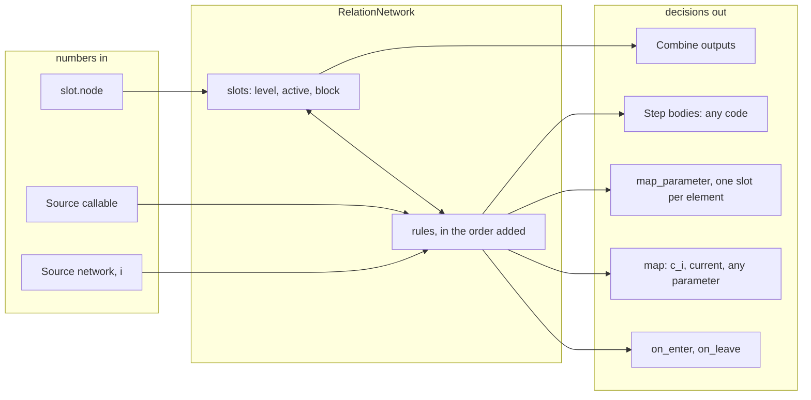

---

# Part 1. Starter tutorial: how it works

## 1.1 One block

```
process_batch(frames):
    for op in chain, in the order added:   op.set_slots(slots);  op.begin_block()   // mapped parameters are read here, once
    for op in chain, in the order added:   op.process(frames)
    publish output 0 of the first publishing operator, scaled by set_output_scale()
```

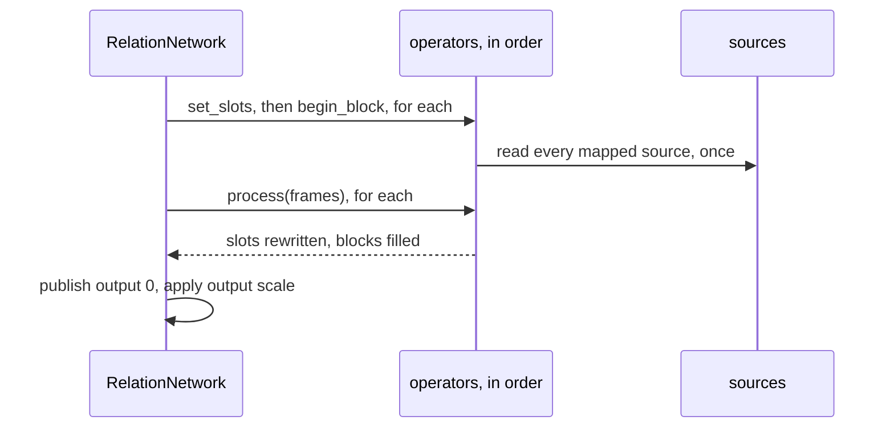

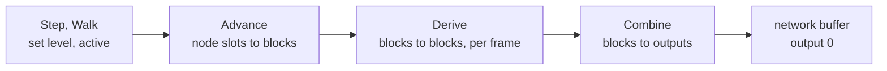

The order operators are added in is the program. Usual order: `Step`/`Walk`, `Advance`, `Derive`s, `Combine`. Every mapped source is read before any rule runs, so it shows state as of the end of the previous block.

## 1.2 Slots

```cpp
auto n = std::make_shared<RelationNetwork>() | Audio[0];

n->add_slot({ .name = "a", .node = vega.Sine(220.0, 1.0) });    // level follows the node
n->add_slot({ .name = "gate", .active = false });               // a bit; its changes are events
const auto v = n->add_slot({ .name = "v", .level = 0.3 });      // no node: a variable
n->add_slots({ { .name = "x" }, { .name = "y" } });

n->get_slot(v).level = 0.5;               // the record itself
n->get_node_output(v);                    // its level
n->get_node_audio_buffer(v);              // what it published this block (zeros if inactive)
n->find_slot_index("gate");
n->get_slot(v).set_active(false);         // runs on_leave if it was true
n->get_slot(v).on_enter.push_back([] { /* ... */ });
```

`add_slot` returns the index; keep indices, never references (a later `add_slot` can reallocate). Add slots, operators and callbacks outside `process_batch()`.

## 1.3 AdvanceOperator

```cpp
n->add<AdvanceOperator>();

// per slot, per block:
//   node, active       block = the node over the whole block    level = its last value
//   node, inactive     block = zeros                            level = its last value (the node keeps running)
//   no node, active    block = level, repeated                  level unchanged
//   no node, inactive  block = zeros                            level unchanged
```

Node hooks (`on_impulse`, `on_phase_wrap`, ...) fire while `Advance` evaluates the node. Put it after rules that change activity this block, before `Derive` and `Combine`. It has no parameters.

## 1.4 CombineOperator

```cpp
auto c = n->add<CombineOperator>(n->slot_count());        // rows = slots, columns = outputs
auto c2 = n->add<CombineOperator>(n->slot_count(), 2);    // two outputs
auto c3 = n->add<CombineOperator>(table);                 // a shared_ptr<Weights> you hold; one output per column

c->weights()->fill(0.0);                  // default: slot -> output 0 at 1.0, all else 0
c->weight(2, 0) = 1.0;                    // slot 2 into output 0 (atomic cell, any thread; throws out_of_range outside the table)
c->weight(0, 1) = 0.5;

c->output(0).combine([](std::span<const double> v) { return std::max(v[0], v[1]); });   // a function instead of the sum
c->output(0).clear_combine();

c->weights()->assign(n->slot_count(), 1, 1.0);    // the table does not grow with slots; this resizes and re-seeds
n->get_output_block(1);                           // any output; only output 0 of the first publisher is the network's buffer
```

## 1.5 DeriveOperator

Per frame: read the input slots' values, call the rule, write the target's block; the target's `level` becomes the block's last value. Place after `Advance`.

```cpp
namespace D = Kinesis::Discrete;

// plain: a function of the frame's inputs
n->add<DeriveOperator>(y, std::vector<size_t> { x }, [](std::span<const double> in) { return std::tanh(3.0 * in[0]); });

// target among its own inputs reads its previous frame: a recurrence
n->add<DeriveOperator>(y, std::vector<size_t> { x, y }, [](std::span<const double> in) { return in[1] + 0.01 * (in[0] - in[1]); });

// coefficients: the rule's numbers live in the operator
auto mix = n->add<DeriveOperator>(y, std::vector<size_t> { a, b, c }, D::weighted_sum, std::vector<double> { 0.5, 0.3, 0.2 });
mix->set_parameter("c0", 0.8);            // direct
mix->map("c1", Source(n, lfo));           // every block, from any source
mix->query_state("c1");  mix->get_coefficients();  mix->set_coefficients({ 0.2, 0.2, 0.6 });

// no inputs: a source with no node
n->add<DeriveOperator>(y, std::vector<size_t> {}, D::lorenz_attractor, D::lorenz_state(1.0 / rate));
n->add<DeriveOperator>(y, std::vector<size_t> {}, D::rotor_bank, D::rotor_bank_state(steps, scales));
// also: phasor_bank, kuramoto, coupled_map_lattice; table_lookup, step_sequence, horner, ...  (see Kernels.hpp)

// gate: returns bool; the block holds 0 or 1 and the target's active follows it
n->add<DeriveOperator>(g, std::vector<size_t> { a, b }, D::comparator, D::comparator_state(0.2));
n->add<DeriveOperator>(g, std::vector<size_t> { a, b, c }, D::signals_at_least, D::signals_at_least_state(2));
n->add<DeriveOperator>(g, std::vector<size_t> { a, b, c }, D::input_truth_table, D::input_truth_table_state(3, 0b10010110));
n->add<DeriveOperator>(g, std::vector<size_t> { clk, data }, D::clocked_register, D::clocked_register_state(8, 3));
n->add<DeriveOperator>(g, std::vector<size_t> { s, r }, D::set_reset_latch, D::set_reset_latch_state());
n->add<DeriveOperator>(g, std::vector<size_t> { x, lo, hi }, D::window_comparator, std::vector<double> {});

// your own gate: exactly bool, (const vector<double>&, span<double>)
n->add<DeriveOperator>(g, std::vector<size_t> { a, b },
    [](const std::vector<double>& in, std::span<double> c) { return in[0] > c[0] && in[1] < c[1]; },
    std::vector<double> { 0.0, 0.4 });
```

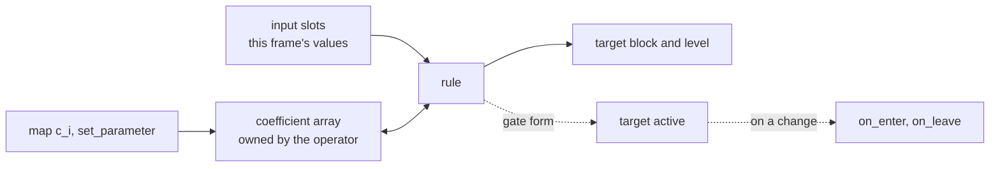

The coefficient kernel sees the frame's inputs as its window, in the order listed; kernels that generate their own signal ignore it. A slot counts as high above the kernel's threshold (0.5 by default). An inactive input contributes zeros. Gate kernels of the one-input or time shapes (`hysteresis_gate`, `edge_divider`, `bernoulli_gate`, `galois_lfsr`, `state_machine`, `step_pattern`, `refractory_gate`, `one_shot`) are not accepted by `Derive`.

## 1.6 Events

```cpp
n->get_slot(g).on_enter.push_back([body] { body->excite(0.3); });          // g became active
n->get_slot(g).on_leave.push_back([body] { body->set_decay_multiplier(0.04); });   // g became inactive

slot.set_active(true);       // from a Step, a Walk, a gate, or your own code; runs callbacks only on a real change
```

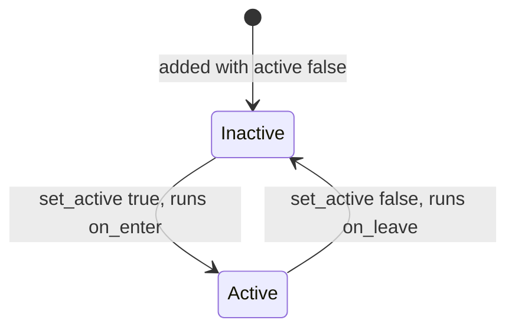

Callbacks run inside the block, on the thread processing it, so they follow the audio-thread rules.

## 1.7 StepOperator

```cpp
auto step = n->add<StepOperator>([](const std::shared_ptr<StepOperator>& self, std::span<RelationSlot> slots, uint32_t frames) {
    slots[0].set_active(slots[1].level > self->parameter("floor"));    // self->parameter(name): 0 if never set
    slots[2].level += 1.0;                                             // a variable
});
step->map("floor", Source(n, 3));
```

Once per block, every slot in hand. State lives in the lambda's captures (`mutable` to change it). Place it before `Advance` for a write to apply this block. `Advance` overwrites the `level` of slots that have a node, so write node-less slots.

## 1.8 map and Source

```cpp
op->map("name", 0.3);                                            // a constant
op->map("name", vega.Sine(0.1, 50.0));                           // a node's last output
op->map("name", Source(n, 3));                                   // network->get_node_output(3), this network or another
op->map("name", Source([body] { return body->get_modes().front().amplitude; }));   // any callable
op->unmap("name");                                               // mapping again replaces
```

Works on `Step` (any name), `Derive` (`"c<i>"`) and `Walk` (`"current"`). What `Source(network, i)` returns depends on the network: a relation's slot level, but a `ModalNetwork`'s mode `i` raw oscillator output (the waveform, not its amplitude). To read how much a body rings, use a callable.

## 1.9 WalkOperator

```cpp
auto table = std::make_shared<Kinesis::Stochastic::Weights>(n->slot_count(), n->slot_count());
table->uniform_excluding_self();                                         // or (*table)(r, c) = ...; table->normalize_row(r);

auto walk = n->add<WalkOperator>(table, WalkOperator::Pick {}, 6);       // step by itself every 6 blocks
auto hand = n->add<WalkOperator>(table);                                 // idle until driven
hand->advance();  hand->jump(3);  hand->current();
hand->map("current", Source([] { return pick_an_index(); }));            // jumps when the value changes
n->add<WalkOperator>(table, [](std::span<const double> row) { return my_choice(row); });   // custom Pick
```

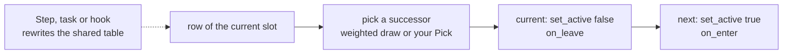

Slots are the states, one active at a time. A step reads the current slot's row, picks a successor, then deactivates the current slot and activates the next, so `on_leave` and `on_enter` fire. A one-hot row is deterministic; a row summing to zero stays put. The table is shared: rewrite it from anywhere.

## 1.10 Other networks

```cpp
// out, element by element (one slot per mode, exactly): ModalNetwork "amplitude" multiplies each mode, "detune" moves each by level * 100 cents
body->map_parameter("amplitude", damp);
body->map_parameter("detune", bend);

// output modes
net->set_output_mode(OutputMode::AUDIO_SINK);        // default, routed with | Audio[...]
net->set_output_mode(OutputMode::AUDIO_COMPUTE);     // computed, placed with vega.NetworkAudioBuffer(ch, 512, net) | Audio[...]
net->set_output_mode(OutputMode::GRAPHICS_BIND);     // state exposed to renderers and simulations; net | Graphics
```

A network that only computes still needs to be registered (`| Audio[0]` or equivalent) to be processed.

## 1.11 Limits

- Slots, operators, nodes and mappings change outside `process_batch()`.
- `Step` bodies, `Source` callables and callbacks run on the processing thread.
- Sources and mapped parameters have a one-block lag; only `Derive` is per frame.
- `Combine` weights do not grow with slots.
- State is numeric (doubles) and finite.

---

# Part 2. Compositions: against expectation

These are pieces, not API examples. Each is a complete program that makes something to hear or see, and each is meant to be run first, understood second and then bent: change the gestures, the weights, the maps and the timings, and the piece becomes yours. They assume Part 1 and use it freely, without stopping to explain.

Five pieces. Each takes something built for one thing and uses it for another: a bit-crusher as a climb, a cellular automaton as a spectrum, a resonator with no strike as a drone, a coefficient rule as a fractal. The relation is what makes that a decision instead of a hack.

## 2.1 A climb of noise, written as a table

A quiet sine sits in one buffer as a key. A noise generator sits in another. The noise passes through two `LogicProcessor`s: the first combines its bits with the key's, plane by plane, at a chosen word width; the second keeps or drops whole lobes of what came out, with a gate that clocks on the signal's own rising edges. Seven gestures are written as a ladder from sparse to dense: dust, a sub rumble, needles, a grid, a register lattice, a sheet, and a void that follows the sheet.

The relation is the score. Each gesture is a slot, and a `Walk` steps between them every half second. The table it reads is built from four edge lists, one per kind of move: stay, climb one rung, step back, and from the top fall into the void. Every time a gesture is entered, the voice and the key also swap sides with a short crossfade, so the sound moves across the room as it climbs. The entered column is worn down and the whole table is pulled a little back toward the written one, so a path that was taken once is less likely the next time round and the climb never repeats exactly.

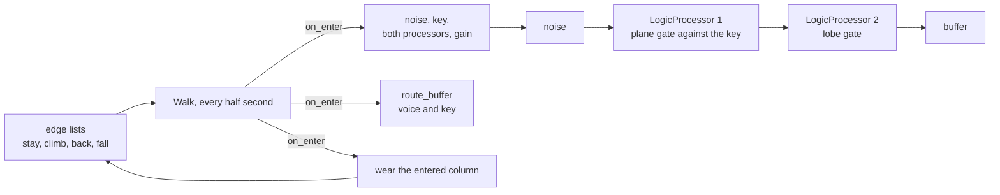

```cpp
void noise_chooser()
{
    namespace D = Kinesis::Discrete;
    using Gate = Nodes::Generator::Logic;
    using Kind = Kinesis::Stochastic::Algorithm;

    struct Gesture {
        uint64_t rule;
        uint32_t planes;
        Kind kind;
        double spread;
        double hz;
        double gain;
        std::function<std::shared_ptr<Gate>()> lobes;
    };

    const auto seed = [] { return static_cast<uint32_t>(get_uniform_random(1.0, 4.0e9)); };
    const auto always = [] { return std::make_shared<Gate>([](double) { return true; }); };
    const auto thinned = [seed](double p) {
        return [seed, p] { return std::make_shared<Gate>(D::bernoulli_gate, D::bernoulli_gate_state(p, seed(), 0.0)); };
    };

    const auto gestures = std::make_shared<const std::vector<Gesture>>(std::vector<Gesture> {
        { 0b0110, 12, Kind::NORMAL, 5.0, 6100.0, 0.50, thinned(0.05) },
        { 0b0100, 14, Kind::BROWNIAN, 1.0, 41.0, 0.90, always },
        { 0b1110, 2, Kind::UNIFORM, 1.0, 9600.0, 0.35, thinned(0.5) },
        { 0b1000, 3, Kind::UNIFORM, 1.0, 1760.0, 0.45,
            [] { return std::make_shared<Gate>(D::edge_divider, D::edge_divider_state(16, 0, 0.0)); } },
        { 0b1001, 5, Kind::NORMAL, 3.0, 1300.0, 0.40,
            [] { return std::make_shared<Gate>(D::galois_lfsr, D::galois_lfsr_state(0xB400U, 1U, 0.0)); } },
        { 0b0110, 8, Kind::UNIFORM, 1.0, 220.0, 0.30, always },
        { 0b1000, 1, Kind::UNIFORM, 1.0, 55.0, 0.04, thinned(0.002) },
    });

    const size_t count = gestures->size();
    const size_t top = count - 2;
    const size_t hush = count - 1;
    const uint32_t channels = std::max(1U, Config::get_global_stream_info().output.channels);

    const auto table_gate = [](uint64_t rule) {
        return std::make_shared<Gate>(D::input_truth_table, 2, D::input_truth_table_state(2, rule));
    };

    auto noise = vega.Random(Kind::UNIFORM);
    auto tone = vega.Sine(110.0, 0.3);
    auto key = vega.NodeBuffer(0, 512, tone) | Audio[0];
    auto voice = vega.NodeBuffer(1, 512, noise) | Audio[1];

    auto& gain = make_persistent(0.0);

    auto shape = create_processor<Buffers::LogicProcessor>(voice, table_gate(gestures->front().rule));
    shape->add_key(key);
    shape->set_modulation_function([&gain](double word, double) { return gain * word; });

    auto thin = create_processor<Buffers::LogicProcessor>(voice, gestures->front().lobes());
    thin->set_modulation_type(Buffers::LogicProcessor::ModulationType::ZERO_ON_FALSE);

    Kinesis::EdgeList stay, climb, back;
    for (size_t i = 0; i < hush; ++i) {
        stay.emplace_back(i, i);
        if (i < top) {
            climb.emplace_back(i, i + 1);
            back.emplace_back(i + 1, i);
        }
    }

    auto table = std::make_shared<Kinesis::Stochastic::Weights>(count, count);
    table->apply_edges(stay, 3.0, false, false);
    table->apply_edges(climb, 1.2, false, false);
    table->apply_edges(back, 0.3, false, false);
    const Kinesis::EdgeList fall { { top, hush } };
    const Kinesis::EdgeList wake { { hush, hush }, { hush, 0 }, { hush, 1 } };
    table->apply_edges(fall, 1.5, false, false);
    table->apply_edges(wake, 0.5, false, true);
    const Kinesis::Stochastic::Weights written = *table;

    auto n = std::make_shared<RelationNetwork>() | Audio[0];
    for (size_t i = 0; i < count; ++i) {
        n->add_slot({ .name = "gesture" + std::to_string(i), .active = false });
        n->get_slot(i).on_enter.push_back([=, &gain] {
            const auto& g = (*gestures)[i];
            noise->set_type(g.kind);
            noise->set_normal_spread(g.spread);
            tone->set_frequency(static_cast<float>(g.hz));
            shape->set_bit_planes(g.planes);
            shape->update_logic_node(table_gate(g.rule));
            thin->update_logic_node(g.lobes());
            gain = g.gain;

            route_buffer(voice, static_cast<uint32_t>(i % channels), 0.4);
            route_buffer(key, static_cast<uint32_t>((channels - 1 - i % channels) % channels), 0.4);

            for (size_t row = 0; row < count; ++row) {
                for (size_t col = 0; col < count; ++col) {
                    (*table)(row, col) = 0.8 * table->get(row, col) + 0.2 * written.get(row, col);
                }
                (*table)(row, i) = 0.6 * table->get(row, i);
                table->normalize_row(row);
            }
        });
    }

    n->add<WalkOperator>(table, WalkOperator::Pick {}, static_cast<uint32_t>(0.5 * Config::get_sample_rate() / Config::get_buffer_size()));
}
```

What the relation decides: where the climb goes next. The path is written as edges, so it always feels like a climb, and the wear on the table is the only randomness that is not a coin inside a gesture. Each gesture uses a different part of the machinery: the sheet is an XOR of eight planes against a low key, the grid a one-bit-wide AND against a high one so it comes out pitched, the lattice a shift register clocked on the signal's own lobes so its gating repeats like data, the needles and the dust a coin on each lobe, the sub a random walk read through fourteen planes so only its slow motion survives. An eighth gesture is one more entry in `gestures`; the edge lists follow the count. `apply_edges` is the closest thing Kinesis has to a ladder: a self pair is a stay, and each call writes one weight, so the four moves read as four numbers.

The contrast: a bit-crusher and a lobe gate are the whole signal path, and the relation turns them into a climb that remembers where it has been. The numbers in each gesture and the five weights are meant to be tuned by ear.

## 2.2 Life as resonance

A ring of 21 cells runs an elementary cellular automaton (rule 90: a cell becomes true when exactly one of its two neighbours is). Each cell is a single resonating partial, one harmonic of 55 Hz. A cell being born strikes its partial and lengthens its decay. A cell dying shortens its decay to a few milliseconds. The automaton is not heard as a rhythm. Its spectrum is: partials appear, ring for as long as they stay alive, and are cut when they die.

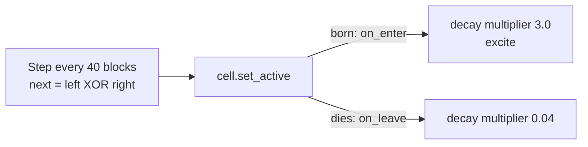

```cpp
void life_as_resonance()
{
    constexpr size_t cells = 21;

    auto n = std::make_shared<RelationNetwork>() | Audio[0];

    for (size_t i = 0; i < cells; ++i) {
        n->add_slot({ .name = "cell" + std::to_string(i), .active = false });

        auto partial = vega.ModalNetwork(std::vector<double> { 1.0 }, 55.0 * static_cast<double>(i + 1), 1.0)
            | Audio[i % 2];
        partial->set_output_scale(0.03);
        partial->set_decay_multiplier(0.04);

        n->get_slot(i).on_enter.push_back([partial] {
            partial->set_decay_multiplier(3.0);
            partial->excite(0.7);
        });
        n->get_slot(i).on_leave.push_back([partial] { partial->set_decay_multiplier(0.04); });
    }

    n->add<StepOperator>([born = false, tick = 0u](const std::shared_ptr<StepOperator>&, std::span<RelationSlot> cell, uint32_t) mutable {
        if (!born) {
            cell[cells / 2].set_active(true);
            born = true;
        }
        if (++tick % 40 != 0) {
            return;
        }

        std::array<bool, cells> next {};
        for (size_t i = 0; i < cells; ++i) {
            next[i] = cell[(i + cells - 1) % cells].active != cell[(i + 1) % cells].active;
        }
        for (size_t i = 0; i < cells; ++i) {
            cell[i].set_active(next[i]);
        }
    });
}
```

What the relation decides: the state of every cell, each step, from its neighbours, in a `Step`. Activity is the state, so entering and leaving are the two events the sound needs.

The contrast: a cellular automaton is a grid of bits, and here it is a bank of resonators whose lifetimes are the bits. Change the XOR to another rule, or the period 40, and the spectrum behaves differently. 21 is not a power of two, because rule 90 on a power-of-two ring with one seed collapses to nothing.

## 2.3 Twelve bodies on their own paths

Twelve bodies at unrelated tunings, each excited tens of times per second by its own fast slot at low gain, so each is a continuous texture, not a series of strikes. A second, very slow slot per body decides which ear it sits in. Each change calls `route_network` with a four second fade, so bodies are always part way between ears, and the overlaps keep changing because no two slow rates agree.

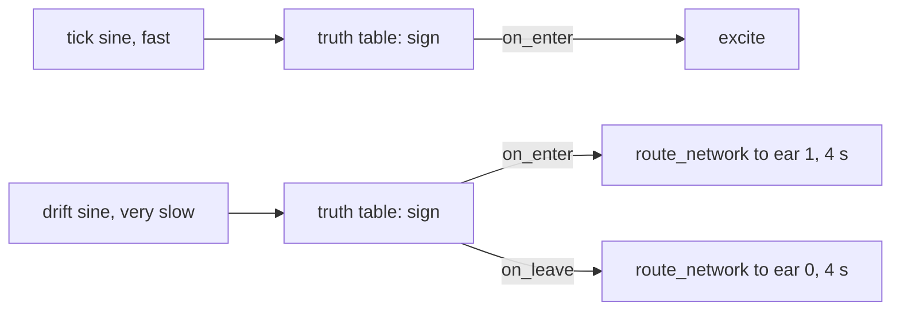

```cpp
void drifting_cloud()
{
    namespace D = Kinesis::Discrete;
    constexpr size_t bodies = 12;
    constexpr uint32_t per = 4;

    auto n = std::make_shared<RelationNetwork>() | Audio[0];
    for (size_t i = 0; i < bodies; ++i) {
        const double k = static_cast<double>(i);
        n->add_slots({ { .name = "tick", .node = vega.Sine(31.0 + 4.7 * k, 1.0) },
            { .name = "drift", .node = vega.Sine(0.031 + 0.0173 * k, 1.0) },
            { .name = "hit" },
            { .name = "side" } });
    }
    n->add<AdvanceOperator>();

    for (size_t i = 0; i < bodies; ++i) {
        const auto first = static_cast<uint32_t>(i) * per;
        auto body = vega.ModalNetwork(8, 90.0 * std::pow(2.0, 0.29 * static_cast<double>(i)),
                        ModalNetwork::Spectrum::STRETCHED)
            | Audio[i % 2];
        body->set_output_scale(0.05);

        n->add<DeriveOperator>(first + 2, std::vector<size_t> { first },
            D::input_truth_table, D::input_truth_table_state(1, 0b10, 0.0));
        n->add<DeriveOperator>(first + 3, std::vector<size_t> { first + 1 },
            D::input_truth_table, D::input_truth_table_state(1, 0b10, 0.0));

        n->get_slot(first + 2).on_enter.push_back([body] { body->excite(0.12); });
        n->get_slot(first + 3).on_enter.push_back([body] { route_network(body, { 1 }, 4.0); });
        n->get_slot(first + 3).on_leave.push_back([body] { route_network(body, { 0 }, 4.0); });
    }
}
```

What the relation decides: how often each body is driven and where it sits, and the two are unrelated per body. A one-input truth table with threshold 0 is a sign detector. The code does not change if the count goes from twelve to forty.

## 2.4 A drone written one mode at a time

A resonant body that is never struck. A relation of one slot per mode holds the amplitudes of fourteen partials, and a `Step` writes each of them into the body every block with `excite_mode`, so the body sounds for as long as the program runs. The same slots rise and fall at unrelated slow rates, and a slow control sets how fast the upper partials fall off. A second relation of one slot per mode detunes the partials through per-element mapping.

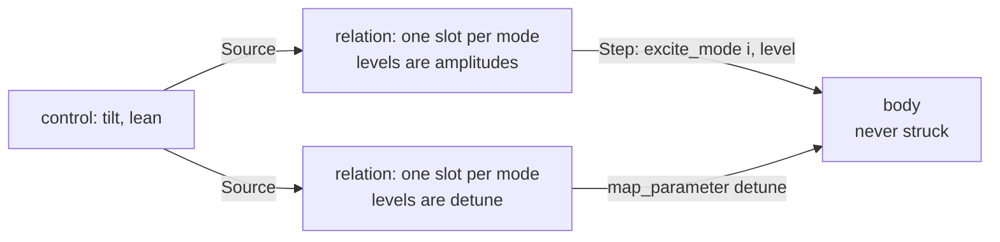

```cpp
void written_drone()
{
    constexpr size_t modes = 14;
    constexpr double rate_hz = 48000.0;

    auto body = vega.ModalNetwork(modes, 73.4, ModalNetwork::Spectrum::INHARMONIC, 3.0) | Audio[0];
    body->set_output_scale(0.4);

    auto control = std::make_shared<RelationNetwork>() | Audio[0];
    const auto tilt = control->add_slot({ .name = "tilt", .node = vega.Sine(0.021, 1.0) });
    const auto lean = control->add_slot({ .name = "lean", .node = vega.Sine(0.013, 1.0) });
    control->add<AdvanceOperator>();

    auto amp = std::make_shared<RelationNetwork>() | Audio[0];
    auto bend = std::make_shared<RelationNetwork>() | Audio[0];
    for (size_t i = 0; i < modes; ++i) {
        amp->add_slot({});
        bend->add_slot({});
    }

    auto write = amp->add<StepOperator>([body, time = 0.0](const std::shared_ptr<StepOperator>& self, std::span<RelationSlot> slots, uint32_t frames) mutable {
        time += static_cast<double>(frames) / rate_hz;
        const double rolloff = 0.6 + 1.6 * (0.5 + 0.5 * self->parameter("tilt"));
        for (size_t i = 0; i < slots.size(); ++i) {
            const double k = static_cast<double>(i);
            const double breath = 0.5 + 0.5 * std::sin(0.31 * (1.0 + 0.173 * k) * time + 1.9 * k);
            slots[i].level = 0.55 * breath / std::pow(1.0 + k, rolloff);
            body->excite_mode(i, slots[i].level);
        }
    });
    write->map("tilt", Source(control, tilt));

    auto warp = bend->add<StepOperator>([](const std::shared_ptr<StepOperator>& self, std::span<RelationSlot> slots, uint32_t) {
        for (size_t i = 0; i < slots.size(); ++i) {
            slots[i].level = 0.35 * self->parameter("lean") * std::sin(1.7 * static_cast<double>(i));
        }
    });
    warp->map("lean", Source(control, lean));

    body->map_parameter("detune", bend);
}
```

What the relation decides: the spectrum of a sustained sound, partial by partial, every block. Nothing here is struck, so nothing decays: the body is an additive bank whose per-partial amplitudes are a table that other rules rewrite. The per-mode amplitude never needed a setter because `excite_mode(i, level)` already is one.

The contrast: this is a physical model of a resonating object with its excitation removed. The `"amplitude"` mapping is not used on purpose: it multiplies what is already there, so it shapes a decay and cannot hold a sound up.

## 2.5 Fractals from coefficient arrays

An iterated function system is a handful of affine maps and the odds of picking each. A fractal is the pattern a point leaves when it is thrown through a randomly chosen map, over and over. That is a coefficient rule: the maps are the array, the point is a recurrence kept in the same array, and a node-less random slot picks which map this frame. The rule runs once per frame, so it throws forty-eight thousand points a second. A `Step` drops them on a canvas and a procedural texture shows the canvas on the GPU.

The relation decides which fractal. A `Walk` chooses between four systems (a triangle, a fern, a dragon curve and a Levy C curve), and the chosen system's numbers are not swapped in but eased into the live array, so the picture does not cut from one to the next. It melts. The in-between pictures are systems nobody wrote, and the piece opens on one: the live array starts as the halfway point between the dragon curve and the Levy C curve, a spiral no one drew, and eases into the dragon over the first few seconds, so the first picture is never a known one.

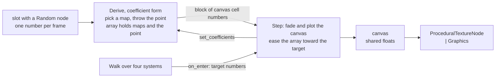

```cpp
void fractal_conductor()
{
    constexpr size_t side = 256;
    constexpr size_t maps = 4;
    constexpr size_t first_map = 8;
    constexpr size_t first_odds = first_map + 6 * maps;

    const auto system = [](std::array<double, 4> window, std::vector<std::array<double, 7>> rules) {
        std::vector<double> numbers(first_odds + maps, 1.0);
        numbers[2] = window[0];
        numbers[3] = window[1];
        numbers[4] = window[2];
        numbers[5] = window[3];
        numbers[6] = static_cast<double>(side);
        numbers[7] = static_cast<double>(side);
        double total = 0.0;
        for (const auto& rule : rules) {
            total += rule[6];
        }
        double running = 0.0;
        for (size_t k = 0; k < maps; ++k) {
            const bool used = k < rules.size();
            for (size_t j = 0; j < 6; ++j) {
                numbers[first_map + 6 * k + j] = used ? rules[k][j] : 0.0;
            }
            running += used ? rules[k][6] : 0.0;
            numbers[first_odds + k] = used ? running / total : 1.0;
        }
        return numbers;
    };

    const std::array<std::vector<double>, 4> systems {
        system({ 0.0, 1.0, 0.0, 1.0 }, { { 0.5, 0, 0, 0.5, 0, 0, 1 }, { 0.5, 0, 0, 0.5, 0.5, 0, 1 }, { 0.5, 0, 0, 0.5, 0.25, 0.433, 1 } }),
        system({ -5.2, 5.2, -0.2, 10.2 }, { { 0, 0, 0, 0.16, 0, 0, 0.01 }, { 0.85, 0.04, -0.04, 0.85, 0, 1.6, 0.85 }, { 0.2, -0.26, 0.23, 0.22, 0, 1.6, 0.07 }, { -0.15, 0.28, 0.26, 0.24, 0, 0.44, 0.07 } }),
        system({ -0.7, 1.3, -0.5, 1.5 }, { { 0.5, -0.5, 0.5, 0.5, 0, 0, 1 }, { -0.5, -0.5, 0.5, -0.5, 1, 0, 1 } }),
        system({ -0.6, 1.6, -0.6, 1.6 }, { { 0.5, -0.5, 0.5, 0.5, 0, 0, 1 }, { 0.5, 0.5, -0.5, 0.5, 0.5, 0.5, 1 } }),
    };

    auto opening = systems[2];
    for (size_t i = 2; i < opening.size(); ++i) {
        opening[i] = 0.5 * (systems[2][i] + systems[3][i]);
    }

    const auto throw_point = [](std::span<const double> in, std::span<double> c) {
        size_t k = 0;
        while (k + 1 < maps && in[0] > c[first_odds + k]) {
            ++k;
        }
        const double* m = &c[first_map + 6 * k];
        const double x = m[0] * c[0] + m[1] * c[1] + m[4];
        const double y = m[2] * c[0] + m[3] * c[1] + m[5];
        c[0] = x;
        c[1] = y;

        const double u = (x - c[2]) / (c[3] - c[2]);
        const double v = (y - c[4]) / (c[5] - c[4]);
        if (u < 0.0 || u >= 1.0 || v < 0.0 || v >= 1.0) {
            return -1.0;
        }
        return std::floor((1.0 - v) * c[7]) * c[6] + std::floor(u * c[6]);
    };

    auto dice = vega.Random(Kinesis::Stochastic::Algorithm::UNIFORM);
    dice->set_range(0.0, 1.0);

    auto canvas = std::make_shared<std::vector<float>>(side * side, 0.0F);
    auto target = std::make_shared<std::vector<double>>(systems[2]);

    auto n = std::make_shared<RelationNetwork>() | Audio[0];
    const auto roll = n->add_slot({ .name = "roll", .node = dice });
    const auto cell = n->add_slot({ .name = "cell" });
    n->add<AdvanceOperator>();

    auto rule = n->add<DeriveOperator>(cell, std::vector<size_t> { roll }, throw_point, opening);

    n->add<StepOperator>([rule, target, canvas, cell](const std::shared_ptr<StepOperator>&, std::span<RelationSlot> slots, uint32_t) {
        auto numbers = rule->get_coefficients();
        for (size_t i = 2; i < numbers.size(); ++i) {
            numbers[i] += 0.003 * ((*target)[i] - numbers[i]);
        }
        rule->set_coefficients(std::move(numbers));

        for (float& pixel : *canvas) {
            pixel *= 0.992F;
        }
        for (const double index : slots[cell].block) {
            if (index >= 0.0) {
                float& pixel = (*canvas)[static_cast<size_t>(index)];
                pixel = std::min(1.0F, pixel + 0.06F);
            }
        }
    });

    auto director = std::make_shared<RelationNetwork>() | Audio[0];
    auto table = std::make_shared<Kinesis::Stochastic::Weights>(systems.size(), systems.size());
    table->uniform_excluding_self();
    for (size_t i = 0; i < systems.size(); ++i) {
        director->add_slot({ .name = "system" + std::to_string(i) });
        director->get_slot(i).on_enter.push_back([target, systems, i] { *target = systems[i]; });
    }
    director->add<WalkOperator>(table, WalkOperator::Pick {}, 1100, 2);

    auto texture = vega.ProceduralTextureNode(side, side,
                       [canvas](uint32_t x, uint32_t y, uint32_t w, uint32_t) -> glm::vec4 {
                           const float v = (*canvas)[static_cast<size_t>(y) * w + x];
                           const float s = std::sqrt(v);
                           return glm::vec4(s, s * s, 0.1F + 0.5F * v, 1.0F);
                       })
        | Graphics;

    auto window = create_window({ "Fractals from coefficient arrays", 1024, 1024 });
    auto buffer = vega.NodeTextureBuffer(texture, "fractal") | Graphics;
    buffer->setup_rendering({ .target_window = window });
    window->show();
}
```

What the relation decides: which fractal, and every number of it, for every frame. The rule's array holds the maps, the odds of each, the window onto the plane and the point itself, so retuning the array while it runs changes the picture with no change to the rule. Easing the array toward a target is the whole morph.

The contrast: a coefficient rule was built to hold a filter's numbers or a sequence, and here it holds a fractal. `Derive` was never told it was drawing anything.

The array layout: `[x, y, window left, right, bottom, top, canvas width, height, six numbers for each of four maps, four cumulative odds]`. The window and canvas size are part of the array on purpose, so they morph too. The windows and the fade and increment on the canvas (0.992 and 0.06) are set by eye and are the first things to tune. The canvas is plain floats written on the audio thread and read on the graphics side, so a pixel can be seen half updated, and it is not visible.

## 2.6 Which interaction points each piece uses

| Piece | Decision | Interaction points |
|---|---|---|
| 2.1 noise climb | where a written climb goes next, with wear | `Walk` on a table built from edge lists, `on_enter` reconfiguring a noise source, a key and two `LogicProcessor`s, moving both buffers with `route_buffer`, and wearing the shared table |
| 2.2 life as resonance | state per cell from its neighbours | `Step` writing activity, `on_enter` and `on_leave` both used, a body reconfigured by its slot |
| 2.3 cloud | flow and overlap | gates driving `excite` and `route_network`, one-input truth table as a sign detector |
| 2.4 written drone | spectrum of a sustained sound | one slot per mode, `Step` calling `excite_mode`, ONE_TO_ONE detune, three relations talking through `Source` |
| 2.5 fractals | which fractal, and its every number | per-frame coefficient rule with state in the array, `Walk` choosing a target, `set_coefficients` easing as a morph, canvas into a `ProceduralTextureNode` |
